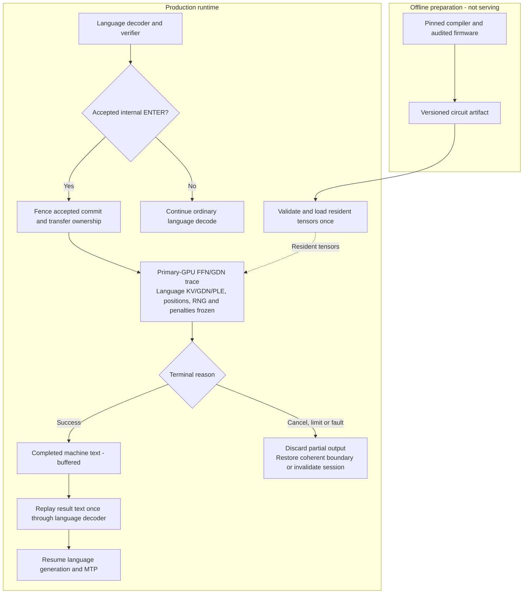
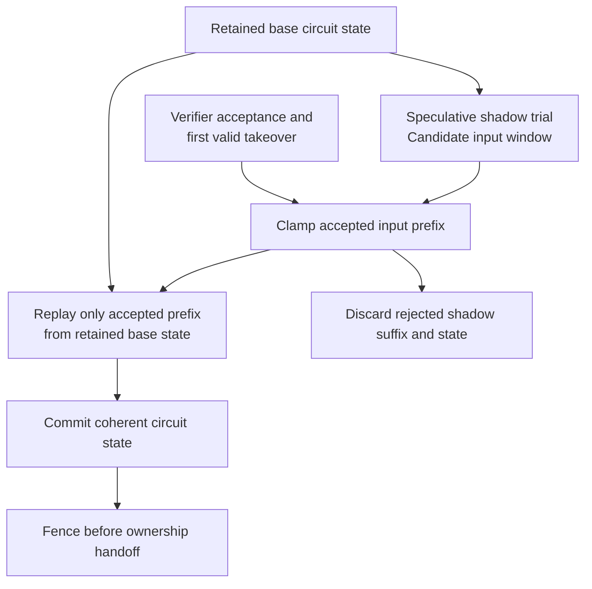
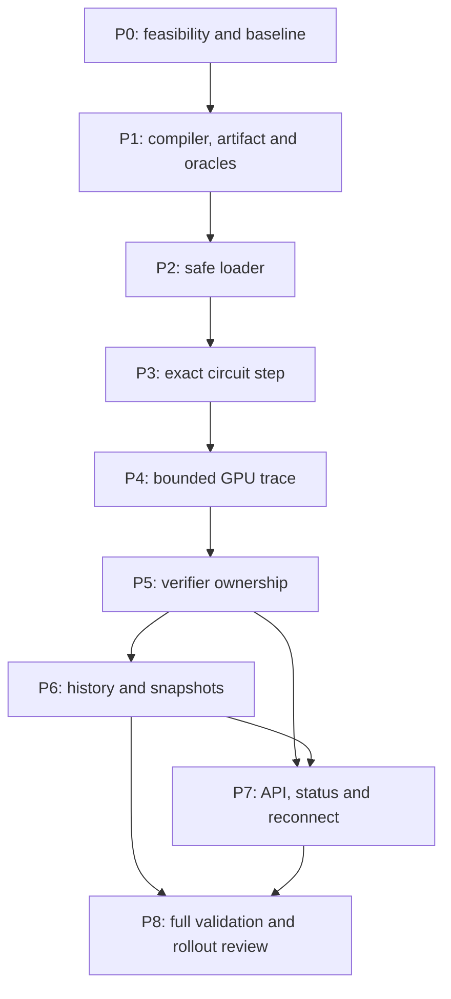

# PRD R9: ให้ Strata คำนวณด้วย Native Qwenputer

ฉบับ R9 สำหรับ PRD issue #276 — 28 ตุลาคม 2026

สถาปัตยกรรมและแผน R2 อนุมัติแล้ว P0 และ P1 offline export/oracles ผ่าน gates ของตัวเองแล้ว กำลังทำ P2 loader โดยทุกช่วงถัดไปยังต้องผ่าน evidence/review gates เอกสารนี้ใช้ Gyro-M 262K context, 5 workers ตามเส้นทาง hub ที่ใช้จริงเป็น operational baseline และแยกคำอธิบายที่อ่านก่อนออกจากข้อกำหนดทางเทคนิคฉบับเต็ม

## Problem Statement — ปัญหาที่ต้องแก้

เมื่อคำตอบต้องใช้เลขคำนวณ โมเดลภาษายังมีโอกาสสร้างตัวเลขผิด แม้จะอธิบายวิธีคิดได้ถูกต้อง Strata จึงต้องมีวงจรคำนวณที่โมเดลใช้ระหว่างตอบ แล้วนำผลกลับไปคิดต่อได้ในคำตอบเดียวกัน

เป้าหมายทั้งหมดต้องเดินด้วยกัน: sandbox ภายในสำหรับทดสอบสมมุติฐาน/logic/บัค, ผลคณิตศาสตร์และโค้ดที่ตรวจแล้วถูกต้องขึ้น, reasoning tokens และ feedback prefill/context ที่ลดลง, external tools และข้อมูลที่ไม่จำเป็นน้อยลง, งานที่แก้สำเร็จต่อ token มากขึ้น, เวลาจนได้คำตอบถูกลดลง, การปรับความสามารถ upstream และการ optimize/offload จนใช้จริงได้ ใช้การ execute แทนการทำนายผลการทดลอง แล้วให้โมเดลนำผลไปปรับและทดสอบต่อ วัดทุกเป้าหมายตาม [goal traceability matrix](2026-10-28-qwenputer-capability-roadmap.md) ด้วย task ที่แก้สำเร็จและ held-out tests

เป้าหมายคือความถูกต้องของเลขที่รองรับ และ latency ต่ำที่สุดที่พิสูจน์ได้บนเครื่องจริง งานนี้ยังไม่รับประกันว่าการเขียนโค้ดหรืองาน 3D จะดีขึ้น ต้องทดสอบประโยชน์เหล่านั้นแยกภายหลัง

P0–P8 เป็น foundation ของเป้าหมายที่กว้างกว่านี้: นำความสามารถที่ upstream มีมาปรับให้ใช้กับ Strata-xeno ได้ แล้ว optimize จนใช้งานจริงได้ เริ่ม Native ก่อนแล้วจึง Universal ต้องวัดว่าโมเดลเลือกใช้เองได้หรือไม่ ลด external tools ต่อ task ที่แก้สำเร็จได้เท่าไร และช่วยแก้โจทย์คณิตศาสตร์หลายขั้นอย่างไร การรัน calc ผ่านอย่างเดียวยังไม่พอให้ประกาศว่าเป้าหมายทั้งหมดสำเร็จ

[Capability roadmap](2026-10-28-qwenputer-capability-roadmap.md) แยกต้นแบบที่ integrated, standalone, experimental และยังเป็นแผน พร้อมงานต่อสำหรับ store/filesystem, bounded programs/debug loop, geometry และ Universal สถานะเหล่านี้ไม่ใช่ผลทดสอบของ Strata และ approval สำหรับ calc firmware เดิมไม่ครอบคลุม firmware ใหม่

กรณีหลักคือ agent อ่าน source หรือ reuse cached prefix ที่ยังถูกต้อง แล้ววนตั้งสมมุติฐาน → รัน sandbox → รับผลสั้นที่พอใช้แก้บัค → ปรับและทดสอบซ้ำ ส่งกลับเพียงค่า, expected/actual, failed assertion, counterexample หรือ state location ที่เกี่ยวข้อง และขอรายละเอียดเพิ่มแบบมีขอบเขตได้ เมื่อ source เปลี่ยนต้องตรวจ identity และแก้หรือ invalidate prefix ให้ถูก การเทียบ external-tool baseline ต้องให้ใช้ prefix caching ตามปกติด้วย แยก initial prefill, feedback prefill, reasoning decode, execution, bridge และ orchestration พร้อมนับจำนวนรอบ, fresh-feedback tokens, retained context, circuit steps/time และเวลาจนผ่าน held-out tests

## Solution — เมื่อเปิดใช้แล้วควรทำงานอย่างไร

ตัวอย่างเช่น เมื่อโมเดลต้องหา `17 × 23` ก็ส่งนิพจน์เข้าวงจรภายใน รอผลที่คำนวณเสร็จ แล้วใช้ผลนั้นตอบหรือคิดขั้นถัดไป แอปที่เรียก API เห็นคำตอบต่อเนื่อง ไม่ต้องรับคำขอให้ไปเปิดเครื่องคิดเลขภายนอก

Native ในแผนนี้หมายถึงวงจร FFN/GDN ที่ compile ไว้เป็น tensor แล้วรันด้วย C++/CUDA บน GPU หลัก วงจรเลือก trace token และเดินงานต่อบน GPU เอง ระหว่างนั้นสถานะของโมเดลภาษาต้องหยุดอยู่ที่จุดเดิม พอคำนวณสำเร็จจึงป้อนข้อความผลลัพธ์กลับเข้าโมเดลและตอบต่อ

ไฟล์ weights ของวงจรแยกจากโมเดลหลักได้ เมื่อโหลดเป็น tensor และ graph ชุดเดียวกันแล้ว การแยกไฟล์ไม่ได้เพิ่มขั้นตอนทุกก้าวระหว่างคำนวณ ส่วน Python compiler และตัวอ้างอิง RISC-V ใช้เตรียมข้อมูลหรือทดสอบนอกเส้นทางตอบจริงเท่านั้น

เมื่อปิด feature เส้นทางเดิมต้องให้ผลเหมือน baseline เมื่อเปิดใช้ ระบบยัง offload experts ได้ตามเดิม แต่ต้องวัด RAM/VRAM ที่วงจรใช้เพิ่ม รวมถึงผลต่อ expert cache และ latency ของข้อความทั่วไปด้วย

### เส้นทางจากโมเดลสู่วงจรและกลับมาคิดต่อ

ส่วนบนของภาพเตรียม artifact นอกเส้นทางตอบจริง ส่วน runtime ใช้ tensor ที่โหลดไว้แล้ว จึงไม่มี host calculator อยู่ในเส้นทางนี้

## ขอบเขตที่ตกลงแล้วและเรื่องที่ต้องยืนยันก่อนเดินต่อ

- ทำ Native สำหรับ Strata Flash-Next ก่อน ส่วน Universal เป็นงานระยะถัดไป
- ใช้ Gyro-M เป็นโมเดลทดสอบ ไม่ต้องกู้ Swift กลับมาเพื่อ baseline นี้
- ใช้ GPU หลักรันวงจร ส่วน GPU รองยังทำหน้าที่ offload experts และแสดงผลตาม profile เดิม
- เก็บ weights ของวงจรเป็น artifact แยก ใช้ standalone conditional WHILE graph และจำกัดงานต่อรอบ
- ยังไม่เปลี่ยน profile ที่เสิร์ฟอยู่ระหว่างพิสูจน์ระบบ ถ้าทดสอบ intended usage ครบแล้วดีขึ้นโดยไม่พบ trade-off ผู้ใช้อนุญาตให้เปิด default ใน hub ได้แบบย้อนกลับได้ ถ้ามีต้นทุนหรือหลักฐานยังไม่ครบ ให้เป็น opt-in/non-default พร้อมข้อมูลประโยชน์และข้อเสีย

ผู้ใช้เลือก Gyro-M 262K context, 5 workers เป็น baseline แล้ว ให้ตรึงไฟล์และ settings ชุดนี้สำหรับเทียบ baseline กับ candidate ไม่ใช้ profile 512K/YaRN แทน

ถ้า conditional graph ใช้ไม่ได้ หรือวงจรเกินงบหน่วยความจำ ต้องเสนอทางเลือกพร้อมหลักฐานให้ตัดสินใจ ไม่เปลี่ยนสถาปัตยกรรมหรือย้ายไปคำนวณบน CPU เอง

## User Stories — สิ่งที่ต้องทำได้

1. **US01** ในฐานะผู้ใช้ Strata ต้องการผลเลขที่คำนวณตรงตามขอบเขตที่รองรับ เพื่อใช้คำตอบนั้นต่อได้
2. **US02** ในฐานะผู้ใช้ ต้องการให้โมเดลใช้วงจรภายใน เพื่อไม่ต้องพึ่งบริการเครื่องคิดเลขภายนอก
3. **US03** ในฐานะผู้ใช้ ต้องการให้โมเดลคิดต่อหลังได้ผล เพื่อให้การคำนวณอยู่ในคำตอบเดียวกัน
4. **US04** ในฐานะผู้ใช้ ต้องการให้พฤติกรรมเดิมคงอยู่เมื่อปิด feature เพื่อเลือกใช้ baseline ได้
5. **US05** ในฐานะผู้ใช้ ต้องการเห็น overhead ของข้อความทั่วไปแยกจากเวลาคำนวณ เพื่อประเมินต้นทุนของการเปิด feature
6. **US06** ในฐานะผู้ใช้ ต้องการเก็บระบบ offload ระหว่าง GPU, RAM และ NVMe ไว้ เพื่อให้โมเดลขนาดใหญ่ยังใช้งานได้
7. **US07** ในฐานะผู้ใช้ ต้องการเห็นสถานะคำนวณทันที เพื่อรู้ว่าระบบกำลังทำงานขั้นไหน
8. **US08** ในฐานะผู้ใช้ ต้องการให้ refresh หรือ reconnect แล้วเห็นงานที่กำลังรันต่อ เพื่อไม่เสียความต่อเนื่อง
9. **US09** ในฐานะผู้เรียก API ต้องการให้ native call อยู่ภายใน เพื่อไม่ต้องรับคำขอ external calc tool
10. **US10** ในฐานะผู้เรียก API ต้องการให้เครื่องมืออื่นทำงานตามเดิม เพื่อไม่ให้ Native เปลี่ยนวิธี dispatch tools
11. **US11** ในฐานะผู้ใช้ ต้องการให้อ่าน tool-call เก่าและข้อความที่ยกมาเป็นประวัติ เพื่อไม่ให้ prefill คำนวณคำสั่งเก่าซ้ำ
12. **US12** ในฐานะผู้ใช้ ต้องการให้ปฏิเสธข้อความที่ยาวเกินหรือไม่รองรับ เพื่อไม่ให้การตัดข้อความกลายเป็นคำตอบผิด
13. **US13** ในฐานะผู้ใช้ ต้องการให้ cancel และ limits หยุดงานได้ เพื่อไม่ให้ผลเลขที่ยังไม่ครบหลุดออกมาเป็นคำตอบสำเร็จ
14. **US14** ในฐานะผู้ใช้ ต้องการแยกข้อผิดพลาดจากผลเลขและเครื่องยนต์ที่เสีย เพื่อเลือกว่าจะลองใหม่หรือเริ่ม session ใหม่
15. **US15** ในฐานะผู้ใช้ ต้องการคำนวณหลายครั้งต่อกันได้ เพื่อให้สถานะวงจรและผู้ถือสิทธิ์การตอบยังถูกต้อง
16. **US16** ในฐานะผู้ใช้ ต้องการสลับบทสนทนาและใช้ prefix cache ได้ เพื่อไม่ให้ประวัติการคำนวณปะปนกัน
17. **US17** ในฐานะผู้ใช้ ต้องการ save/restore ทั้งโมเดลและวงจร หรือปฏิเสธข้อมูลที่ใช้ร่วมกันไม่ได้ก่อนเปลี่ยนสถานะ
18. **US18** ในฐานะผู้ดูแล ต้องการผูก artifact กับ tokenizer, firmware และ semantics ที่ตรงกัน เพื่อให้โหลดผิดชุดแล้วแจ้งชัดเจน
19. **US19** ในฐานะผู้ดูแล ต้องการปฏิเสธ artifact หรือ firmware ที่เสียก่อนจองหน่วยความจำก้อนใหญ่หรือส่งเข้า GPU
20. **US20** ในฐานะผู้ดูแล ต้องการจำกัดงานบน GPU เพื่อให้ Windows ยังตอบสนองได้โดยไม่แก้ TDR หรือค่าความปลอดภัย
21. **US21** ในฐานะผู้ดูแล ต้องการเห็นเวลาเริ่มระบบ ยอดใช้หน่วยความจำ และ expert hits บนเครื่องจริง เพื่อประเมินผลต่อการเสิร์ฟ
22. **US22** ในฐานะผู้พัฒนา ต้องการตรวจ trace กับ oracle อิสระและทดสอบทุกจุดที่เปลี่ยนผู้ถือสิทธิ์ เพื่อจับข้อผิดพลาดที่ผลเลขอย่างเดียวอาจมองไม่เห็น
23. **US23** ในฐานะผู้พัฒนา ต้องการพิสูจน์ parity ตอนปิด feature และวัด latency ใน session เดียวกัน ก่อนตัดสินใจนำไปใช้
24. **US24** ในฐานะผู้พัฒนา ต้องการบันทึกสัญญาของ Native ให้ชัด เพื่อให้ Universal ในอนาคตยังรักษาข้อกำหนดเดิมได้

## Implementation Decisions — สิ่งที่ implementation ต้องรักษา

### วงจรและ artifact ต้องตรวจสอบย้อนกลับได้

แยก compiler/exporter, artifact loader, circuit executor และตัวเชื่อมกับ decoder ออกจากกัน แต่ให้ทดสอบผ่านจุดเชื่อมระดับ conversation เป็นหลัก การทดสอบระดับล่างมีไว้แยกสาเหตุเมื่อจุดเชื่อมนี้ล้ม

artifact ต้องมี schema, compiler revision และ patch, numeric ABI, token map, firmware, geometry และ hashes ที่ผูกกันไว้ ต้องตรวจ license ของ source, firmware, runtime libraries และ weights ตามที่มาจริงด้วย

ก่อน allocate หรือ upload ต้องตรวจชนิด ขนาด รูปร่าง ช่วงค่า และขอบเขตของไฟล์ รวมถึง ELF machine/endian, entry point, segment overlaps และเงื่อนไข `memsz >= filesz` ไฟล์ที่ไม่ตรงต้องหยุดก่อนแก้สถานะ session

### คณิตศาสตร์ของวงจรต้องตรงตาม compiler

ต้องรักษา sparse FFN, normalization, head และ GDN RAM ตามสัญญาที่ตรึงไว้ ห้ามใช้ host calculator หรือ opcode emulator คำนวณคำตอบจริงแทน

FP32 atomic add เพียงอย่างเดียวไม่ได้พิสูจน์ว่าผลซ้ำจะเหมือนเดิม ต้องมีลำดับ reduction ที่แน่นอน หรือหลักฐานเรื่องช่วงค่าและ partial sums ที่เพียงพอ แล้วตรวจซ้ำกับ trace และผลเลขจาก oracle อิสระ

### GPU เดินงานเอง แต่ทุกครั้งต้องจบในขอบเขตที่กำหนด

graph ของวงจรเป็น standalone graph บน GPU หลัก ไม่เอาไปเป็น child ของ graph ที่มีอยู่ ต้องตั้ง condition ใหม่ทุก launch และจัดการ graph/state แยกตามกติกาที่ CUDA รองรับ

ระหว่าง trace ไม่ให้ host เลือก token ทีละก้าว หน่วยความจำที่ต้องใช้ต้องเตรียมก่อนเข้า graph งานต้องมี step/time/output limits, cancellation และ terminal reason ที่แยกสำเร็จ หยุด และผิดพลาดออกจากกัน

### การเข้าและออกจากวงจรต้องรักษาสถานะภาษา

จุด ENTER ต้องอิงจำนวน **input tokens ที่ commit แล้ว** ถ้าอยู่แถว `r` ของ verifier window ต้องคิดขอบเขต `r + 1` ให้ถูก ต้องรอ commit fence และทิ้ง speculative suffix ที่ใช้ไม่ได้ก่อนข้าม stream หรือ snapshot

ให้ลองเดิน candidate window บนสถานะวงจรสำรอง (shadow state) ก่อน แล้วจำกัด input prefix ตามผลยอมรับของ verifier และจุดรับช่วงแรกที่ใช้ได้ จากสถานะฐานที่เก็บไว้ (base state) ให้ replay เฉพาะ prefix ที่ยอมรับแล้ว และทิ้ง shadow state ของส่วนที่ถูกปฏิเสธ

ระหว่าง machine-only steps ห้ามขยับ language KV/GDN/PLE, logical position, RNG counters หรือ penalty history ข้อความผลลัพธ์ที่เสร็จแล้วจึงผ่าน exact language replay ครั้งเดียว แล้วค่อยให้ MTP และการตอบปกติทำงานต่อ

ต้องทดสอบ ENTER ทุกตำแหน่งใน window รวมแถวแรก แถวสุดท้าย rejected drafts และการสลับซ้ำ ส่วน execution modes ที่ยังไม่รองรับต้องปฏิเสธเมื่อเปิด feature โดยคงเส้นทางตอนปิดไว้

### การรับนิพจน์ต้องไม่มีการตัดข้อความเงียบ ๆ

เริ่มจาก native XML tool-call syntax และ eligibility/role gates ของโมเดลเดิม ตัวอย่างในประวัติ ข้อความที่ยกมา และ tool names อื่นต้องไม่เปิดวงจร

รองรับเลขและตัวดำเนินการตาม firmware ที่ตรึงไว้ รวม rational division, floor division/modulo แบบ Python, gcd, powers ที่เป็นจำนวนเต็มไม่ติดลบและมีขอบเขต ตลอดจน decimal operations ที่ firmware รองรับ

ขอบเขตเดิมมี 80 capture tokens, 16 bytes ต่อ row, expression payload 255 bytes และ `MAXD=62` ต้องปฏิเสธ overflow, NUL, UTF-8 ที่ผิด, syntax ที่ไม่รองรับ และข้อความที่ถูกตัด ถ้าจะขยายขอบเขต ต้องเปลี่ยน compiler ABI และชุด oracle ไปด้วย

### ประวัติและ session ต้องคืนสถานะได้ทั้งชุด

แต่ละบทสนทนามี RAM, PC, registers, lag history, trace cursor และข้อมูล bridge ของตัวเอง ต้องผูกข้อความที่แสดงกับ canonical internal token history ด้วย identity และ prefix hashes ที่ตรวจได้ ห้ามเดาประวัติที่ซ่อนอยู่จากข้อความที่ไม่ครบ

v1 save ได้ที่ coherent quiescent boundary เท่านั้น ถ้ายังมี burst ทำงาน ให้ตอบ busy/refused หรือรอผ่านคิวที่จำกัดไว้ การ restore ต้องตรวจ identity ก่อนแก้ state และถ้า transfer ได้เพียงบางส่วนก็ต้อง invalidate ทั้ง context ห้าม resume จากสถานะครึ่งชุด Graph handles ไม่อยู่ใน snapshot; เมื่อ address เปลี่ยนต้องสร้างใหม่

### API และหน้าจอต้องแสดงงานตามจริง

native call/result เป็นเรื่องภายใน เครื่องมืออื่นยัง dispatch แบบเดิม สถานะคำนวณต้องเริ่มแสดงตั้งแต่เริ่มขั้นตอน ไม่รอให้จบก่อน แล้วต้องตามงานเดิมต่อได้หลัง reconnect

ผลระหว่างทางเก็บไว้ก่อน ถ้า limit, cancel หรือ fault ต้องทิ้งผลที่ยังไม่ครบ แล้วกลับ transactional boundary ที่ถูกต้องหรือ invalidate session ห้ามส่งเลขบางส่วนในสถานะสำเร็จ

### Offload และงบหน่วยความจำยังเป็นข้อจำกัดเดิม

เริ่มจาก static reserve สำหรับวงจรบน GPU หลัก ไม่ใช้ elastic VRAM ในเส้นทางที่รองรับ D2x ไม่ได้ แยกไฟล์ cold storage บน NVMe ออกจาก working state ที่ต้อง resident ระหว่าง burst

static reserve เป็น correctness baseline ให้ทดลอง lean all-resident เทียบ whole-module on-demand และ per-layer paging/prefetch ตาม dependency ที่มีจริง แยก immutable weights, active GDN/lag/bridge state, scratch, shadow/committed state และ cold snapshots ถ้าผลทดลองดี ให้ implement adapter/cache/graph lifecycle ที่ Strata ยังขาด ไม่หยุดเพียงเพราะระบบ offload เดิมรับวงจรชนิดนี้ไม่ได้ และไม่ย้าย active state ระหว่างรันโดยไม่มี exactness/address-stability tests

ยังต้องรักษา D2x expert/prefill offload บนสอง GPU การไม่รองรับ decoder layer split ใน v1 ไม่ได้แปลว่าตัด secondary expert tier ออก ต้องวัดผลของ reserve ต่อ expert slots, hit split และ latency ด้วย

## Testing Decisions — จะพิสูจน์ว่าใช้ได้อย่างไร

จุดทดสอบหลักคือหนึ่ง conversation ที่เข้า native call ได้ รับผล แล้วให้โมเดลตอบต่อ จากจุดนี้ต้องตรวจ API, ประวัติ, session และภาษาได้ครบ ส่วน circuit replay และ kernel tests ใช้พิสูจน์รายละเอียดที่จำเป็น

ทดสอบการบังคับเรียกวงจรแยกจากการดูว่าโมเดลเลือกเรียกเองได้ดีแค่ไหน ต้องตรึง compiler, corpus และ seeds แล้วแยก development fixtures ออกจาก held-out free-running acceptance cases ด้วย

เมื่อเทียบ baseline กับ candidate ให้ใช้ Gyro-M ชุดเดียวกันที่ 262K context, 5 workers และค่า RoPE เดิมของ profile/GGUF ต้องตรึง model inputs, tokenizer, MTP และ runtime settings ให้เหมือนกัน ต่างเฉพาะ executable กับ paths สำหรับหลักฐานของแต่ละ arm ส่วน learned expert profile ให้เริ่มจากสำเนาที่มีเนื้อหาเดียวกัน เพื่อไม่ให้การรัน arm หนึ่งเปลี่ยน input ของอีก arm

Operational baseline ต้องตามเส้นทาง hub จริง ทั้ง executable, backend/dependencies, cache/offload และ process settings ห้ามเติม private-commit cap หรือข้อจำกัดที่ hub ไม่ใช้แล้วเรียกผลนั้นว่า production baseline ให้บันทึก instrumentation, timeout และ cleanup ของ test wrapper แยกไว้ ส่วน unchanged build ที่ใช้ source เดียวกับ candidate เป็น development control อีกตัวสำหรับแยกผลของ feature ห้ามสลับตัวควบคุมสองแบบนี้หรือเทียบ timing ข้าม build แล้วอ้างว่าเกิดจาก Native circuit

ชุดเลขต้องมี signed add/sub/mul, rational division, negative floor/modulo, gcd, precedence, powers, decimals, ขอบเขต 62 หลัก, divide-by-zero, capacity/complexity errors และการคำนวณต่อเนื่อง Oracle เลขต้องเป็นอิสระจาก parser/compiler ของ firmware เพื่อไม่ให้ผิดแบบเดียวกันทั้งคู่

### Gates ที่ต้องผ่านก่อนนำไปใช้

| Gate | หลักฐานที่ต้องมี |
|---|---|
| **G0** | conditional graph จริงบน GPU หลัก: 0/1/N, relaunch/reset, output bound, stop/cancel พร้อม runtime, driver, device และ OS |
| **G1** | export/schema ทำซ้ำได้ hashes ตรง feature map ครบ มีที่มาและ license; ไฟล์ผิดหรือใหญ่เกินต้องหยุดก่อน allocate |
| **G2** | trace และผลเลขไม่ผิดจาก reference กับ oracle อิสระ ครบ instruction/error paths, repeated runs และ held-out cases; มีหลักฐาน deterministic reduction และผล Compute Sanitizer ตามที่รองรับ |
| **G3** | ทุกจุด ENTER/commit, MTP, rejected drafts และ suffix ถูกต้อง; machine trace ไม่ขยับสถานะภาษา และ replay ผลครั้งเดียว |
| **G4** | สลับสองบทสนทนา ใช้ cache อ่านประวัติใหม่ และ save/restore ได้โดยไม่มี state เก่าหรือ hidden prefix ปะปน |
| **G5** | bounds, input ผิด, cancel และ GPU fault ให้ terminal reason ชัด ไม่คืนเลขบางส่วนเป็นสำเร็จ; status และ refresh ผ่านจริง |
| **G6** | unchanged baseline กับ candidate ที่ปิด feature ให้ greedy raw tokens ตรงกันใน session เดียว รวมข้อความไทย โค้ด และ long-prefix turns; prompt, budget, protocol, snapshot และการไม่ allocate วงจรต้องตรง |
| **G7** | full D2x builds มี sm_89 และ sm_120 ตรวจ binary จริงและรัน secondary tier ก่อน ABBA; build ทุก backend ที่แตะและรักษา Q2 parity งาน HIP/SYCL ที่ยังทำไม่ได้ต้องระบุเป็นหนี้ validation |
| **G8** | ใช้ timeline อธิบายกลไก แล้ววัด ABBA แบบปิด profiler พร้อม counters จาก run เดียวกัน, hashes, priorities, resources, hit split, acceptance, entry/exit และ DONE แยกงานที่ถูกรบกวนออกมา |
| **G9** | ผ่าน correctness/quality, compatibility, ordinary/computation latency, cold/warm/tail, RAM/VRAM/cache, startup, repeated sessions และ cancellation/stability ก่อน rollout ถ้าดีขึ้นโดยไม่พบ trade-off ใน coverage ที่เพียงพอ ให้เปิด hub default แบบย้อนกลับได้ ถ้ามี trade-off หรือยังไม่แน่ชัด ให้เป็น opt-in/non-default |

G2 ต้องรัน memcheck, initcheck, synccheck และ racecheck ในส่วนที่ใช้ได้ ถ้าเครื่องมือไม่รองรับก็ต้องบอกไว้ ผล racecheck อย่างเดียวไม่พิสูจน์ว่า global atomics ให้ผลแน่นอน

G8 ห้ามรวม oracle, reference หรือ checksum verification ไว้ในช่วงจับเวลา ให้ตรวจผลหลังจับเวลา และยืนยันว่า production path ไม่เรียก host arithmetic/reference ต้องรายงาน distribution, startup และ peak RAM/VRAM ด้วย ทุก arm ใช้ `--pool-priority 2` และ `--process-priority 2`

เกณฑ์ noise 13.6% เป็นกติกาประจำ repo ไม่ใช่ statistical significance ถ้าผลต่ำกว่าเกณฑ์นี้และยังไม่มี paired ABBA ที่สม่ำเสมอ ก็ยังยืนยันผลไม่ได้ งบ private commit 42 GB กับ headroom จอ 2.5 GB รวมการใช้ของโปรแกรมอื่นยังคงเดิม

## ลำดับงานและสิ่งที่จะส่งมอบ

| Phase | สิ่งที่จะได้ | เงื่อนไขก่อนเดินต่อ |
|---|---|---|
| **P0** | inventory/hashes, baseline build, CUDA probe และรายงานข้อจำกัดบนเครื่องจริง | ผู้ใช้ตรวจผลก่อน P1 |
| **P1** | compiler/tokenizer adapter ที่ตรึง revision, artifact และ oracle corpus | อนุมัติการรัน third-party code เมื่อจะใช้จริง |
| **P2** | loader ที่ตรวจไฟล์และถอด token features ได้ตรงสัญญา | artifact ที่ผิดต้องถูกปฏิเสธก่อนแก้ state |
| **P3** | native CUDA circuit step ที่ตรง reference | ผ่าน numerical proof/replay และ sanitizer gates |
| **P4** | GPU trace runner ที่จำกัดงานและ cancel ได้ | ยืนยัน graph, limits และ repeated execution จริง |
| **P5** | ตัวเชื่อม verifier/commit/MTP/suffix และประวัติ prompt | ownership transitions ครบและสถานะภาษาคงเดิมระหว่าง trace |
| **P6** | canonical history และ snapshot ของโมเดลกับวงจร | ทดสอบหลายบทสนทนาและ restore failures |
| **P7** | API, internal tool handling, status และ reconnect | ตรวจผ่าน API/UI จริง |
| **P8** | หลักฐาน correctness, resources, latency และข้อเสนอ rollout | ผ่าน gates และให้ผู้ใช้เลือกก่อนนำไปใช้ |

P2–P4 ใช้ artifact/ABI จาก P1; P5 ต้องได้ circuit runner ที่ผ่านการตรวจแล้ว; P6–P7 ใช้สัญญา ownership จาก P5 ส่วน P8 ตรวจระบบที่รวมครบ ไม่ใช้ผล microbenchmark แทนผลของหนึ่ง turn

## Out of Scope — งานที่ยังไม่รวม

ขอบเขต foundation P0–P8 ยังไม่รวม Universal adapters, การรับโมเดลทุกตระกูล หรือข้ออ้างว่าคุณภาพโค้ด/3D ดีขึ้นโดยยังไม่ทดสอบ งานต่ออยู่ใน capability roadmap ห้ามใช้ host calculator สำหรับคำตอบจริง เปลี่ยน quantization/context เงียบ ๆ ดาวน์โหลด merged Qwen3.5 หรือปรับ TDR/ความปลอดภัย การเปลี่ยน hub default ทำได้เฉพาะเมื่อผ่าน G9 ตามคำสั่งล่าสุด

v1 ยังไม่รับทุก execution mode ต้องรองรับหรือปฏิเสธแต่ละชุดอย่างชัดเจน การใช้ storage เก็บไฟล์ไม่ได้ทำให้ working state ที่วงจรต้องใช้บน GPU หายไป

## Further Notes — ข้อกำหนดอ้างอิงและสถานะหลักฐาน

Gyro-M ใช้ routed experts แบบ TQ2_T การมี geometry หรือจำนวน vocabulary เท่ากันยังไม่ยืนยันว่า tokenizer หรือ artifact ใช้ร่วมกันได้ ต้องตรวจเนื้อหา vocabulary, merges, token types และ special IDs แล้วผูก artifact identity กับข้อมูลชุดนั้น การทดสอบ Q2 เดิมยังต้องรักษาไว้ แต่ใช้แทนหลักฐาน TQ2_T หรือ MTP runtime compatibility ของ Gyro-M ไม่ได้

หลักฐานเดิมของ build และ conditional probe ยืนยันได้เฉพาะส่วนที่ทดสอบ ชุด probe มี 10 cases ส่วนชุดทดสอบเดิมมี 9 tests และรวม negative control ด้วย ยังไม่ถือว่า model inference, ownership correctness, การลงตัวกับงบทรัพยากร หรือ performance readiness ผ่านแล้ว การเทียบโมเดลยังต้องตรึง code baseline และ build dependencies ให้ตรงกัน

การตรวจ startup เพิ่มเติมบน main เดิมจับ `JOB_OBJECT_MSG_PROCESS_MEMORY_LIMIT` ของ process โมเดลได้ตรงช่วง error 1455 และ peak อยู่ชิด hard process guard 42 GB ของการทดสอบ ขณะเดียวกันตัววัด `GetPerformanceInfo` ยังรายงาน system commit headroom จึงยืนยันได้ว่ารอบนี้ชน guard การทดสอบ ยังไม่ใช่หลักฐานว่า Gyro-M inference บน main มี bug หรือเครื่อง RAM หมด ไม่มีการผ่อน guard หรือเปลี่ยน branch และข้อความว่า expert split ใช้ไม่ได้ยังเป็นข้อจำกัดของเส้นทาง performance ที่แยกตรวจต่างหาก

เมื่อผู้ใช้อนุญาตให้ปิด private-commit cap เฉพาะการทดสอบ จึงรัน workload เดิมโดยคง main, Gyro-M 262K, 5 workers และ cache settings เดิม อ่าน job configuration กลับแล้วไม่พบ process/job memory limit และยังมี kill-on-close รอบนี้โหลดสำเร็จและสร้าง 16 output tokens ได้จริง พร้อม counters ของ secondary compute และ MTP ผลนี้ยืนยัน component inference smoke และอธิบายสาเหตุของ startup failure ที่เกิดจาก cap ของ harness ไม่ได้ยืนยัน raw-token parity, คุณภาพเลขคำนวณ หรือ performance readiness

ข้อยกเว้นนี้ใช้กับ diagnostic run เท่านั้น ไม่เปลี่ยนกติกางบ 42 GB ของ repo หรือ served settings ค่า private commit ที่วัดได้เกินงบเดิมจึงยังต้องรายงานต่อ resource gate ณ การทดสอบ startup รอบนั้นยังไม่ได้ implement P1 ปัจจุบัน P1 กำลังทำ exporter/oracles ส่วน Native CUDA และ integration ยังไม่ผ่าน

หลังจากนั้นได้รัน server และ executable ตัวเดียวกับ hub โดยใช้ profile เดิม ไม่มี hard private-commit cap และ API สร้าง reasoning ได้ 16 tokens ก่อนถึงขีดจำกัดของคำขอทดสอบ ผลนี้แยกจาก main component control เพราะ executable และ expert placement ต่างกัน ยืนยันเพียง startup/inference smoke ไม่ใช่คุณภาพคำตอบ, disabled parity, Native memory fit หรือ performance readiness จึงปิดงานตรวจของ P0 แล้วเดิน P1 ต่อ โดยยังไม่อ้างว่า Native runtime ผ่าน

ค่า `system_commit` จาก controller รุ่นแรกติดป้ายผิด เพราะคำนวณจาก `GlobalMemoryStatusEx` เก็บ raw evidence เดิมไว้เป็นประวัติและไม่ใช้ค่านั้นยืนยัน system-wide commit รุ่นที่แก้แล้วแยก system commitment, process private commit, job limits และ peaks พร้อม limit notifications การไม่มี notification ยังใช้สรุปว่าเป็น OS limit ไม่ได้ ส่วนการระบุ expert และขนาด page-rounded ของคำขอที่ล้มเหลวแบบเจาะจงยังไม่ได้ instrument จึงไม่อ้างว่าได้ข้อมูลนั้นแล้ว

P1 มี tokenizer/source/ELF guards, STQPUT01 artifact และ oracle bundle แล้ว Export ซ้ำได้ไฟล์ตรงกันทุก byte; features 550 ตัวเทียบครบ 263,254,200 ค่า ผ่านทั้งหมด ชุด IR arithmetic มี 29 cases รวม 74,406 tokens: ได้คำตอบเลข 21 cases และ explicit errors 8 cases รวม known conservative-capacity refusals 3 cases อีกชุดมี synthetic instruction/fault fixtures 50 cases ผ่านในระดับ IR Held-out acceptance spec 64 cases แยกและยังไม่ execute ชุด regression ก่อนเพิ่ม spec มี 88 pass / 3 skip และ unit spec เพิ่มอีก 1 pass ส่วน tools suite กว้างมี 748 pass / 14 skip / 2 fail ซึ่งยืนยันว่าล้มเหมือนกันบน main เดิม ผลทั้งหมดนี้เป็น offline/compiler/IR evidence ยังไม่มี Native CUDA arithmetic หรือ model integration ที่ผ่านการตรวจ

รายละเอียดระดับ schema, state, token bridge, module inventory และ primary sources อยู่ใน [ข้อกำหนด R2 ทั้งอังกฤษและไทย](https://github.com/xenodeve/Strata-xeno/issues/276#issuecomment-6479163682) ซึ่งเป็นส่วนหนึ่งของ PRD นี้ อ้างอิงเป็น R2-public-technical โดยมี payload SHA256 `e2b47234a3767b95eb838c7380d5f6d9d4d657f6e460bac4a4276edf5de54204`

ถ้า R2 กับ R9 ต่างกัน ให้ใช้ R9 แทนเฉพาะเจ็ดรายการนี้:

1. โมเดลทดสอบเปลี่ยนจาก Swift เป็น Gyro-M
2. ใช้ 262K context, 5 workers ที่เลือกแล้ว โดยตรึง RoPE และ runtime settings เดิมในการเทียบแต่ละ arm
3. ไฟล์ Swift ที่หายเป็นผลสำรวจในอดีต ไม่ต้อง restore เพื่อ baseline ใหม่
4. ใช้สถานะหลักฐานปัจจุบันข้างต้นแทนสถานะก่อนรันใน R2 โดยไม่เปลี่ยน identity ของผลทดสอบเก่า
5. ใช้ operational baseline ตาม hub จริง และเก็บ source-matched development control แยกกัน ไม่เพิ่ม test-only private cap ให้ production baseline
6. เพิ่มเป้าหมาย capability/residency ตาม roadmap โดยคง P0–P8 เป็น foundation และแยกความสามารถ upstream ที่มีจริงออกจากงานวิจัยหรือแผน
7. ใช้ rollout policy ล่าสุด: เปิด hub default ได้เมื่อวัดแล้วดีขึ้นโดยไม่พบ trade-off ใน coverage ที่เพียงพอ ถ้ามีต้นทุนหรือยังไม่แน่ชัด ให้เป็น opt-in/non-default พร้อมหลักฐาน

ข้อกำหนดอื่นของ R2 ยังมีผลครบ แผนภาพอธิบายการทำงานและ dependencies ไม่ได้ลด acceptance gates

| รายการที่ตรวจความครอบคลุม | ครบ |
|---|---|
| User stories US01–US24 | 24/24 |
| Acceptance gates G0–G9 | 10/10 |
| Delivery phases P0–P8 | 9/9 |
| ข้อกำหนดทางเทคนิคและ citations ของ R2 | อยู่ในเอกสารอ้างอิงที่ลิงก์ไว้ครบ |

English requirements and source references

## R9 status and precedence

Native compiled computation for Strata Flash-Next remains the approved architecture. Gyro-M at 262K context and five CPU workers through the actual hub path is the operational baseline. P0 feasibility and P1 offline export/oracle gates passed; P2 loader work has started and later gates remain required. The diagrams distinguish offline preparation, production GPU execution, transactional shadow evaluation and replay, without a host calculator.

The bilingual [R2-public-technical companion](https://github.com/xenodeve/Strata-xeno/issues/276#issuecomment-6479163682) is normative except for seven R9 overrides: the Gyro-M test model, the selected 262K/five-worker profile, removal of the obsolete missing-Swift-file blocker, current evidence status, the actual-hub operational-baseline contract below, the overarching capability/residency roadmap, and the latest conditional rollout authority. Its payload SHA256 is `e2b47234a3767b95eb838c7380d5f6d9d4d657f6e460bac4a4276edf5de54204`. Preserve historical test identities. Startup/inference smoke is established, while Native ownership correctness, resource fit and performance readiness remain unproved.

Controlled baseline/candidate arms use identical 262K context, original RoPE settings, five workers, model/tokenizer/MTP inputs and runtime configuration. Only executable and task-owned evidence/output paths differ. Learned expert profiles start from byte-identical copies and cannot mutate the serving profile or each other's initial inputs.

The operational reference must use the actual hub executable, backend/dependencies, cache/offload and process settings. A private-commit cap or behavioral restriction absent from the hub cannot be introduced into a production baseline. Disclose passive instrumentation and emergency cleanup/time bounds separately. Keep an unchanged source-matched development control for feature attribution; do not substitute it for the operational reference or attribute cross-build timing differences to the Native feature.

Matching model geometry or vocabulary count is insufficient: validate exact tokenizer contents, special IDs and artifact identity, and separately prove TQ2_T and MTP runtime compatibility. Existing Q2 regression gates remain required but do not establish Gyro correctness. Pin the code baseline and dependencies appropriate to daily use before model comparisons.

The earlier real control-flow probe covers 10 cases; its earlier helper/GPU suite contains 9 tests including a meaningful negative control. Neither is a compiled-arithmetic, model-parity or latency result.

A subsequent startup reproduction on unchanged main captured JOB_OBJECT_MSG_PROCESS_MEMORY_LIMIT for the model process at terminal error 1455, with its peak immediately below the test's 42 GB hard process guard. Concurrent GetPerformanceInfo samples retained system commit headroom. This establishes a binding test guard in that run, not a Gyro-M inference bug on main or exhausted physical RAM. The guard and source baseline were not changed; unavailable expert splitting remains a separate performance-path limitation.

After explicit user authorization to disable the task's private-commit cap for a diagnostic run, the same workload ran on unchanged main, Gyro-M at 262K, five workers and the original cache settings. Job configuration readback confirmed no process/job memory limit while kill-on-close remained. Loading and generation succeeded with 16 output tokens and observed secondary-compute and MTP counters. This establishes component inference smoke and explains the harness-cap startup failure; it does not establish raw-token parity, arithmetic quality or performance readiness.

This exception applies only to the diagnostic run. It changes neither the repository's 42 GB budget policy nor served settings. Measured private commitment exceeded the original budget and remains a resource-gate finding. The Native Qwenputer circuit and P1+ integration are not implemented.

A subsequent smoke used the actual hub server/executable and unchanged profile settings without a hard private-commit cap. Its API produced 16 reasoning tokens before the test request's token limit. It is distinct from the main component control because the executable and observed expert placement differ. This establishes startup/inference smoke only, not final-answer quality, disabled parity, Native memory fit or performance readiness. P0 evidence is complete and P1 is underway; Native runtime is not yet validated.

P1 includes tokenizer/source/ELF guards, a reproducible STQPUT01 artifact and oracle bundle. Repeated exports match byte for byte; 550 features passed 263,254,200 complete-domain comparisons. Checked original-IR arithmetic covers 29 cases/74,406 tokens: 21 solved math cases and eight explicit errors, including three known conservative-capacity refusals. Fifty first-party synthetic instruction/fault cases passed original IR. A separate 64-case held-out acceptance specification remains unexecuted. Regression before that added spec passed 88 tests with three skips; its additional unit test passed. The broader tools unit suite had 748 passes/14 skips/two failures, both reproduced on unchanged main. These are offline/compiler/IR results; Native CUDA arithmetic and integrated-model behavior remain unverified.

The first controller's system_commit label was incorrect because it was calculated from GlobalMemoryStatusEx. Preserve that raw historical evidence but do not treat it as authoritative system-wide commitment. Corrected telemetry separates system commitment, process private commitment, job limits, peaks and limit notifications. Missing notifications cannot prove an OS limit. The exact failed expert and page-rounded request identity were not instrumented and are not claimed.

The English requirements below retain the detailed Native foundation contracts; apply the seven R9 overrides above wherever older assumptions occur. P0–P8 are not completion of the entire upstream-capability goal.

R9 adds the [capability roadmap](2026-10-28-qwenputer-capability-roadmap.md): adapt real upstream capabilities with their maturity clearly stated, Native first and Universal later. Evaluate spontaneous model selection/arguments/execution/incorporation, unnecessary and unsupported calls, external tools per successfully solved task, and multi-step math formulation/execution/interpretation separately. Coding/debug means bounded compiled programs, test generation, execution, state/output inspection, revision and reruns against independent held-out tests; it does not establish self-editing learned weights or a general debugger. Model-addressable store/filesystem is distinct from P6 snapshots. Geometry/advanced math need numerical contracts and task tests; proposed upstream skills are not released functionality. Source and capability evidence, remaining adapters and C0–C5/research milestones are recorded in the roadmap. Current calc firmware approval does not cover new firmware.

All outcomes remain joint goals: an internal hypothesis/logic/debug sandbox; exact execution and improved verified math/code results; fewer reasoning tokens, feedback-prefill tokens and retained context; fewer external tools and irrelevant feedback; more successful tasks per token; lower time to correct results; upstream capability adaptation; and practical optimization/residency/offload. The roadmap maps every goal to milestones and evidence. The central loop reads source once or reuses a valid canonical cached prefix, formulates a hypothesis, executes supported logic/tests internally, observes compact useful feedback and revises/reruns. Return values, expected/actual, failed assertions, minimal counterexamples or relevant state locations, with bounded detail on demand. Source edits update/invalidate prefix identity. The external-tool baseline also uses normal valid prefix caching. Separate initial/feedback prefill, reasoning decode, execution, bridge and orchestration; record iterations, fresh-feedback tokens, context growth, circuit steps/time and latency to a held-out-test-verified fix, including complex multi-iteration tasks.

Optimize from measured mechanisms without reducing correctness or workload. Compare lean all-resident circuits, whole-module on-demand and justified per-layer strategies, separating immutable weights, active GDN/lag/bridge state, scratch, committed/shadow state and cold snapshots. Implement missing residency/cache/graph-lifecycle support when evidence justifies it; existing expert offload is neither automatic circuit support nor a permanent restriction. V1 static reservation remains the correctness baseline. Profile first and validate exactness/address stability, first-call/warm/tail latency, memory peaks and expert-cache impact.

Use actual hub/Gyro-M262K/five-worker end-to-end task latency, first result, trace/entry/replay, ordinary-text overhead, cold/warm/tail, startup, RAM/VRAM/transient peaks, expert hits, cancellation/UI responsiveness and repeated-session stability. Reference/oracle/checksum work is outside timed intervals. A reversible hub default is authorized only after measured benefit with no observed trade-off over adequately covered intended usage. Memory cost, slow first call, narrower compatibility or other trade-offs stay opt-in; incomplete coverage or uncertain downside stays non-default. Do not interrupt active user sessions casually. No result yet qualifies for default activation.

## Problem Statement

Strata serves Qwen3.8 Flash-Next with GPU/RAM/NVMe expert placement, but has no compiled-computation circuit in its decoder. The user wants accurate arithmetic produced by a real circuit inside inference, with the least practical latency, then a possible Universal phase. A host calculator, an emulator answering production requests, or downloading the merged Qwen3.5 model would not satisfy this Native stage.

The user approved a primary-GPU native C++/CUDA sparse FFN/GDN executor, separate circuit weights, GPU-driven trace/token selection, and frozen language state during machine-only steps. This approves the architecture, not an unmeasured speed claim.

## Solution

Load a versioned circuit artifact once, validate it before device allocation, and execute its compiled FFN/GDN operations within Strata's decode controller. A bounded standalone CUDA conditional graph generates internal trace tokens and machine-owned text. Only text enters the language model; trace steps do not advance its cache, sampling position, penalty history or PLE history. Feed the machine's completed response into the exact language decode path, then resume normal generation and MTP.

The production path is compiled sparse tensor arithmetic, not instruction emulation. Python and a RISC-V reference may compile artifacts or generate test oracles offline only. Artifact packaging is independent of steady-state latency when both loaders produce identical resident tensors, placement and graphs.

Keep the feature opt-in. Disabled execution retains the previous prompt, expert budgeting, protocol and token behavior. Enabling it preserves offloading mechanisms but reserves real additional GPU state; any resulting expert-slot/latency cost must be measured and reported.

## User Stories

1. As a Strata user, I want exact supported arithmetic so that the answer is computed rather than guessed.
2. As a user, I want the model to use the circuit internally so that no external calculator service is needed.
3. As a user, I want the model to continue reasoning after the result so that calculation is part of one answer.
4. As a user, I want ordinary text generation to retain its behavior when the feature is disabled.
5. As a user, I want normal text overhead with the feature enabled measured separately from calculation time.
6. As a user, I want existing GPU/RAM/NVMe expert offloading preserved so that my large model remains usable.
7. As a user, I want computation status shown immediately so that I know the model is working.
8. As a user, I want refresh/reconnection to retain that status and the running answer.
9. As an API client, I want native calls kept internal so that my application does not receive an external calc tool request.
10. As an API client, I want non-native tools to keep their existing dispatch behavior.
11. As a user, I want previous tool-call text and quoted text to be read as history, not executed on prefill.
12. As a user, I want overlong or unsupported input rejected explicitly so that truncation cannot produce a plausible wrong answer.
13. As a user, I want cancellation and limits to stop computation without publishing a partial number as success.
14. As a user, I want errors distinguished from arithmetic results and from a broken engine.
15. As a user, I want consecutive calculations to retain correct machine state and return ownership correctly.
16. As a user, I want conversation switching and prefix reuse to preserve the correct internal calculation history.
17. As a user, I want saved sessions to restore both model and circuit state or refuse incompatible data before mutation.
18. As an operator, I want artifacts bound to the correct tokenizer, firmware and semantics so that incompatible packs fail clearly.
19. As an operator, I want malformed artifact/firmware files refused before large allocation or GPU upload.
20. As an operator, I want bounded GPU work that keeps Windows responsive without changing TDR or security settings.
21. As an operator, I want startup, peak memory and expert-hit changes reported on the actual serving hardware.
22. As a developer, I want exact circuit replay against an independent oracle and tests for every ownership transition.
23. As a developer, I want disabled parity and same-session latency evidence before any rollout decision.
24. As a developer, I want the Native contract documented so that a later Universal phase does not weaken it.

## Implementation Decisions

1. **Native scope and ownership.** Support the existing single-decoder Flash-Next D2x path, including secondary expert offload, MTP and suffix drafting. GPU-generated internal trace IDs use a separate token kind, never an extension exposed to client token IDs. Explicitly refuse feature-on decoder layer-split, multi-request batch and pipelined-window modes before allocation in v1; this does not refuse the current D2x secondary expert tier or STRATA_PREFILL_EXPERT_SPLIT path. Feature-off support remains unchanged.
2. **Offline compiler.** Reuse the pinned RV32IM/Zba/bignum FFN/GDN compiler with a Strata vocabulary adapter and a reviewed native-call eligibility change. Preserve the circuit's arithmetic parser. Compile/park firmware offline and export a ready snapshot; production startup never runs a host emulator. Preserve provenance and required notices. A 29,932-byte pinned calc-bridge ELF fixture exists upstream, but matching source/build/provenance must be verified before use.
3. **Artifact ABI.** Propose little-endian `STQPUT01`, schema 1.0, checked section directory and typed FP32/int32 arrays. Include compiler commit plus local patch digest, numeric ABI, model contract/tokenizer digests, firmware SHA256, op ordering, dimensions, CSR/scatter arrays, feature-slot descriptors, byte/printable maps, initial state and declared resource limits. No pickle, executable payload or arbitrary Python callback is accepted.
4. **Feature lowering.** Export 16-byte text rows plus original byte lengths and special/printable maps, and lower only known circuit feature kinds. Do not materialize a dense vocabulary-by-residual embedding matrix. Prove all exported token-feature values against the compiler over the supported trace vocabulary and all 248,320 text IDs.
5. **Loader.** Validate magic/version/endian, file/section integrity, overflow-safe sizes, indices, row pointers, finite coefficients, head layout and configured memory caps before GPU allocation/upload. Firmware ingestion also checks ELF32 little-endian RISC-V, entry, segment bounds/overlaps and filesz/memsz. Limit auxiliary host memory during validation. Reject unsupported ABI/binding before state mutation.
6. **Exact operations.** Preserve coefficient bits, sparse products, ReLU, decay, beta/write/read rules, argmax tie rules, lag history, normalization and rounded sqrt/division. Start with deterministic per-output reductions and fixed dot-product trees. Upstream FP32 atomics do not establish determinism. No quantization, TF32, fast-math, lossy state, or reduction reordering without an exactness proof and oracle gate.
7. **Device control.** Use a standalone top-level conditional WHILE graph on the primary device, with an initialized condition every launch and a finite chunk step/output budget. No host callback, allocation/free, CDP or device-graph launch occurs in its body. Do not clone the conditional graph or graft it as a child of the verifier graph. v1 serializes the active executor; parked sessions own separate saved states and graph addresses are rebound/rebuilt when storage changes.
8. **Feasibility gate.** Before relying on conditional graphs, run real Windows create/instantiate/launch/relaunch tests for zero/one/N trips, stop conditions and repeated sessions on the installed driver. If unsupported, stop and ask the user about a fixed-count regular graph with GPU active/done masks and host supervision per bounded chunk. That fallback remains native arithmetic but is not silently substituted for the approved runtime.
9. **Transactional decode.** Define ENTER after a consumed input row r, where the circuit owns the next token. Commit at most r+1 input rows, not the emitted-token count. A speculative shadow circuit evaluates the candidate window; normal acceptance and the first valid takeover clamp the prefix. Commit the circuit by replaying only that accepted prefix from its retained base state; discard the rejected shadow suffix. Validate this correctness-first cost before replacing it with a journal optimization. Fence outstanding commit/cross-stream work before handoff, snapshot or host access.
10. **Language state.** Machine-only trace steps do not change language KV/GDN/PLE, logical positions, RNG counters or penalty history. Machine-owned text advances language state once in its original order. Initially consume that text through exact verifier windows; ordinary batched prefill is allowed only after equivalence is proved. Keep the machine output unpublished until complete success, then resume language sampling/MTP at the correct position.
11. **Bridge contract.** V1 uses the existing model's native XML call syntax, with an explicitly enrolled internal calc capability and eligibility/role gates. Other tool names and historical/quoted examples cannot start a machine burst. Preserve upstream expression semantics, including Python floor division/modulo, rational division, limited non-negative powers, gcd and decimal +/−/* where supported. The pinned source has 80 capture tokens, 16 bytes per row, a 255-byte expression payload and MAXD=62; reject any overflowing/truncated input, unsupported operand/operator or embedded NUL before it can be treated as successful arithmetic. Any extension changes the compiler ABI and oracle corpus.
12. **API and canonical history.** Internal call/result syntax must never leak into external tool dispatch. Preserve a verified mapping from visible assistant messages to the canonical internal token transcript per cache slot. Bind it to message-prefix hashes, artifact identity and session identity. Matching continuations reuse canonical tokens; ambiguous/untrusted histories cold-read safely and never splice guessed internals. Prefill history updates bridge history without replaying earlier calculations. This map must survive the session persistence modes supported in v1.
13. **Sessions and failures.** Save only at a coherent quiescent boundary in v1; an active burst save is explicitly busy/refused or waits within an existing bounded queue. Saved identity includes artifact/numeric ABI, compiler patch, tokenizer, firmware and state geometry. Store RAM/PC/registers/counters, lag history, bridge/ownership and canonical-history metadata; never graph handles. A partial device restore invalidates the entire context. Limit/cancel/fault discards unpublished output and restores the retained coherent transaction boundary or invalidates the session; it never silently continues from partial state.
14. **Scheduling and resources.** Compute actual resident weights, committed/shadow/init states, histories, FIFO, scratch, graphs and transient restore peaks before reserving GPU memory and filling expert caches. Active execution stays on the primary GPU; NVMe holds artifacts and cold snapshots only. Preserve the display card's 2.5 GB total headroom and the existing offload mechanism. Report against the existing 42 GB private-commit budget (AGENTS.md:295-299) and measured baseline, explicitly noting a baseline already over budget. The 2.5 GB rule is total display headroom, including current desktop use (AGENTS.md:323-324), not a requirement for 2.5 GB free VRAM. Do not edit served profiles/launchers.
15. **Observability and rollout.** Reuse the existing engine protocol, timeline and live-run status path. Emit computing/return/error transitions when they begin; refresh must show the current step. Add timeline spans and paired counters for bridge, trial/commit, entry, trace, result replay and host waits. Keep native enabled only in an experimental test config until user approval of evidence; disabled behavior remains unchanged.

## Testing Decisions and Proposed Primary Seam

The primary behavioral seam is one consumed text window plus its next-token ownership decision: accepted text in, language/circuit ownership and visible output/state out. Test it through the existing verifier/commit and service request boundaries, rather than exposing many new public APIs. User review of this PRD includes checking that this seam matches the expected native behavior; no additional architecture interview is presumed.

Two lower seams are necessary evidence, not substitutes for the feature: artifact validation must prove refusal before GPU mutation, and circuit replay must prove that real native tensor operations produce the trace/result. HTTP tests alone cannot prove either. Prefer existing conversation validation/transfer, protocol, tokenizer, timeline and slots patterns.

Good tests assert outputs, state ownership/fingerprints, counters or explicit refusal reasons. A deliberate negative control must fail for the named semantic reason; missing scripts/imports or unexecuted tests are not red/green evidence. Oracle calculators/emulators are test-only and must be visibly separate from the production executable's dispatch path. Freeze compiler/patch/corpus digests and seeds, separate development fixtures from held-out free-running acceptance cases, and use an independent integer/Fraction arithmetic oracle not derived from upstream firmware/IR. Exclude oracle/reference/checksum verification from timed turn intervals and compare results offline after timing; assert that the production benchmark path never invokes host arithmetic/reference.

## Change Inventory and Search Boundary

Paths below are proposed change sites, not existing implementation claims; baseline anchors refer to e5737a27.
| Path | Responsibility/change | Verification |
|---|---|---|
| `tools/qwenputer/{export,tokenizer,oracle}.py` (new), `third_party/qwenputer/` (new) | Pinned compiler/provenance, Strata adapter, artifact and test-only oracle | G1/G2 |
| `include/strata/artifact/qwenputer.hpp`, `src/artifact/qwenputer.cpp` (new) | Bounded ABI parser, binding, resource estimate | G1 malformed fixtures/no-allocation |
| `include/strata/kernels/qwenputer.hpp`, `src/kernels/qwenputer.cu` (new) | Exact deterministic sparse FFN/GDN and device token features/control | G2 native step/state replay |
| `include/strata/core/qwenputer.hpp`, `src/core/qwenputer.cpp` (new) | Session/transaction ownership, top-level graph, limits | G0/G3/G5 |
| `include/strata/core/verify.hpp:1-23,66-96`, `src/core/verify.cpp:2012,2407-2433` | Accepted input boundary and async commit dependencies | G3 every ENTER row |
| `src/program/generate.cpp:12672-12679,13903-13928,15509-15543` | Prompt, serve/generate loops, draft suffix discard/replay | G3/G6; no missed loop |
| `src/program/generate.cpp:5919-5935`, cache budget/init sites | Static reserve before expert placement; no elastic assumption | G8 slots/peak/hit split |
| `include/strata/core/{conversation_cache,conversation_file,conversation_snapshot}.hpp`, corresponding `src/core/` sources | Native identity/state, coherent save/restore limits | G4; invalid/partial restore |
| `include/strata/core/coupled_draft.hpp:19-35`, MTP/penalty callers | Preserve counters/history; change only if integration requires it | G3 seeded continuation |
| `serve/native_transcript.py` (new), `serve/server.py:1723-1854,3913-3972,4328` | Native event protocol, canonical prefix mapping, internal ownership | G4/G5/G6 |
| `serve/frontend.py:622-637,832`, `serve/runs.py` | Internal/native vs external calls; reconnect metadata | G5 streaming fragmentation |
| `serve/ui/src/lib/status.ts:37`, i18n/event consumers and tests | Immediate continuous computing/return/error status | G5 real rendered refresh |
| `include/strata/timeline*.hpp`, `serve/timeline.py`, `tests/xeno/perf/timeline.py`, `tests/xeno/test_timeline.py` | Extend analyzer first; spans/counters at new stages | G8 timeline fixtures/off-cost |
| `tests/qwenputer/` (new), `serve/test_native_qwenputer.py` (new), `tests/xeno/perf/qwenputer.py` (new) | Component, ownership, service and measurement gates | G0-G8 |
| `CMakeLists.txt`, `docs/BLUEPRINT.md`, new native guide and reports | Opt-in build/flag/protocol docs, backend guards, evidence | G6/G7/G9 |

Search used git grep/git ls-files across engine, headers, serving, tokenizer, tests, CMake and blueprint (rg unavailable), plus pinned upstream compiler/runtime/bridge/firmware source and primary CUDA/Windows docs. Dynamic imports, all remote issue history, other drives/caches and unavailable backend toolchains were not exhaustively surveyed. Existing unrelated untracked reports/builds/profiles were not incorporated into baseline code.

## Acceptance Gates

| ID | Required evidence; no invented speed target |
|---|---|
| G0 Feasibility | Actual conditional graph probe on primary: 0, 1, N, relaunch/reset, full-buffer, stop and bounded cancel; runtime/driver/device/OS recorded. Unsupported runtime stops the selected path. |
| G1 Artifact | Reproducible schema/export hashes; all feature-map values match compiler; license/provenance manifest; malformed/oversize/incompatible packs rejected before device allocation. |
| G2 Native exactness | Zero semantic trace/result mismatches against the pinned IR/reference corpus and an independent exact arithmetic oracle; every instruction family/error path, repeated runs and frozen held-out free-running cases/seeds are covered separately from development fixtures. Deterministic reduction proof/tests cover colliding outputs. Compute Sanitizer memcheck/initcheck/synccheck and applicable racecheck must run; unsupported paths are reported. Racecheck does not prove global-atomic determinism. |
| G3 Ownership | ENTER at every input-window position, rejected drafts, first/last rows, suffix and MTP transitions; no machine trace advances language state/RNG/penalties/PLE; completed result replays once. |
| G4 History/session | Two interleaved conversations, cached continuation, cold history, history without hidden fragments, save/restore identity mismatch and partial transfer failure; no stale circuit state or hidden-prefix corruption. |
| G5 Safety/status | Bounds, cancel, malformed UTF-8/NUL/overlong/nested/reserved tokens, unsupported syntax, huge powers, fault and GPU failure produce explicit terminal reasons; no partial numeric success; immediate status and refresh are verified. |
| G6 Disabled parity | Fresh unchanged baseline vs candidate disabled, same session greedy raw-token parity over code/Thai/ordinary/long-prefix turns; disabled prompt/budget/protocol/snapshot serialization and no circuit allocation match. |
| G7 Backend/build | Full D2x builds include sm_89 and sm_120, verified binary coverage and an actual secondary-tier smoke before ABBA. Build every backend touched by shared files and preserve Q2 parity (AGENTS.md:44). CUDA real tests come first; unavailable HIP/SYCL execution is explicit implementation-validation debt, not a passed check or a blocker to plan review. |
| G8 Performance | Timeline first; profiler-off ABBA for disabled parity/ordinary enabled overhead and native arithmetic turns. Record same-run stage counters, hashes, priorities, hit split, draft acceptance, startup/peak RAM/VRAM, entry/exit/host waits, disturbed runs and DONE. Timed intervals exclude oracle/reference/checksum verification; compare results offline and assert no host arithmetic/reference in the production path. Report distributions; the existing 13.6% rule (AGENTS.md:320-321) is a repo heuristic, not statistical significance, and under-gate effects remain unproved without consistent paired repetition. |
| G9 Release | Validate correctness/quality, compatibility, ordinary/computation cold/warm/tail latency, memory/cache, startup, repeated sessions and cancellation/stability. Enable a reversible hub default only for demonstrated benefit with no observed trade-off and adequate coverage; otherwise opt-in/non-default with measured costs. Universal remains a later milestone. |

Arithmetic corpus includes signed add/sub/mul, exact rational division, negative floor/modulo, gcd, precedence/powers, decimals within firmware support, 62-digit capacity boundaries, divide-by-zero, capacity/complexity errors, and multi-call continuation. Separate a forced native-call proof from spontaneous model call-use evaluation; neither implies general coding/3D quality improvement.

## Delivery Order and Dependencies

| Phase | Deliverable | Depends on |
|---|---|---|
| P0 | Preflight, real conditional-graph smoke probe, frozen baseline manifest and model-input inventory | Plan review; task-owned probe only |
| P1 | Pinned licensed compiler adapter, fixture/oracle bundle and reproducible artifact export | P0; specific third-party execution approval |
| P2 | CPU artifact loader/validator and exact token-feature lowering | P1 schema and fixtures |
| P3 | Deterministic single-step CUDA FFN/GDN executor | P2; compiler oracles |
| P4 | Bounded standalone GPU trace/token-selection graph | P0 runtime capability, P3 |
| P5 | Transactional verifier/commit integration, MTP/suffix ownership and prompt-history mode | P4 |
| P6 | Snapshot identity, save/restore and canonical transcript storage | P5 |
| P7 | API-native ownership, live status, refresh and ordinary-tool compatibility | P5/P6 |
| P8 | Full backend/parity/quality tests, D2x timelines and profiler-off ABBA; review report | P0-P7 and available model inputs |

Each phase is test-first, ends with its own evidence and blueprint update, and remains local until publishing is separately authorized. The companion implementation plan names proposed files, exact seams and per-phase tests; this PRD's decisions describe contracts rather than unstable file locations.

## Outside the P0–P8 foundation

- Universal, model-addressable store/filesystem, allowlisted program/debug loops and geometry are later roadmap milestones, not claims of foundation completion. No unapproved learned-model training, arbitrary architecture loading, merged Qwen3.5 runtime or untested coding/3D benefit claims.
- No host calculator/emulator production fallback, arbitrary C/Python/OS filesystem/network execution or additional privileges. New upstream firmware/program digests still need their applicable action-time approval.
- V1 static primary residency is a correctness baseline. Investigate and implement justified circuit residency/cache adaptations with exactness/address stability and resource/performance evidence. No display-GPU circuit migration, silent active-state paging or default changes justified by estimates.
- V1 concurrent batch/layer-split/pipelined machine execution and mid-burst session serialization; supported combinations must be explicit.
- Latest G9 permits a reversible hub default only for a demonstrated win without observed trade-off and adequate coverage. Preserve active sessions. TDR/driver/security changes, large installs/downloads, unrelated publication, push/PR and unrelated deployment remain unauthorized.

## Risks, Approvals and Further Notes

- **Conditional graph gate:** require actual runtime feasibility; failure needs a reviewed native chunk fallback, never silent CPU execution.
- **Third-party execution:** before running the pinned compiler/reference/firmware or a downloaded binary, present the exact commit/paths, audited imports/commands, purpose, expected writes and resource requirements for action-time approval. Reading source and writing this plan did not execute it.
- **Dependencies:** use existing minimal NumPy-based export where viable. Any install, RISC-V toolchain/WSL use, firmware rebuild or model download is separately reviewed; the existence of wsl.exe does not prove a working Linux toolchain.
- **Resource decisions:** actual artifact/shadow/graph sizes and ordinary-text overhead are unknown. If a reserve cannot fit the approved memory/headroom constraints, report the measured alternatives; do not silently shrink context, change experts/defaults or move the circuit.
- **Licensing:** source MIT notice is verified. Check firmware/libc/libgcc and binary provenance separately; any checkpoint-derived tensors must retain their applicable weight license. Do not assume all generated/binary inputs inherit one license.
- **Rollback:** feature disabled restores the original runtime path; damaged contexts are discarded, not resumed. Removing the experimental config/artifact leaves served profiles untouched. No roll-forward/default promise follows from a component benchmark.

## Evidence Index

- R1: [Strata blueprint](https://github.com/xenodeve/Strata-xeno/blob/e5737a27f485773a7ce22784fef6af7b480dcc9a/docs/BLUEPRINT.md) baseline/revision log and elastic-cache refusal; [ADR 0001](https://github.com/xenodeve/Strata-xeno/blob/e5737a27f485773a7ce22784fef6af7b480dcc9a/docs/adr/0001-q2-exp-baseline.md) Q2 correctness contract.
- R6: Existing local policy at [AGENTS.md:44](https://github.com/xenodeve/Strata-xeno/blob/e5737a27f485773a7ce22784fef6af7b480dcc9a/AGENTS.md#L44) (backend builds), [295-299](https://github.com/xenodeve/Strata-xeno/blob/e5737a27f485773a7ce22784fef6af7b480dcc9a/AGENTS.md#L295) (42 GB private commit), [320-321](https://github.com/xenodeve/Strata-xeno/blob/e5737a27f485773a7ce22784fef6af7b480dcc9a/AGENTS.md#L320) (13.6% noise heuristic), [323-324](https://github.com/xenodeve/Strata-xeno/blob/e5737a27f485773a7ce22784fef6af7b480dcc9a/AGENTS.md#L323) (2.5 GB total display headroom); [CMakeLists.txt:9,156-159](https://github.com/xenodeve/Strata-xeno/blob/e5737a27f485773a7ce22784fef6af7b480dcc9a/CMakeLists.txt#L9) (dual architecture configuration). These constraints are not newly proposed thresholds.
- R3: [Pinned verifier contract](https://github.com/xenodeve/Strata-xeno/blob/e5737a27f485773a7ce22784fef6af7b480dcc9a/include/strata/core/verify.hpp#L1), [commit](https://github.com/xenodeve/Strata-xeno/blob/e5737a27f485773a7ce22784fef6af7b480dcc9a/src/core/verify.cpp#L2407), [snapshot](https://github.com/xenodeve/Strata-xeno/blob/e5737a27f485773a7ce22784fef6af7b480dcc9a/include/strata/core/conversation_snapshot.hpp#L50), [sampling counters](https://github.com/xenodeve/Strata-xeno/blob/e5737a27f485773a7ce22784fef6af7b480dcc9a/include/strata/core/coupled_draft.hpp#L19).
- U1: [Pinned RV chat](https://github.com/divagr18/qwenputer/blob/ca13310e2f9f788d1dd3feeea8213c1b0c23913c/experimental/riscv/chipformer/rv/chat.py#L100) full merged loader; lines 172-184 host token selection; 324-426 ownership.
- U2: [Pinned sparse executor](https://github.com/divagr18/qwenputer/blob/ca13310e2f9f788d1dd3feeea8213c1b0c23913c/experimental/riscv/chipformer/rv/tritonexec.py#L47) atomic scatter, rounded normalization and state layout.
- U3: [Pinned bridge](https://github.com/divagr18/qwenputer/blob/ca13310e2f9f788d1dd3feeea8213c1b0c23913c/experimental/riscv/chipformer/rv/bridge.py#L45), [core features](https://github.com/divagr18/qwenputer/blob/ca13310e2f9f788d1dd3feeea8213c1b0c23913c/experimental/riscv/chipformer/rv/core.py#L109), [ELF loader](https://github.com/divagr18/qwenputer/blob/ca13310e2f9f788d1dd3feeea8213c1b0c23913c/experimental/riscv/chipformer/rv/elf.py).
- U4: [Pinned calc firmware](https://github.com/divagr18/qwenputer/blob/ca13310e2f9f788d1dd3feeea8213c1b0c23913c/experimental/riscv/chipformer/rv/env/calc/calc.c#L1), [firmware build](https://github.com/divagr18/qwenputer/blob/ca13310e2f9f788d1dd3feeea8213c1b0c23913c/experimental/riscv/chipformer/rv/env/calc/build_calc.sh), [MIT license](https://github.com/divagr18/qwenputer/blob/ca13310e2f9f788d1dd3feeea8213c1b0c23913c/LICENSE).
- C1: [CUDA 13.3 conditional graph requirements](https://docs.nvidia.com/cuda/archive/13.3.0/cuda-programming-guide/04-special-topics/cuda-graphs.html#conditional-node-body-graph-requirements) and installed `driver_types.h`; header presence is not a runtime pass.
- C2: [CUDA conditional-node API restrictions](https://docs.nvidia.com/cuda/cuda-runtime-api/cuda_runtime_api/structcudaConditionalNodeParams.html).
- W1: [Microsoft WDDM TDR](https://learn.microsoft.com/en-us/windows-hardware/drivers/display/timeout-detection-and-recovery): the default two seconds concerns scheduling/preemption timeout; it is not a blanket per-graph duration guarantee. Do not change TDR settings.

