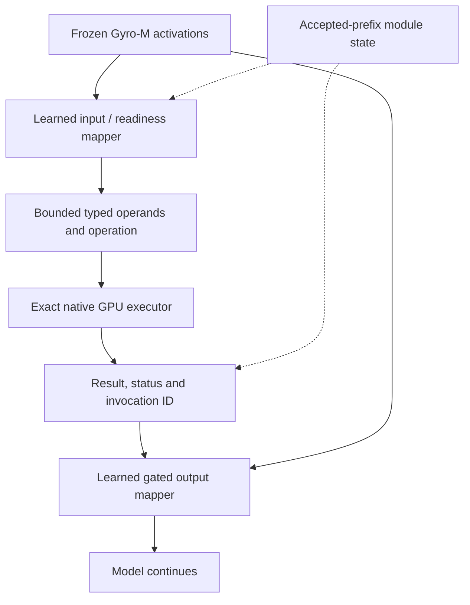

# IGC สำหรับ Strata: แผนเส้นทางหลัก

ติดตามร่วมกับ [PRD #276](https://github.com/xenodeve/Strata-xeno/issues/276)
สถานะ: อ่านงานต้นฉบับและสำรวจ training seam แล้ว ยังไม่มี mapper ที่ฝึกกับ Gyro-M
ผู้ใช้เลือก IGC เป็นทางหลักแล้ว compiled-Qwenputer เป็นทางรองสำหรับเทียบผล
ผลทดสอบ P0–P8 เดิมยังเป็นประวัติของเส้นทางนั้น ไม่เปลี่ยนชื่อเป็นผลของ IGC
PRD ปัจจุบันอยู่ที่ [IGC primary PRD R10](2026-10-29-igc-primary-prd.md)

## สิ่งที่จะนำมาใช้

เป้าหมายของเส้นทางนี้คือให้ weights ของ mapper ส่ง operands และ operation แบบมีชนิดข้อมูล
ให้ native executor ใน engine แล้วส่งผลกลับผ่าน activation โดยไม่ต้องสร้างข้อความเรียก tool
เก็บ compiled-Qwenputer ไว้เป็นอีกเส้นทางสำหรับเทียบความถูกต้อง คุณภาพ และเวลาใช้งานจริง

Research attribution และสถานะ source/license อยู่ใน PRD R10 ใช้แหล่งต้นฉบับและเขียน implementation เอง

## แยกระดับหลักฐานให้ชัด

| ระดับ | สิ่งที่ต้องทำได้ | สิ่งที่ผลทดสอบยืนยัน |
|---|---|---|
| Typed executor | รับ record ที่เตรียมไว้แล้วคำนวณบน GPU | arithmetic และ ABI ยังไม่ยืนยัน proxy หรือ learned mapper |
| Token-feature proxy | แปลง operand tokens เป็น record โดยไม่สร้าง tool-call syntax | ลด serialization แต่ยังใช้ token features |
| Learned input/routing mapper | ดึง operation/operands จาก activations ของ Gyro-M จริง | ต้องวัด tuple accuracy และ trigger บน held-out inputs |
| Full latent path | learned input → native execution → learned gated output → โมเดลตอบต่อ | ต้องฝึกและทดสอบ output mapping กับโมเดลจริงก่อนใช้ชื่อนี้ |

การทดลองแต่ละระดับมีชื่อและผลแยกกัน ไม่มีการนับ typed-kernel tests เป็น learned integration

## เส้นทางข้อมูลที่เสนอ

Record มี version, invocation ID, logical position, operation, domain, sign,
length และ digits/limbs ภายในขอบเขตที่กำหนด ไม่รับ arbitrary pointers หรือ code
ผลมี status แยก success, unsupported, malformed, overflow, divide-by-zero และ limit
ถ้า input ไม่ผ่านหรือผลไม่พร้อม จะไม่นำตัวเลขที่ยังไม่ยืนยันไปแก้ activation

## ขอบเขตตัวเลขและ gate

Paper ไม่ใช่ numeric ABI ของ Strata เส้นทางทดลองต้องตรวจ range และ overflow เอง
I1a เริ่มจาก signed integer add/subtract/multiply ที่รับ operands ได้ถึง 62 digits
และปฏิเสธผลเกินขอบเขตอย่างชัดเจน ใช้ multi-limb/digit arithmetic แทน int64 หรือ FP32
I1b เพิ่ม rational, floor/modulo, gcd, powers และ decimal contracts พร้อม oracle แยก
I1 ยังไม่ปิดทั้ง Phase จนรายการที่ประกาศรองรับมี exact tests ครบ ส่วนที่ยังไม่รองรับคืน
Unsupported และไม่เปลี่ยนไปใช้ host calculator อัตโนมัติ

Hard feature-off ข้าม mapper, cache และการเขียน activation ทั้งหมด การเรียนรู้ให้ gate
มีค่าใกล้ศูนย์ยังไม่ใช่หลักฐานว่าเส้นทางปิดให้ผล byte-identical

## งานตามลำดับ

| Phase | ผลงาน | Gate ก่อนผ่าน |
|---|---|---|
| I0 | ตรวจ source/license และพิสูจน์ training/activation seam ของ Gyro-M | native forward fidelity, declared gradient path, bounded resources และข้อสรุปตำแหน่ง output mapper |
| I1a | typed exact GPU kernel และ ABI | independent oracle, boundaries, negative controls, sanitizer; ยังไม่เชื่อม mapper |
| I1b | numeric domains ที่เหลือตามขอบเขต | exact semantics และ explicit unsupported/overflow ครบ |
| I2 | bounded activation capture และ input/readiness training | activation fidelity, held-out tuple/trigger accuracy และ resource budget |
| I3 | output-mapper training และจุดเชื่อม forward | พิสูจน์ differentiable path และทดสอบผลกับ Gyro-M จริง |
| I4 | repeated committed triggers ระหว่าง reasoning | invocation ID, exactly-once consumption, KV/MTP/suffix และ rollback ถูกต้อง |
| I5 | เทียบคุณภาพและใช้งานจริง | matched tasks, profiler-off ABBA, token/context/tool ledger และ rollout gates |

I1 และการเตรียมข้อมูล I2 ทำแยกจากการพิสูจน์ I3 ได้ แต่ผลเหล่านั้นไม่ปิด gate ของ I3
ตัวเลือก readout/supervised surrogate ต้องใช้ชื่อการทดลองของตัวเอง ถ้าไม่ได้ฝึกผ่าน LM loss

### Milestone แรกที่กำลังทำ: I0

1. จับ `head_mixed` กับ logits ของ first verifier window จากโมเดลจริง โดยไม่เขียน state กลับ
2. ใช้ native head เดิมรัน activation ที่จับไว้ซ้ำ และเทียบ logits/argmax ก่อนใช้เป็น training seam
3. พิสูจน์ backward ของตำแหน่ง output mapper ที่เสนอ ระบุว่าเป็น exact gradient หรือใช้
   straight-through/surrogate ตรง quantization ห้ามเรียก surrogate ว่า gradient ตรงของ native quantizer
4. เทียบ early-layer injection ที่ต้อง backward ผ่าน frozen suffix กับ late head-input injection
   ที่ใช้ suffix สั้นกว่า เลือกจาก fidelity, คุณภาพและต้นทุนที่ตรวจได้ ไม่ย้ายตำแหน่งแล้วอ้างว่าเหมือน paper
5. กำหนด activation-cache/training budget จาก shapes จริงก่อนเปิด training run ที่ใหญ่ขึ้น

ตอนนี้ตรวจ GGUF header แล้ว: head เป็น Q8_0, shape 2560 × 248320 และขนาด 675,430,400 bytes
`NativeHead::run` quantize input เป็น Q8_1 ก่อน projection ส่วน routed experts เป็น TQ2_T
จึงต้องตรวจ forward และ backward ของ head แยกจากการรองรับ quantization ของ experts
การเก็บ early residual ครบ 262K × 4 HC streams × 2560 × BF16 จะใช้ **5 GiB ตามการคำนวณขนาด**
ยังไม่รวม cache/allocator อื่น ตัวเลขนี้ไม่ใช่ peak ที่วัดจริง จึงต้องออกแบบ selected/projected cache
ถ้าเก็บ F32 ที่ shape เดียวกันจะเป็น 10 GiB การลด precision ต้องผ่าน activation-fidelity gate

## สิ่งที่ตรวจพบในเครื่องมือปัจจุบัน

Python ที่ใช้กับ task มี PyTorch แบบ CPU-only การค้นใน `src/core`, `src/kernels`
และ `tools` ยังไม่พบ autograd registration หรือ backward path สำหรับ engine นี้
จึงยังไม่มีหลักฐานว่าฝึก early output mapper ผ่าน downstream frozen layers ได้
การ freeze weights ไม่ได้ตัด backward computation ออก และการมี QLoRA ทั่วไปก็ยังไม่ยืนยัน
ว่าใช้กับ TQ2_T ของ Gyro-M ได้ ขั้น I3 ต้องพิสูจน์ส่วนนี้ก่อนเริ่ม training run ขนาดใหญ่

Input/readiness heads ฝึกจาก cached activations จริงได้โดยไม่ต้องแก้ weights ของ Gyro-M
ต้องเก็บ activation จาก inference path ที่ deploy จริง ผูกกับ model/tokenizer/build identity
และตรวจ dtype, HC geometry, layer, normalization, position และ cached-prefix identity
ไม่ใช้ embedding หรือ activations จากโมเดลอื่นแทนแล้วเรียกว่าผลของ Gyro-M

สำหรับ context 262K ให้เริ่มจากการออกแบบ selected-state/projected cache ที่มี budget ชัดเจน
วัดขนาดที่ต้องใช้ก่อนเก็บ hidden vectors ทั้งหมด ถ้าข้อมูลที่จำเป็นอยู่นอกขอบเขตของ cache
ต้องรายงานว่าไม่รองรับ ไม่เปลี่ยน workload ของ baseline เงียบ ๆ

## การวัดและ controls

ใช้ Gyro-M 262K / 5 workers ตาม hub พร้อม settings เดิมและไม่มี private-commit cap เพิ่ม
ฝึกและทดสอบด้วย corpus/seeds ที่ตรึงไว้ แยก held-out templates, ranges, ภาษาไทย,
distractors, quoted arithmetic และ non-arithmetic tasks จาก training data

- วัด exact operator/operand tuples แยกจาก arithmetic และคำตอบสุดท้าย
- เทียบ base/off, adapter-only, oracle operands, learned operands, token-result bridge,
  full latent path, compiled-Qwenputer และ external-tool route ที่ใช้ prefix caching ตามปกติ
- นับ reasoning/final/invocation tokens, feedback prefill, retained context, internal work,
  attempts และ external calls ต่อโจทย์ที่แก้สำเร็จ
- วัดเวลาถึงคำตอบที่ผ่าน independent tests รวม cold/warm/tail, cache/adapter memory,
  expert hits, startup, cancellation และ repeated-session stability
- ผลที่มี trade-off คงเป็น opt-in การเปิด default ใช้ gate เดิมของ PRD และผลบน hub จริง

## Change inventory

| จุดเปลี่ยน | หน้าที่ | การตรวจ |
|---|---|---|
| `include/strata/core/igc_*`, `src/kernels/igc_*` (proposed) | typed ABI, exact GPU operations, cached result identity | I1 oracle/limits/sanitizer |
| layer/verifier activation seam (survey before editing) | off-default capture and gated injection | fidelity/off parity/I3 gradient check |
| first-party offline training/data tools (proposed) | mapper datasets, CE/readiness and declared output loss | frozen splits/seeds/checkpoints |
| verifier/MTP/suffix and module state | accepted-row state and repeated triggers | I4 exactness/rollback |
| timeline/analyzer and benchmark harness | mechanism, paired counters and fair comparisons | analyzer test first; I5 |
| PRD/BLUEPRINT/reports | distinct scope, status and rollout | same-commit docs; issue comments when permitted |

ไม่มีการดาวน์โหลดโมเดล ติดตั้ง training stack รัน code จากแหล่งใหม่ หรือเปิด training ที่ไม่กำหนด
ขอบเขตจากแผนนี้โดยอัตโนมัติ งานที่ต้องใช้สิทธิ์เฉพาะยังต้องผ่านขั้นตอนอนุมัติของ action นั้น

## References

- [IGC paper v1](https://arxiv.org/html/2501.00684v1): method §§3–4, limitations and Appendix B
- [QLoRA](https://github.com/artidoro/qlora): conceptual reference; TQ2_T compatibility is unverified
- [Native PRD](2026-10-28-native-qwenputer-prd.md): original P0–P8 contracts and full goal ledger
