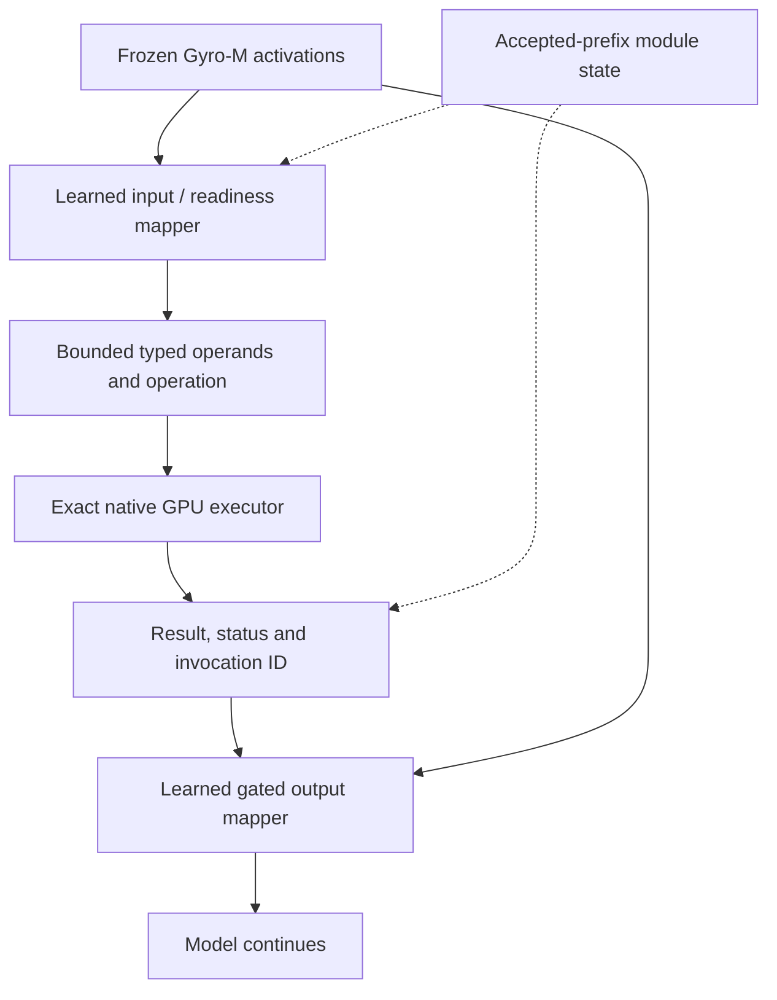
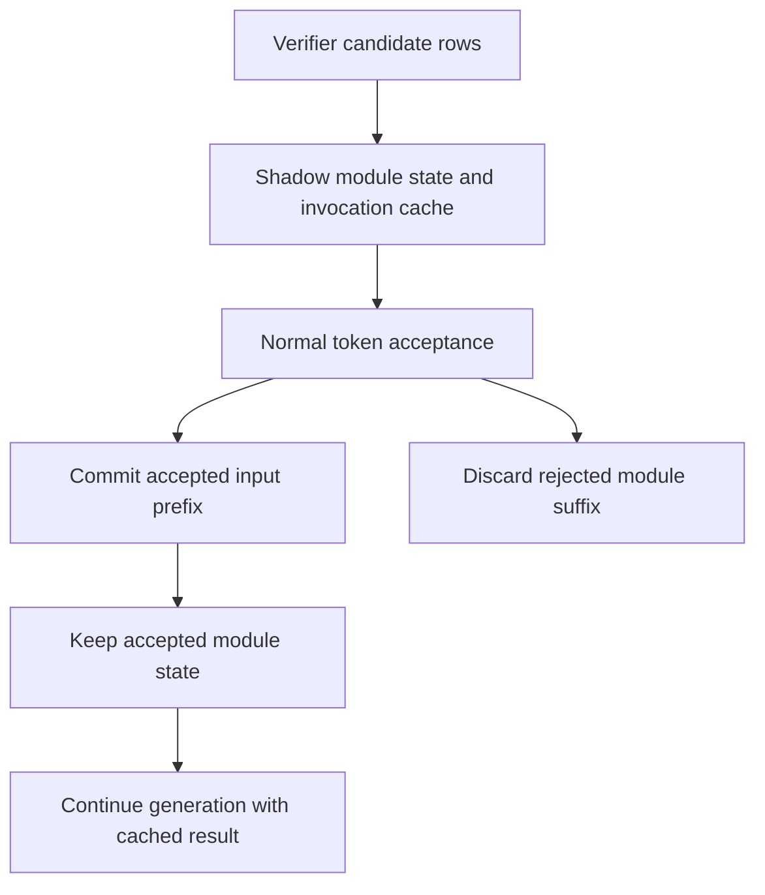

# PRD R12: IGC เป็นทางหลักของการคำนวณภายใน Strata

Tracker: [#276](https://github.com/xenodeve/Strata-xeno/issues/276)
สถานะ: R12 กำหนดเกณฑ์ตัดสินตามขนาดโมเดล และลำดับงานลด token กับการตรวจสมมุติฐาน; R11 ด้านล่างยังมีผลในส่วนที่ R12 ไม่ได้แก้

## R12 (2026-11-01)

### เกณฑ์ตัดสิน

- บนโมเดลใหญ่อย่าง Gyro-M เป้าหลักคือลด token และเวลาตอบ ความแม่นเป็นผลพลอยได้ที่ต้องไม่แย่ลง
- ข้อที่ผิดเพราะโมเดลตีความโจทย์ไม่นับเป็นผลเสียของ MIP แต่ MIP รับผิดชอบความเสียหายที่ตัวเองก่อ เช่น ข้อความที่แทรกแล้วเปลี่ยนสิ่งที่โมเดลเขียน
- ผู้พัฒนาคาดว่าโมเดลขนาดกลางและเล็กจะได้ผลด้านความแม่นมากกว่า ข้อนี้ยังไม่ได้วัด ห้ามอ้างจนกว่าจะมีตัวเลข
- การแก้แต่ละครั้งทดสอบเฉพาะข้อที่การแก้นั้นมีผล คัดจากผลที่มีอยู่ด้วยกฎที่ระบุก่อนรัน และรันแขนเทียบใหม่บนข้อชุดเดียวกัน ชุดเต็มเก็บไว้รอบสุดท้าย

### หลักฐาน (รายละเอียดใน #276)

- GSM-Hard 200 ข้อ: เปิด MIP 177, ปิด MIP 178 หลังอ่านข้อที่เห็นแย้ง token น้อยลง 22 % เวลา decode น้อยลง 18 % จากการรันแขนละรอบ ยังไม่ใช่ ABBA เฉลยของชุดนี้ผิดบางส่วน
- ผลคูณ 180 จุดในการคิดของแขนปิดไม่พบข้อผิดจริง จากการตรวจด้วย pattern ที่เห็นเฉพาะ `a*b = c`
- 30 ข้อเพดานรันจนสุด context: แขนปิดจบเองครบ การคิด 71 % (เปิด) และ 83 % (ปิด) อยู่หลังเจอคำตอบครั้งแรก
- จุดปิดท้ายโน้ตตัดประโยคและทำให้ gsm8k-201 วน 3 จาก 3 รอบ เอาออกแล้วจบเอง 3 จาก 3 รอบ โน้ตจึงไม่ปิดด้วย `.` อีกต่อไป และ engine ปิดการคิดเมื่อเจอวงซ้ำเป๊ะ (ตัวกันวนทำงานจริงแล้วในงานวัด และวงยาว 350 token ของ math-6 ทำให้ต้องขยายระยะที่มองเห็น) แต่การเปิดท้ายโน้ตทำให้เกิดปัญหาใหม่ (#277): model อ่านผลบวกที่ส่งให้เป็นพจน์แรกแล้วเขียนพจน์ท้ายซ้ำ 28 ครั้งใน 297 รอบ เทียบกับ 0 ใน 1,290 รอบที่โน้ตปิดด้วย `.` และ 0 ใน 680 รอบที่ปิด MIP ยังไม่พบข้อที่เปลี่ยนจากถูกเป็นผิด
- สัญญาณจากตัวเลขอย่างเดียวจับข้อผิดได้น้อย: ค่าที่ไม่เป็นจำนวนเต็มเกิดในข้อถูก 23 ข้อ ข้อผิด 9 ข้อ และ MIP ตรวจได้ว่าคำนวณถูก แต่ตรวจไม่ได้ว่าโจทย์ตั้งถูก การแทนคำตอบกลับลงสมการเดิมจึงผ่านเสมอ

### ลำดับงาน

1. **ความมั่นใจในค่าที่ส่งให้:** ไม่ใช้ ประโยคใน system บน 60 ข้อที่คัด token ไม่ลด เวลาเพิ่ม 4 % ประโยคตรวจซ้ำเพิ่ม 15 % และโมเดลลอกโน้ตจนเกิดวงใหม่ 1 ข้อ ขั้นถัดไปคือวัดแขนส่งค่าไม่มีโน้ต และแขน effort medium บน 49 ข้อ
2. **คงการปิดการคิดเมื่อนิพจน์ซ้ำครั้งที่ 3:** ที่เคยตัดสินใจเลิกปิดนั้นผิด วัดบน 49 ข้อ การถอดออกเพิ่ม token 43.7 % (เพิ่ม 36 ลด 13 ข้อ, sign-flip p 0.0012) ถูกหลังอ่าน 37 เทียบ 40 ไม่มีข้อไหนเปลี่ยนจากผิดเป็นถูก และเกิดวงยาวจริง 1 ข้อ ที่ปิดแล้วเสียหายจริงมีโจทย์วงเล็บ (ปิดแล้วถูก 2 จาก 4 รอบ) และ reply ที่ขัดกันเอง 1 ข้อ ขั้นถัดไปคือยืนยันด้วย exe เดียวหลายรอบผ่าน `--igc-close-repeat 3` กับ `0` เพราะ 48 จาก 49 คู่แยกกันก่อนถึงจุดปิด และปิด swap แล้วก็ยังจับคู่ไม่ได้ (A/A ด้วย `--no-adapt` เหมือนกัน 0 จาก 8 ข้อ) ส่วนการปิดเมื่อเจอคำทบทวนแบบ CGRS ยังคงยกเลิก เพราะลดได้ 3–10 % และปิดกลางงานราว 8 % คำในการคิดบอกไม่ได้ว่าคิดเสร็จแล้ว
   - **แก้ #277 ก่อนไปขั้นถัดไป:** ทดสอบ `--igc-sum-note` บนข้อที่เกี่ยวเท่านั้น เทียบโน้ตเปิดท้าย ปิดด้วย `.` เฉพาะผลบวกระดับบนสุด และไม่มีโน้ตบนผลบวก `2000*1.05` เป็นผลคูณจึงไม่กระทบ gsm8k-201
3. **ตรวจสมมุติฐานด้วยเกณฑ์ภายนอก:** ทดลองตรวจย้อนกลับแบบ FOBAR หรือ Key Condition Verification โดยซ่อนเลขในโจทย์แล้วให้ MIP คำนวณ เทียบกับเลขจริง เริ่มจากข้อผิด 20 ข้อและข้อถูก 20 ข้อ วัดอัตราจับข้อผิดและการเตือนผิด ถ้าไม่คุ้มไม่สร้าง ถ้าคุ้มให้ทำงานเฉพาะเมื่อมีสัญญาณ
4. **แปลงเป็นเงื่อนไขให้ solver (SatLM):** ทางเลือกระยะยาว ใช้เมื่อข้อ 3 พิสูจน์แล้วว่าการตรวจภายนอกคุ้มค่า เป็น dependency ใหม่ ต้องคุยกับผู้พัฒนาก่อน
5. **วัดเวลาจริง:** ABBA ที่ priority สูงตามกฎ repo และแยกต้นทุนด้วย timeline ก่อนอ้างตัวเลขเวลา
6. **เทียบกับผลที่เผยแพร่ด้วยโปรโตคอลเดียวกัน:** Table 11 ของ arXiv 2608.30320 ให้ `Qwen3.8-Flash-Next-Base` GSM8K 93.29, MATH 72.78 (4-shot, CoT), BBH 90.87 (3-shot, CoT) เป็นผลของ base weights เท่านั้น ไม่มีผลของโมเดล instruct หรือแบบเปิด reasoning ไม่บอก split จำนวนข้อ หรือวิธีดึงคำตอบ ตัวเลข Gyro-M ที่เปิดการคิดบน prompt เปล่าจึงเทียบตรงไม่ได้ ก่อนไต่ชุดเต็มต้องมีแขน few-shot CoT ไม่เปิดการคิด บน GSM8K test เต็ม เปิดและปิด MIP และรายงานคู่กับแขนแบบใช้งานจริง โดยบอกทุกครั้งว่าเป็นคนละโมเดล และ MATH-500 เฉพาะคำตอบจำนวนเต็มไม่ใช่ MATH ของ paper

ถ้อยคำกำกวมที่ไม่มีเงื่อนไขให้ตรวจอยู่นอกขอบเขต เป็นเรื่องการตัดสินของโมเดล

### R12 in English

**Decision criteria.** On a large model such as Gyro-M the main goal is fewer tokens and less response time; accuracy is a by-product that must not fall. A wrong answer from the model misreading a question does not count against MIP, but MIP owns harm it causes itself, such as inserted text that changes what the model writes. The developer expects medium and small models to gain more accuracy; that is unmeasured and must not be claimed until it has numbers. Each change is tested on the cases it reaches, picked from existing runs by a rule stated before the run, with a fresh comparison arm on the same cases. Full suites wait for the final round.

**Evidence, details in #276.** GSM-Hard 200: on 177, off 178 after reading disagreements, 22 % fewer tokens and 18 % less decode time from one run per arm, not ABBA; part of that suite's gold is wrong. 180 products in off's thinking held no real error, by a pattern that sees only `a*b = c`. The 30 limit cases ran to the end: off finished all of them, and 71 % (on) and 83 % (off) of the thinking came after the answer first appeared. The note's closing stop cut sentences and made gsm8k-201 cycle in 3 of 3 runs; without it the case finished in 3 of 3, so the note no longer ends in `.`, and the engine closes thinking on an exact cycle of 8 rounds (the guard has fired in measured runs, and the 350-token loop of math-6 forced a longer reach). Leaving the note open caused #277: the model reads a delivered sum as its first term and writes the last term again, 28 times in 297 runs, against 0 in 1,290 runs with the closed note and 0 in 680 runs with MIP off. No traced answer went from right to wrong. Numeric signals alone catch little: a non-integer value appears in 23 right cases and 9 wrong ones. MIP checks that a calculation is right, not that the setup is right, so substituting an answer back into the same equations always passes.

**Order of work.**

1. Confidence in delivered values: rejected. A system line on the 60 selected cases gave no token gain, 4 % more time, 15 % more recheck sentences, and one new loop where the model copied the note. Next, an arm with no note and an arm at medium effort on 49 cases.
2. Keep closing thinking on the third repeat of an expression. The decision to stop was wrong. On 49 cases, removing it added 43.7 % tokens (36 more, 13 fewer, sign-flip p 0.0012), 37 right after reading against 40, no case went from wrong to right, and one real long loop appeared. The close does real harm on the parenthesis question (2 right of 4 closed runs) and one reply contradicting itself. Next, confirm on one exe through `--igc-close-repeat 3` and `0` over repeated rounds, because 48 of the 49 pairs diverge before the close, and swaps off does not pair them: two runs of one exe with `--no-adapt` were identical on 0 of 8 questions. A close at a reflection opener in the CGRS style stays dropped: it saved 3 to 10 % with about 8 % of closes mid-work, and words in the thinking do not show that the work is done.
   - Fix #277 before the next step: test `--igc-sum-note` only on the questions it reaches, comparing the open note, a closing `.` on top-level sums only, and no note on sums. `2000*1.05` is a product, so gsm8k-201 is not touched.
3. Check assumptions by an outside criterion: a trial of backward verification in the style of FOBAR or Key Condition Verification, masking a number in the question and having MIP compute it against the known value. Start from 20 wrong and 20 right cases and measure catches and false alarms. Do not build it if it does not pay; if it does, it runs only on a signal.
4. Declarative constraints for a solver (SatLM): a longer-term option once step 3 shows outside checks pay. A new dependency, to be discussed with the developer first.
5. Measure time properly: ABBA at high priority under the repository's rules, with cost split by the timeline, before any time figure is claimed.
6. Compare with published results under the same protocol. Table 11 of arXiv 2608.30320 gives `Qwen3.8-Flash-Next-Base` GSM8K 93.29, MATH 72.78 (4-shot, CoT) and BBH 90.87 (3-shot, CoT). These are base weights only, with no instruct or reasoning result, and no split, problem count or answer extraction stated. Gyro-M numbers with thinking on plain prompts cannot be set against them. Before the full-suite climb there must be a few-shot CoT arm with thinking off on the whole GSM8K test, MIP on and off, reported beside the arm as used in practice. Each report must say it is a different model, and that integer-answer MATH-500 is not the paper's MATH.

Ambiguous wording with no condition to check is out of scope; it is the model's judgement.

Research read at abstract and summary level only, numbers to be checked against the papers before reuse: [RCoT](https://arxiv.org/pdf/2305.11499), [FOBAR](https://arxiv.org/pdf/2308.07758), [SatLM](https://arxiv.org/pdf/2305.09656), [First Try Matters](https://papers.cool/arxiv/2510.08308), [CGRS](https://papers.cool/arxiv/2508.05337).

---

R11 เดิมอยู่ด้านล่าง

สถานะ R11: เพิ่มเส้นทางตรวจเป้าหมายครบทุกด้าน; งานฝึก mapper และ integration ยังไม่ผ่าน gates

## Problem Statement

ระหว่างตั้งสมมุติฐานและตรวจ logic โมเดลควรใช้ผล execute จริงแทนการทำนายผลการทดลอง
แล้วนำผลที่กระชับไปคิดต่อได้ ลดความผิดพลาด เวลาวนแก้โจทย์ และต้นทุนข้อความที่ไม่จำเป็น

เป้าหมายเดิมยังอยู่ครบ: internal sandbox สำหรับ hypothesis/logic/debug, ผล math/code ที่ตรวจแล้ว,
reasoning tokens และ incremental prefill ที่ลดลง, context ที่โตช้าลง, external tools และข้อมูล
ที่ไม่จำเป็นน้อยลง, งานสำเร็จต่อ token มากขึ้น และเวลาถึงคำตอบที่ถูกลดลง รวมทั้งความสามารถ
จาก upstream, งาน geometry/3D, model-accessible memory และการ optimize/offload จนใช้จริงได้
เริ่มจาก Native บน Gyro-M แล้วจึงขยายไปโมเดล MoE ที่เล็กลงและ Universal พร้อม adapter และการตรวจของแต่ละโมเดล รายละเอียด goal ledger ใน repo คือ
`docs/plans/2026-10-28-qwenputer-capability-roadmap.md` เป้าหมายทั้งหมดข้างต้นมีผลใน PRD นี้

| เป้าหมายที่ต้องรักษา | การตรวจที่ต้องมี |
|---|---|
| Hypothesis/logic/debug sandbox | สร้างการทดลอง ดู assertions/counterexamples แบบกระชับ แก้และรันใหม่; ตรวจ bug fix ด้วย held-out tests |
| Math และ multi-step outcomes | แยกการเลือกสูตร/operands, exact execution และการตีความผล ไม่ใช้ forced invocation แทน spontaneous use |
| Tokens/context/tools/เวลา | วัด reasoning และ total tokens, invocation syntax, feedback prefill, retained context, calls และเวลาต่อ task ที่สำเร็จ |
| Cached debugging loop | เก็บ canonical source/prefix identity อ่าน source ครั้งเดียวเมื่อ cache ยังถูกต้อง; edits ต้อง invalidate; external baseline ใช้ cache ตามปกติ |
| ข้อมูลกลับที่จำเป็น | ส่ง value, failed assertion, expected/actual หรือ minimal counterexample; เก็บ bounded detail สำหรับการตรวจเพิ่ม |
| ความเชื่อถือได้ | แยก observed result, selected tests และ bounded proof; ตรวจ final-answer consistency และ unsupported verification claims |
| Geometry/3D | vectors/matrices/transforms/clearance และ Three.js scene repair; แยก AABB/OBB broad phase จาก mesh intersection พร้อม tolerance/oracle |
| Upstream capabilities | ทำ ledger ของสิ่งที่มีจริง/standalone/experimental รวม programmable execution และ model-accessible store; snapshots ไม่แทน filesystem |
| Optimization/residency | แยก immutable weights, active state, scratch, shadow/cache และ cold snapshots; ทดลอง resident/on-demand/tiered support พร้อม cold/warm/tail และ expert hits |
| Quantization hypothesis | เทียบ Gyro-M เดิมกับ IGC เป็น ablation หลัก; เทียบ higher-precision same-base เมื่อมีอยู่และใช้งานได้จริง โดยไม่ดาวน์โหลดเพิ่มเอง |
| โมเดล MoE ที่เล็กลง | หลัง Native ให้ทำ adapter และตรวจ input/output fidelity, task quality, resources และ latency แยกตามโมเดล ไม่อนุมานจากผล Gyro-M |
| Practical rollout | Correctness/quality, ordinary latency, resources, startup, cancellation และ repeated sessions ต้องผ่าน; trade-off เป็น opt-in |

## Solution

ใช้แนวคิด IGC เป็นทางหลัก: learned input/readiness mapper อ่าน activations แล้วส่ง operation
และ operands แบบ typed ให้ exact executor ภายใน engine ผลคำนวณส่งกลับผ่าน gated output
mapper เพื่อให้โมเดลตอบหรือทดลองต่อ โดยไม่มีข้อความเรียก tool คั่นกลาง

เก็บ compiled-Qwenputer เป็นทางรองสำหรับเทียบ semantics, state, คุณภาพและ latency
P0–P3 ผ่าน gates เดิม P4 มี autonomous exactness/lifecycle evidence แต่ WHILE instrumentation
ยังเปิดอยู่ P5 มี state/grammar/transaction components แล้ว ยังไม่ใช่ real-model integration
checkpoint ของ transaction components ทางรองคือ `8bdad772` ไม่เดินงาน P5–P8 ขนาดใหญ่ก่อน IGC

แผนดำเนินงานใน repo คือ `docs/plans/2026-10-29-igc-experimental-adaptation.md`
milestone แรกพิสูจน์ input/output training seam กับ Gyro-M ที่ใช้งานจริง โดยเฉพาะ forward fidelity
และ gradient ของ output mapper ก่อนเริ่ม training ขนาดใหญ่

## User Stories

1. ได้คำตอบ math ที่อิงผล execute จริงในขอบเขตที่รองรับ
2. ใช้ความสามารถภายในโดยลด external tool calls
3. โมเดลนำผลไปคิด แก้สมมุติฐาน และทดลองซ้ำได้
4. Hard feature-off รักษาพฤติกรรมและ raw tokens เดิม
5. ทราบ overhead ของงานทั่วไปแยกจากงานคำนวณ
6. ใช้ offload VRAM/RAM/NVMe ของโมเดลต่อได้
7. เห็นสถานะ computing/return/error เมื่อเริ่มขั้นนั้น
8. Refresh แล้วเห็นงานและสถานะที่กำลังทำต่อได้
9. API เก็บ internal computation ไว้ภายใน
10. External tools เดิมยังทำงานตามปกติ
11. ประวัติ ข้อความอ้างอิง และ code examples ไม่สั่ง execute เอง
12. Input เกินขอบเขตหรือกำกวมถูกปฏิเสธอย่างชัดเจน
13. Cancel/limit ไม่เผยแพร่ตัวเลขบางส่วนเป็นคำตอบที่ตรวจแล้ว
14. แยก result, refusal, unknown และ engine fault ได้
15. เรียกซ้ำโดย invocation/state ไม่ปะปนกัน
16. Prefix reuse และ conversation switching ใช้ module state ที่ตรงกัน
17. Save/restore ตรวจ identity และปฏิเสธ partial/incompatible state
18. Adapter/ABI ผูกกับ model/tokenizer/layer/normalization ที่ถูกต้อง
19. Artifact ผิดรูปแบบถูกปฏิเสธก่อน allocation/upload
20. งาน GPU มีขอบเขตและยกเลิกได้โดยไม่เปลี่ยน TDR/security
21. ทราบ startup/peak RAM/VRAM และผลต่อ expert cache บน hub จริง
22. มี independent oracles และ ownership/gradient/fidelity tests
23. เห็นคุณภาพและเวลาแบบ matched comparisons ก่อน rollout
24. มีสัญญา Native ที่ขยาย Universal ได้โดยไม่ลดมาตรฐาน

## Implementation Decisions

### สิ่งที่ผู้ใช้เลือกแล้ว

- IGC-inspired latent proxy และ native software executor เป็นทางหลัก
- compiled FFN/GDN Qwenputer เป็นทางรองและเก็บผลเดิมไว้ครบ
- Native ก่อน Universal; Gyro-M 262K / 5 workers และ settings ตาม hub เป็น baseline
- Optimize ต่อจนใช้จริงได้ ถ้าต้องเพิ่ม support ใน Strata ก็ทำใน scope นี้
- ผลดีที่มี trade-off คงเป็น opt-in ผลดีที่ไม่พบ trade-off ต้องผ่าน coverage/ABBA ก่อน default

### สัญญาของทางหลัก

- Arithmetic ABI แรกมี operation/domain/sign/length/digits หรือ limbs, invocation ID และ logical
  position ไม่รับ arbitrary pointers/code ผลมี status และ provenance ชัดเจน ข้อจำกัดนี้ใช้กับ ABI
  แรก ไม่ปิดทาง bounded interpreter/DSL/bytecode หรือ validated program reference ใน C1
  โดยต้องมีขอบเขตและการตรวจของตนเอง ไม่เปิด unrestricted host execution
- Arithmetic ใช้ checked exact integers/rationals ตาม ABI ไม่ใช้ int64/FP32 แทนขอบเขต 62 digits
  ส่วนที่ยังไม่รองรับต้องแสดงสถานะ ไม่ clamp, wrap หรือเปลี่ยนไปใช้ host calculator
- Learned mapping กับ arithmetic ตรวจแยกกัน Operand tuples ที่ mapper เลือกต้องมี held-out gate
- Input/routing heads ฝึกจาก activations ของโมเดลจริงได้ ส่วน output mapper ต้องพิสูจน์
  differentiable path ผ่าน frozen computation ที่ใช้จริงหรือระบุ surrogate/STE เป็นอีก experiment
- เก็บ selected/projected activation state ภายใน budget ไม่เพิ่ม full 262K hidden cache โดยไม่วัด
- Invocation คำนวณและ commit ครั้งเดียวต่อ accepted event ผลที่ cache ไว้อาจถูกอ่านโดย output
  mapper หลายตำแหน่งได้ แต่แต่ละตำแหน่งต้องไม่รับ delta ซ้ำ Rejected rows ทิ้ง state ของตัวเอง
- Native operation ไม่ขยับ language positions/RNG/penalties เพิ่มเอง Output injection เป็นส่วนหนึ่ง
  ของ normal forward ที่ตั้งใจให้เปลี่ยน activations จึงตรวจด้วย enabled semantics และ off parity
- Prefix/source edits ทำให้ cache ที่อ้างอิง prefix เก่าใช้ต่อไม่ได้ Session identity รวม adapter,
  numeric ABI, source model/tokenizer และ layout ไม่ serialize graph handles

### ลำดับความสำคัญและการแทนข้อกำหนดเดิม

R11 คงสถาปัตยกรรมและ priority ที่ R10 ใช้แทน R9/R2 เฉพาะทางหลัก ข้อบังคับว่าต้องคำนวณด้วย compiled
FFN/GDN, ใช้ WHILE trace, ใช้ STQPUT01 และคืนผลด้วย Text replay ใช้กับทางรองเท่านั้น
ทางหลักใช้ adapter/typed ABI และ latent output mapping ของตนเอง

ข้อกำหนดด้าน exactness, bounded execution, accepted-prefix state, identity, isolation,
history/session, status, ordinary-tool compatibility, disabled parity และ measured rollout ยังมีผล
ต้องปรับวิธีตรวจให้ตรง representation ใหม่ ไม่ตัด gate ออกหรือเปลี่ยนชื่อผลเก่าเป็นผลของ IGC
[R2 reference](https://github.com/xenodeve/Strata-xeno/issues/276#issuecomment-6479163682)
คงอยู่บน tracker ส่วน R9 ใน repo คือ `docs/plans/2026-10-28-native-qwenputer-prd.md`
เก็บไว้เพื่ออ่านประวัติและเทียบผล ไฟล์ใน repo ที่ยังไม่ push ไม่ใช่แหล่งอ้างอิงที่ต้องเปิดได้เพื่ออ่าน PRD นี้

## Testing Decisions

| Gate | หลักฐานที่ต้องมี |
|---|---|
| G0 | Native activation capture/replay ตรงกัน และมี training/gradient seam ที่พิสูจน์ได้ |
| G1 | Adapter/typed ABI version, reproducible identities, bounded loader และ source/license provenance |
| G2 | Exact arithmetic เทียบ independent oracle; tuple accuracy แยกจาก result accuracy |
| G3 | Accepted/rejected rows, repeated triggers, MTP/suffix, cache positions และ delta ไม่ซ้ำ |
| G4 | Cached/cold history, สลับบทสนทนา, restore mismatch/partial failure และ source invalidation |
| G5 | Malformed/range/confidence/unknown/fault/cancel แยกกัน; ไม่อ้าง verified answer โดยไม่มีหลักฐาน |
| G6 | Same-session greedy raw-token parity ของ hard-off; off ไม่มี module allocation หรือ injection |
| G7 | CUDA จริง; full D2x builds `89;120`; backend ที่ยัง build/run ไม่ได้ระบุเป็น debt |
| G8 | Timeline ก่อน, profiler-off ABBA, same-run counters, memory/expert hits, quality/tokens และ latency |
| G9 | Practical-use coverage, stability/cancel และ rollout ตาม trade-off policy |

Controls มี base/off, adapter-only, oracle operands, learned operands, token-result bridge,
full latent path, compiled-Qwenputer และ external tools ที่ใช้ valid prefix caching ตามปกติ
ตรึง corpus/seeds ก่อน held-out tests ตรวจภาษาไทย, distractors, quoted arithmetic,
unsupported tasks และ final-answer/execution consistency ไม่ยืนยัน learned integration จาก typed tests

ก่อนวัดประโยชน์ของแต่ละ experiment ต้องตรึง workload/splits/seeds, source/model/build/config,
baseline ที่จะเทียบ, rubric ของคำตอบที่ถูก, การนับ tokens/เวลา และเกณฑ์ uncertainty/non-regression
ไว้ก่อนเห็นผล Baseline external tools ใช้ cache ที่ถูกต้องตามปกติ แยก gate ว่า execute ถูกต้อง
ออกจาก gate ว่า task สำเร็จมากขึ้นต่อ token หรือถึงคำตอบที่ถูกเร็วขึ้น ต้องผ่านการตรวจทั้งสองส่วน
จึงอ้างประโยชน์นั้นได้ ไม่เปลี่ยน workload หรือเกณฑ์หลังวัดเพื่อให้ผลดูดี

## Phases

I0 training/forward feasibility → I1 checked typed executor → I2 input/readiness mapper →
I3 output mapper → I4 repeated committed triggers → I5 matched practical-use evaluation

I0 ต้องจับ native activations/logits จาก Gyro-M จริงและรัน head ซ้ำให้ตรงก่อนใช้ฝึก
จากนั้นพิสูจน์ gradient path ของตำแหน่งที่เสนอ แยก early injection ที่ต้อง backward ผ่าน
frozen suffix ออกจาก late head-input หรือ surrogate variant ที่ต้องใช้ชื่อและ controls ของตนเอง
ไม่เริ่ม training ขนาดใหญ่จากการคาดว่า freeze แล้วไม่ต้อง backward

I1a เริ่ม signed integer add/subtract/multiply แบบ checked 62 digits I1b เพิ่ม rational,
floor/modulo, gcd, powers และ decimal contracts ทั้ง I1 ยังไม่ปิดจนสิ่งที่ประกาศรองรับมี
independent oracle tests ครบ Unsupported/overflow ต้องชัดเจน ไม่ใช้ int64/FP32 แทน scope นี้

I2 ฝึก input/readiness heads ด้วย cached activations จริงที่ตรึง identity/splits/seeds
I3 ต้องแสดง output-mapper training และผลกับโมเดลจริง ส่วน I4 เพิ่ม repeated model-selected
triggers และ accepted-state rollback จากฐาน fixed-anchor ที่ตรวจแล้ว I5 ตรวจคุณภาพและ latency
ครบ workload ของฐาน arithmetic ตาม hub และใช้กรอบวัดเดียวกันตรวจ capability milestones ด้านล่าง

### Capability milestones และความครบของโครงการ

I0–I5 เป็นฐานการเชื่อมโมเดลกับ execution และการตรวจ arithmetic การผ่านฐานนี้ยังไม่ถือว่าปิด
โครงการทั้งหมด ต้องติดตามแต่ละเป้าหมายกับ milestone และหลักฐานของมันต่อไป

| Milestone | Dependencies และสิ่งที่ส่งมอบ | Oracle/เกณฑ์รับงาน | สถานะ |
|---|---|---|---|
| C0: ฐาน Native arithmetic | I0–I5; learned input/output, exact domains, ownership และ Hub evaluation | Tuple/exactness แยกจากผลกับโมเดล; G0–G9 และ matched task success/token/time | ทำอยู่; component arithmetic ผ่าน แต่ learned integration ยังไม่ผ่าน |
| C1: Bounded programmable execution | I1 numeric contracts, I3/I4; interpreter/DSL/bytecode หรือ validated program reference ที่มี version, memory/step/output/time bounds, reset/rollback และ assertions/state feedback | Independent semantic oracle กับ held-out programs: branches, loops, state transitions, malformed/limit/cancel; oracle ไม่ใช้ compiler/runtime ตัวเดียวกันเป็นคำตอบอ้างอิงเพียงตัวเดียว | ยังไม่ implement |
| C2: Iterative hypothesis/debug sandbox | C1, I4 และกรอบวัด I5; อ่าน source หรือใช้ canonical cached prefix แล้ววนสร้างสมมุติฐาน รัน ตรวจ และแก้ โดยคืน compact evidence | Held-out bug fixes/tests อิสระ, hypothesis discrimination, final-answer consistency; วัด attempts, calls, reasoning/prefill/context และเวลาถึง fix ที่ตรวจผ่าน เทียบ cached external-tool baseline | ยังไม่ implement |
| C3: Geometry/3D verification | C1 และ numerical contracts ที่ระบุ; vectors/matrices/world transforms, clearance/overlap และ Three.js scene repair | Independent geometry oracle/tolerances; แยก AABB/OBB broad phase จาก mesh intersection ตรวจ transformed bounds และ moving samples; วัด violations ที่แก้แล้วและ task time | ยังไม่ implement |
| C4: Model-addressable store | I3/I4 และ session identity; bounded put/append/get/list/delete พร้อม save/load ข้าม session แยกจาก conversation snapshots | Independent state-model oracle, content roundtrip, capacity/name/token boundaries, isolation, mismatch/partial restore; ตรวจ numerical ABI ของ store แยกจาก arithmetic | ยังไม่ implement; upstream ที่เกี่ยวข้องยังเป็น experimental |
| A1: Smaller MoE / Universal adapters | หลัง C0 Native; model/tokenizer/layer/quantization bindings และ mapper ของโมเดลแต่ละตัว | Native forward fidelity, held-out mapping/result use, hard-off parity และ matched quality/resources/latency ต่อโมเดล เลือกใช้ไฟล์ที่มีหรือขออนุมัติการได้โมเดลใหม่ตามปกติ | ยังไม่เริ่ม |

ทุก milestone ใช้ experiment contract ที่ตรึงก่อนวัด และรายงานทั้ง correct execution กับ task
success ต่อ token/เวลา ไม่ใช้เพียงตัวอย่างที่ forced call สำเร็จเป็นหลักฐานว่าเป้าหมายทั้งหมดผ่าน
Optimization/residency/offload และผลที่ไม่ถดถอยต้องตรวจซ้ำเมื่อเพิ่ม capability หรือ adapter

## Out of Scope for the First Milestone

I0 ยังไม่เปิด default, deploy, train base weights, ดาวน์โหลดโมเดล หรือ install training stack
ไม่รัน training ที่ไม่กำหนดขอบเขต และไม่เพิ่ม external-host fallback ให้ arithmetic path
เป้าหมาย sandbox/code/geometry/memory ยังอยู่ใน roadmap ไม่ถือว่า calculator หนึ่งตัวทำครบแล้ว

## Further Notes

Paper/method ได้อ่านแล้ว ยังไม่พบ released implementation จากต้นฉบับ จึงเขียนเองพร้อม attribution
ใน Python ของ task มี CPU-only PyTorch; inventory ไม่ใช่หลักฐานว่าไม่มี framework อื่นทั้งเครื่อง
Head ของ Gyro-M จริงเป็น Q8_0 และใช้ Q8_1 activation quantization ดังนั้น gradient/forward
fidelity ต้องตรวจตรงจุดนี้ด้วย ไม่สรุปจากชื่อ TQ2_T ของ experts

การเก็บ residual ครบ 262K × 4 HC streams × 2560 ใช้ 5 GiB ถ้าเป็น BF16 หรือ 10 GiB
ถ้าเป็น F32 ตามการคำนวณขนาด ยังไม่ใช่ peak ที่วัดจริง ต้องกำหนด selected/projected cache
จากหลักฐานและตรวจ fidelity ก่อนลด precision ไม่เพิ่ม full hidden cache โดยไม่คิดต้นทุน

## หลักฐานเดิมที่เก็บไว้เป็นทางรอง

Commits ในตารางเป็น local checkpoints ที่ยังไม่ push ไม่ใช่ผลของ learned IGC

| งาน | หลักฐาน | Checkpoint |
|---|---|---|
| P0 | baseline/conditional-graph probe และ startup smoke; แยก cap diagnostics ออกจาก hub | `7d49c8c0` |
| P1 | reproducible 18,298,944-byte artifact; 263,254,200 feature comparisons; offline oracles | `50ca54cb` |
| P2 | CPU loader, identity/bounds/mutant controls และ exact feature lowering | `f057540d` |
| P3 | native FFN/GDN supplied-trace replay 79 cases / 74,704 steps | `938065e4` |
| P4 | autonomous held-out 64/64 สองรอบ; WHILE instrumentation ยังเปิดอยู่ | `10d848eb` |
| P5 components | state/grammar/accepted-prefix/result-replay controls; fake language callback | `01f15c1a`, `8bdad772` |

ยังไม่มี learned IGC หรือ real-model compiled-Qwenputer integration ที่ผ่านการตรวจ
ผล standalone `17*23 = 391` และ state rollback ไม่ใช้แทนหลักฐานเหล่านั้น
Generated compiled artifacts ยังมี distribution hold เรื่อง linked-runtime notices

## Research source

[IGC v1](https://arxiv.org/html/2501.00684v1) ใช้ frozen base model, supervised input mapping
และ output mapping ผ่าน LM loss พร้อม calculator ที่ไม่ส่ง gradient กลับ Paper ทดสอบ
หนึ่ง invocation ต่อ sample ที่ fixed anchor; repeated reasoning triggers เป็นงานเพิ่มของ Strata
Appendix B ยังเป็นข้อความว่าจะปล่อย code ภายหลัง ไม่พบ official runnable implementation
หรือ checkpoint จากต้นฉบับที่อ่าน License CC-BY 4.0 ของ paper ไม่ใช่ software license
งานนี้จึงเป็น independent adaptation พร้อม attribution

English specification — full requirement mirror

## Problem Statement

The model should replace prediction-based evaluation of hypotheses with actual internal
execution and use compact results to revise and test again. All goals remain: an internal
hypothesis/logic/debug sandbox; verified math/code outcomes; fewer reasoning and feedback-prefill
tokens; slower retained-context growth; fewer external tools and irrelevant feedback; more
successful tasks per token; and less time to correct results. Upstream capability adaptation,
geometry/3D, model-accessible memory and practical optimization/offload also remain goals.
Native Gyro-M comes first, then smaller-MoE and Universal adaptation with per-model adapters
and evaluation. Calculator success alone does not complete them.

## Solution and Priority

IGC-inspired trained activation mapping plus an exact in-engine executor is primary. A learned
input/readiness mapper produces bounded typed operations/operands. A learned gated output mapper
returns the result through activations, without intermediate textual tool-call serialization.
Compiled Qwenputer is secondary and retains its own identities/evidence. Do not advance major
compiled-only P5–P8 work ahead of primary IGC feasibility. Shared identity, transaction, isolation
and measurement components remain reusable. The local plan is
`docs/plans/2026-10-29-igc-experimental-adaptation.md`; the normative requirements are included here
so unpushed companion files are not required to understand this issue.

## User Stories

1. Obtain exact execution-backed arithmetic within supported domains.
2. Use internal computation with fewer external tool calls.
3. Revise hypotheses and run repeated experiments using the results.
4. Preserve behavior and raw tokens with a hard feature-off bypass.
5. See ordinary-task overhead separately from computation time.
6. Preserve model VRAM/RAM/NVMe offloading.
7. See computing/return/error status when the relevant stage begins.
8. Recover the current running answer/status after refresh.
9. Keep internal computation inside the API boundary.
10. Preserve ordinary external-tool behavior.
11. Prevent history, quotations and code examples from independently authorizing execution.
12. Explicitly refuse ambiguous, malformed or oversized inputs.
13. Never publish a partial number as verified success after cancellation or a limit.
14. Distinguish results, refusals, unknowns and engine faults.
15. Isolate repeated invocations and their state.
16. Keep module state coherent across prefix reuse and conversation switches.
17. Verify saved identities and reject partial/incompatible restores.
18. Bind adapters/ABI to the actual model, tokenizer, layer and normalization.
19. Refuse malformed artifacts before allocation/upload.
20. Bound and cancel GPU work without TDR/security changes.
21. Measure startup/peak RAM/VRAM and expert-cache effects on the actual hub.
22. Use independent arithmetic oracles and ownership/gradient/fidelity tests.
23. Compare matched quality and latency before rollout.
24. Preserve a Native contract that can later extend to Universal.

## Implementation Decisions

The user selected IGC as primary, compiled Qwenputer as secondary, and Native before Universal.
Use the actual Gyro-M 262K/five-worker hub settings and continue practical optimization, adding
necessary Strata support within scope. Measured wins with costs remain opt-in; default activation
requires adequate no-tradeoff coverage and the standing paired-measurement gates.

Typed records carry version, invocation ID, logical position, operation/domain, signs, lengths
and bounded digits/limbs. The initial arithmetic ABI contains no arbitrary pointers/code; this
is not a permanent ban on a later bounded interpreter/DSL/bytecode or validated program reference
in C1, with its own validation and bounds. Unrestricted host execution remains excluded. Results
carry explicit status and provenance. Arithmetic uses checked exact integer/rational semantics; int64/FP32 cannot
silently replace the 62-digit scope. Unsupported/range errors must not clamp, wrap or invoke a
host calculator automatically. Mapper tuple selection and arithmetic exactness are separate gates.

Train input/routing heads from real deployed-model activations. An output mapper requires a
demonstrated differentiable path through the actual frozen computation, or an explicitly named
STE/surrogate experiment. Do not claim that freezing weights removes backward computation or that
generic QLoRA supports TQ2_T. Use a budgeted selected/projected state cache rather than retaining
every 262K hidden vector without measuring its cost.

Calculate and commit each invocation once per accepted event. A cached result may condition
multiple output positions, but a position must not receive the same delta twice. Discard rejected
row state. Native operations do not advance extra language positions, RNG or penalties. Output
injection intentionally changes normal forward activations; validate enabled semantics and hard-off
parity accordingly. Invalidate module caches after source/prefix edits. Session identity includes
adapter, ABI, model/tokenizer and layout. Do not serialize graph handles.

## Precedence over R9/R2

R11 retains R10's supersession of primary architecture and priority. Mandatory compiled FFN/GDN arithmetic,
conditional WHILE traces, STQPUT01 and textual result replay now apply only to secondary Qwenputer.
Primary IGC has its own adapter/typed ABI and latent output mapping. Retain exactness, bounded
execution, accepted-prefix transactions, identity/isolation, history/session integrity, status,
ordinary-tool compatibility, hard-off parity and measured rollout. Adapt the tests to the new
representation; do not delete gates or relabel historical results. The
[existing R2 companion](https://github.com/xenodeve/Strata-xeno/issues/276#issuecomment-6479163682)
remains available for secondary contracts. R9 is preserved locally with an explicit supersession
banner. The local capability ledger retains the full goal set summarized above.

## Acceptance Gates

| ID | Required evidence |
|---|---|
| G0 | Real-Gyro activation capture/native forward replay and a demonstrated declared training/gradient seam |
| G1 | Versioned/reproducible adapter and typed ABI identities; bounded loader; source/license provenance |
| G2 | Independent exact arithmetic oracles; operand/operator tuple accuracy separate from final outcomes |
| G3 | Accepted/rejected rows, repeated triggers, MTP/suffix, cache positions and no duplicate deltas |
| G4 | Cached/cold history, conversation switches, restore mismatch/partial failure and source invalidation |
| G5 | Distinct malformed/range/confidence/unknown/fault/cancel outcomes; no unsupported verification claims |
| G6 | Same-session greedy raw-token hard-off parity, with no module allocation or injection when off |
| G7 | Real CUDA validation, full D2x `89;120` builds and explicit unavailable-backend validation debt |
| G8 | Timeline first; profiler-off ABBA; same-run counters; memory/expert hits; quality/token/latency ledger |
| G9 | Practical-use coverage, stability/cancellation and the tradeoff-based rollout policy |

Controls include base/off, adapter-only, oracle operands, learned operands, a token-result bridge,
full latent mapping, secondary compiled Qwenputer and external tools with normal valid prefix
caching. Freeze datasets/seeds before held-out evaluation. Include Thai, distractors, quoted
arithmetic, unsupported tasks and final-answer/execution consistency. Typed-kernel or token-feature
tests do not establish learned activation integration.

Before each benefit experiment, freeze workload/splits/seeds, source/model/build/config, the
baseline arms, correctness rubric, token/time accounting and uncertainty/non-regression criteria.
Give external-tool baselines their normal valid caching. Correct execution and improved successful
tasks per token or time to a correct answer are separate gates; both must support the corresponding
claim. Do not change the workload or acceptance rules after observing results to manufacture a win.

The complete goal ledger additionally requires: hypothesis/logic/debug experiments with compact
assertions/counterexamples and held-out-test-verified fixes; separate formulation, execution and
interpretation on multi-step math; spontaneous capability use; reasoning/total/invocation tokens,
feedback prefill, retained context, calls and latency per successfully solved task. Reuse valid
canonical source/prefix caches, invalidate after edits and give external-tool baselines their normal
caching. Return minimal useful evidence with bounded extra detail, not entire traces.

Distinguish observed execution, selected-test success and explicitly bounded proof. Test final-answer
consistency and unsupported verification claims. Geometry includes vectors/matrices/transforms,
clearance and Three.js scene repairs, with independent tolerances/oracles and AABB/OBB broad phase
separate from mesh intersection. Maintain a maturity ledger for real/standalone/experimental upstream
capabilities, programmable execution and model-accessible storage; session snapshots are not a
filesystem. Investigate resident/on-demand/tiered immutable weights separately from active state,
scratch, shadow/cache and cold snapshots, measuring cold/warm/tail costs and expert hits. Primary
quantization ablation is the same Gyro-M with/without IGC; higher-precision same-base comparison is
conditional on existing feasible inputs, not permission for downloads. Practical rollout requires
quality, ordinary-task latency, resources, startup, cancellation and repeated-session evidence.

## Phases and First Milestone

I0 proves training/forward feasibility. Capture actual native activations/logits and replay the
head before using the seam for training. Demonstrate the proposed backward path; distinguish early
injection through a frozen suffix from late head-input or supervised/STE alternatives. Each variant
needs its own name and controls. Do not launch large training based on an assumed gradient path.

I1a introduces checked signed integer add/subtract/multiply with operands up to 62 digits. I1b adds
rational, floor/modulo, gcd, powers and decimal contracts. I1 stays open until every declared domain
has independent exact tests and explicit unsupported/overflow behavior. I2 trains input/readiness
heads from identity-bound real activations with frozen splits/seeds. I3 trains and evaluates the
output mapper on the real model. I4 extends the validated fixed anchor to repeated model-selected,
committed triggers and rollback. I5 performs matched practical-use evaluation of the arithmetic
foundation; its evaluation framework also applies to the capability milestones below.
I1/preparatory I2 work cannot be counted as passing I3.

### Capability milestones and project completion

I0–I5 establish the model/execution and arithmetic foundation. Passing that foundation does not
close the whole project. Track every goal against its own milestone and evidence.

| Milestone | Dependencies and deliverables | Independent oracle / acceptance | Status |
|---|---|---|---|
| C0: Native arithmetic foundation | I0–I5; learned input/output, exact domains, ownership and Hub evaluation | Separate tuple/exactness from real-model outcomes; G0–G9 plus matched task success/token/time | In progress; component arithmetic passes, learned integration does not |
| C1: Bounded programmable execution | I1 numeric contracts, I3/I4; versioned interpreter/DSL/bytecode or validated program reference, memory/step/output/time limits, reset/rollback and assertion/state feedback | Independent semantic oracle and held-out programs: branches, loops, state transitions, malformed/limit/cancel cases; the same compiler/runtime cannot be the sole reference | Not implemented |
| C2: Iterative hypothesis/debug sandbox | C1, I4 and I5 measurement protocol; read source or reuse a canonical valid prefix, then hypothesize, execute, inspect compact feedback and revise | Independent held-out bug-fix tests, hypothesis discrimination, final-answer consistency; attempts, calls, reasoning/prefill/context and time to a verified fix versus a normally cached external-tool baseline | Not implemented |
| C3: Geometry/3D verification | C1 and declared numerical contracts; vectors/matrices/world transforms, clearance/overlap and Three.js scene repairs | Independent geometry oracle/tolerances, AABB/OBB broad phase separate from mesh intersection, transformed bounds and moving samples; repaired violations and task time | Not implemented |
| C4: Model-addressable store | I3/I4 and session identity; bounded put/append/get/list/delete and cross-session save/load, separate from conversation snapshots | Independent state-model oracle, content roundtrip, capacity/name/token boundaries, isolation and mismatch/partial restore; validate its numerical ABI separately from arithmetic | Not implemented; relevant upstream features are experimental |
| A1: Smaller-MoE / Universal adapters | After C0 Native; per-model tokenizer/layer/quantization bindings and mappers | Native forward fidelity, held-out mapping/result use, hard-off parity and matched quality/resources/latency per model; existing model inputs or normally approved acquisition | Not started |

Every milestone uses the frozen experiment contract and reports both correct execution and
successful-task token/time outcomes. A successful forced call does not satisfy the whole goal set.
Recheck optimization/residency/offload and non-regression when adding a capability or adapter.

## Scope and Current Feasibility

The first milestone does not enable defaults, deploy, train base weights, download models, install
a training stack or start unbounded training. No automatic external-host arithmetic fallback is
introduced. The task Python currently has CPU-only PyTorch; this is an inventory of that environment,
not a claim about every environment on the PC. Actual Gyro head weights are Q8_0 and native input
activation quantization is Q8_1. Verify that seam rather than inferring it from TQ2_T expert weights.

A complete 262K × four-HC-stream × 2560 cache would occupy 5 GiB in BF16 or 10 GiB in F32, calculated
storage rather than a measured peak, before other allocations. Budget selected/projected caches;
precision reduction requires fidelity evidence. The goals extend beyond one calculator to internal
sandbox, coding/debug, geometry and memory, with separate declared acceptance experiments.

## Preserved Secondary Evidence

The following are local unpushed checkpoints, not learned-IGC results: P0 baseline/probe/startup
`7d49c8c0`; P1 reproducible 18,298,944-byte artifact and 263,254,200 feature comparisons `50ca54cb`;
P2 CPU validation/feature controls `f057540d`; P3 supplied-trace native replay of 79 cases/74,704 steps
`938065e4`; P4 autonomous held-out 64/64 twice `10d848eb`; and P5 state/grammar/transaction components
with a fake language callback `01f15c1a`, `8bdad772`. P4 WHILE instrumentation remains open.
Standalone `17*23 = 391` and rollback tests do not establish model integration. Generated compiled
artifacts retain their linked-runtime-notice distribution hold. No learned IGC or real-model
compiled-Qwenputer integration is claimed as validated.

## Research Attribution

This is an independent adaptation of [IGC v1](https://arxiv.org/html/2501.00684v1).
The source uses supervised input mapping and LM-loss output mapping around a non-differentiable
calculator with a frozen base. It evaluates one invocation at a fixed anchor per sample; repeated
reasoning triggers are additional Strata work. Appendix B still promises future code release;
no official runnable implementation/checkpoint was verified. Paper CC-BY 4.0 is not a software license.

