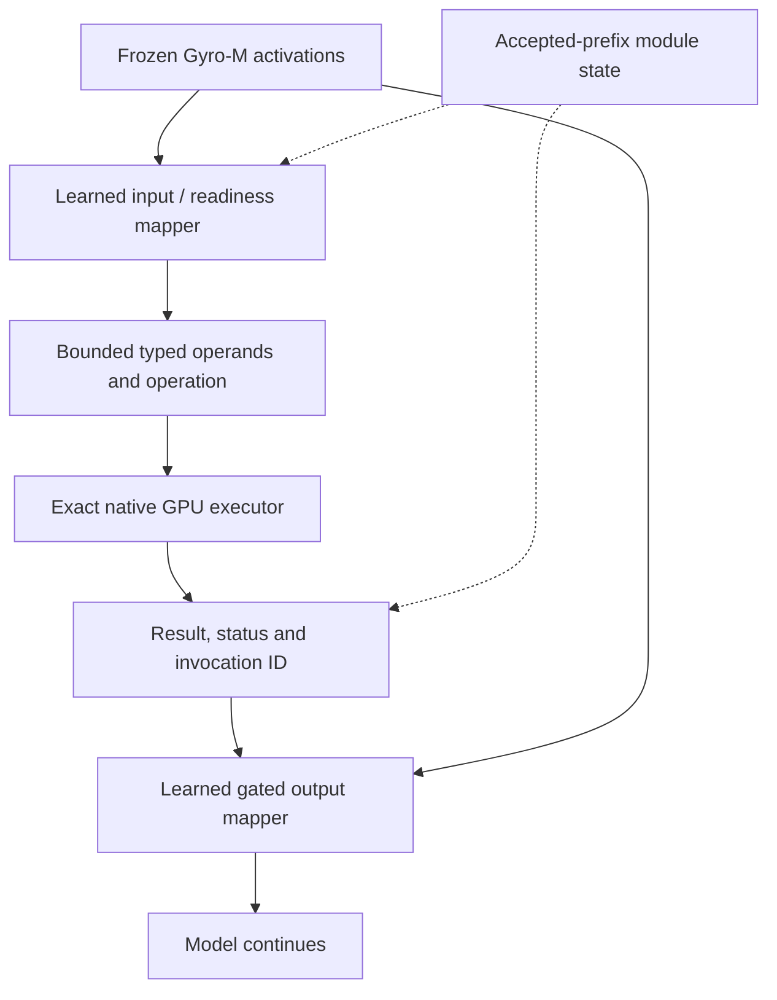
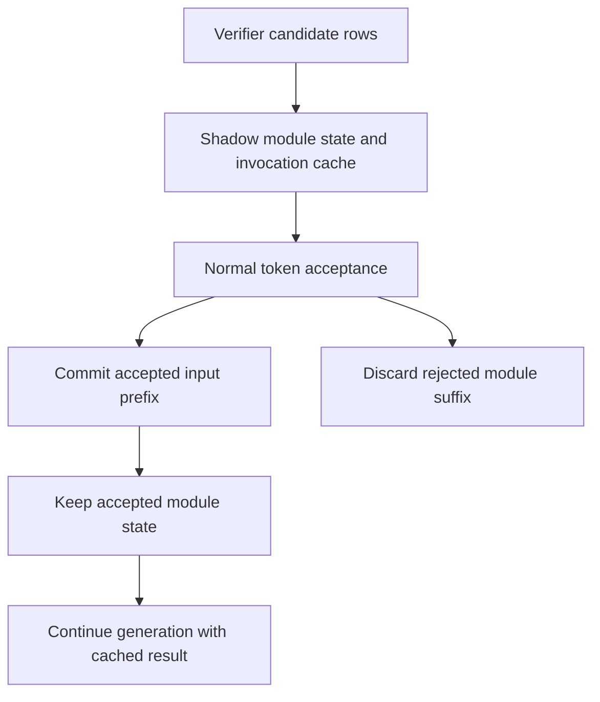

# PRD R10: IGC เป็นทางหลักของการคำนวณภายใน Strata

Tracker: [#276](https://github.com/xenodeve/Strata-xeno/issues/276)
สถานะ: R10 หลังผู้ใช้เปลี่ยน priority วันที่ 29 ตุลาคม 2026; I0 feasibility กำลังทำ

## Problem Statement

ระหว่างตั้งสมมุติฐานและตรวจ logic โมเดลควรใช้ผล execute จริงแทนการทำนายผลการทดลอง
แล้วนำผลที่กระชับไปคิดต่อได้ ลดความผิดพลาด เวลาวนแก้โจทย์ และต้นทุนข้อความที่ไม่จำเป็น

เป้าหมายเดิมยังอยู่ครบ: internal sandbox สำหรับ hypothesis/logic/debug, ผล math/code ที่ตรวจแล้ว,
reasoning tokens และ incremental prefill ที่ลดลง, context ที่โตช้าลง, external tools และข้อมูล
ที่ไม่จำเป็นน้อยลง, งานสำเร็จต่อ token มากขึ้น และเวลาถึงคำตอบที่ถูกลดลง รวมทั้งความสามารถ
จาก upstream, งาน geometry/3D, model-accessible memory และการ optimize/offload จนใช้จริงได้
เริ่มจาก Native บน Gyro-M แล้วจึงขยาย Universal รายละเอียด goal ledger ใน repo คือ
`docs/plans/2026-10-28-qwenputer-capability-roadmap.md` เป้าหมายทั้งหมดข้างต้นมีผลใน PRD นี้

| เป้าหมายที่ต้องรักษา | การตรวจที่ต้องมี |
|---|---|
| Hypothesis/logic/debug sandbox | สร้างการทดลอง ดู assertions/counterexamples แบบกระชับ แก้และรันใหม่; ตรวจ bug fix ด้วย held-out tests |
| Math และ multi-step outcomes | แยกการเลือกสูตร/operands, exact execution และการตีความผล ไม่ใช้ forced invocation แทน spontaneous use |
| Tokens/context/tools/เวลา | วัด reasoning และ total tokens, invocation syntax, feedback prefill, retained context, calls และเวลาต่อ task ที่สำเร็จ |
| Cached debugging loop | เก็บ canonical source/prefix identity อ่าน source ครั้งเดียวเมื่อ cache ยังถูกต้อง; edits ต้อง invalidate; external baseline ใช้ cache ตามปกติ |
| ข้อมูลกลับที่จำเป็น | ส่ง value, failed assertion, expected/actual หรือ minimal counterexample; เก็บ bounded detail สำหรับการตรวจเพิ่ม |
| ความเชื่อถือได้ | แยก observed result, selected tests และ bounded proof; ตรวจ final-answer consistency และ unsupported verification claims |
| Geometry/3D | vectors/matrices/transforms/clearance และ Three.js scene repair; แยก AABB/OBB broad phase จาก mesh intersection พร้อม tolerance/oracle |
| Upstream capabilities | ทำ ledger ของสิ่งที่มีจริง/standalone/experimental รวม programmable execution และ model-accessible store; snapshots ไม่แทน filesystem |
| Optimization/residency | แยก immutable weights, active state, scratch, shadow/cache และ cold snapshots; ทดลอง resident/on-demand/tiered support พร้อม cold/warm/tail และ expert hits |
| Quantization hypothesis | เทียบ Gyro-M เดิมกับ IGC เป็น ablation หลัก; เทียบ higher-precision same-base เมื่อมีอยู่และใช้งานได้จริง โดยไม่ดาวน์โหลดเพิ่มเอง |
| Practical rollout | Correctness/quality, ordinary latency, resources, startup, cancellation และ repeated sessions ต้องผ่าน; trade-off เป็น opt-in |

## Solution

ใช้แนวคิด IGC เป็นทางหลัก: learned input/readiness mapper อ่าน activations แล้วส่ง operation
และ operands แบบ typed ให้ exact executor ภายใน engine ผลคำนวณส่งกลับผ่าน gated output
mapper เพื่อให้โมเดลตอบหรือทดลองต่อ โดยไม่มีข้อความเรียก tool คั่นกลาง

เก็บ compiled-Qwenputer เป็นทางรองสำหรับเทียบ semantics, state, คุณภาพและ latency
P0–P3 ผ่าน gates เดิม P4 มี autonomous exactness/lifecycle evidence แต่ WHILE instrumentation
ยังเปิดอยู่ P5 มี state/grammar/transaction components แล้ว ยังไม่ใช่ real-model integration
checkpoint ล่าสุดขององค์ประกอบที่ตรวจแล้วคือ `8bdad772` ไม่เดินงาน P5–P8 ขนาดใหญ่ก่อน IGC

แผนดำเนินงานใน repo คือ `docs/plans/2026-10-29-igc-experimental-adaptation.md`
milestone แรกพิสูจน์ input/output training seam กับ Gyro-M ที่ใช้งานจริง โดยเฉพาะ forward fidelity
และ gradient ของ output mapper ก่อนเริ่ม training ขนาดใหญ่

## User Stories

1. ได้คำตอบ math ที่อิงผล execute จริงในขอบเขตที่รองรับ
2. ใช้ความสามารถภายในโดยลด external tool calls
3. โมเดลนำผลไปคิด แก้สมมุติฐาน และทดลองซ้ำได้
4. Hard feature-off รักษาพฤติกรรมและ raw tokens เดิม
5. ทราบ overhead ของงานทั่วไปแยกจากงานคำนวณ
6. ใช้ offload VRAM/RAM/NVMe ของโมเดลต่อได้
7. เห็นสถานะ computing/return/error เมื่อเริ่มขั้นนั้น
8. Refresh แล้วเห็นงานและสถานะที่กำลังทำต่อได้
9. API เก็บ internal computation ไว้ภายใน
10. External tools เดิมยังทำงานตามปกติ
11. ประวัติ ข้อความอ้างอิง และ code examples ไม่สั่ง execute เอง
12. Input เกินขอบเขตหรือกำกวมถูกปฏิเสธอย่างชัดเจน
13. Cancel/limit ไม่เผยแพร่ตัวเลขบางส่วนเป็นคำตอบที่ตรวจแล้ว
14. แยก result, refusal, unknown และ engine fault ได้
15. เรียกซ้ำโดย invocation/state ไม่ปะปนกัน
16. Prefix reuse และ conversation switching ใช้ module state ที่ตรงกัน
17. Save/restore ตรวจ identity และปฏิเสธ partial/incompatible state
18. Adapter/ABI ผูกกับ model/tokenizer/layer/normalization ที่ถูกต้อง
19. Artifact ผิดรูปแบบถูกปฏิเสธก่อน allocation/upload
20. งาน GPU มีขอบเขตและยกเลิกได้โดยไม่เปลี่ยน TDR/security
21. ทราบ startup/peak RAM/VRAM และผลต่อ expert cache บน hub จริง
22. มี independent oracles และ ownership/gradient/fidelity tests
23. เห็นคุณภาพและเวลาแบบ matched comparisons ก่อน rollout
24. มีสัญญา Native ที่ขยาย Universal ได้โดยไม่ลดมาตรฐาน

## Implementation Decisions

### สิ่งที่ผู้ใช้เลือกแล้ว

- IGC-inspired latent proxy และ native software executor เป็นทางหลัก
- compiled FFN/GDN Qwenputer เป็นทางรองและเก็บผลเดิมไว้ครบ
- Native ก่อน Universal; Gyro-M 262K / 5 workers และ settings ตาม hub เป็น baseline
- Optimize ต่อจนใช้จริงได้ ถ้าต้องเพิ่ม support ใน Strata ก็ทำใน scope นี้
- ผลดีที่มี trade-off คงเป็น opt-in ผลดีที่ไม่พบ trade-off ต้องผ่าน coverage/ABBA ก่อน default

### สัญญาของทางหลัก

- Record มี operation/domain/sign/length/digits หรือ limbs, invocation ID และ logical position
  ไม่รับ arbitrary pointers/code ผลมี status และ provenance ชัดเจน
- Arithmetic ใช้ checked exact integers/rationals ตาม ABI ไม่ใช้ int64/FP32 แทนขอบเขต 62 digits
  ส่วนที่ยังไม่รองรับต้องแสดงสถานะ ไม่ clamp, wrap หรือเปลี่ยนไปใช้ host calculator
- Learned mapping กับ arithmetic ตรวจแยกกัน Operand tuples ที่ mapper เลือกต้องมี held-out gate
- Input/routing heads ฝึกจาก activations ของโมเดลจริงได้ ส่วน output mapper ต้องพิสูจน์
  differentiable path ผ่าน frozen computation ที่ใช้จริงหรือระบุ surrogate/STE เป็นอีก experiment
- เก็บ selected/projected activation state ภายใน budget ไม่เพิ่ม full 262K hidden cache โดยไม่วัด
- Invocation คำนวณและ commit ครั้งเดียวต่อ accepted event ผลที่ cache ไว้อาจถูกอ่านโดย output
  mapper หลายตำแหน่งได้ แต่แต่ละตำแหน่งต้องไม่รับ delta ซ้ำ Rejected rows ทิ้ง state ของตัวเอง
- Native operation ไม่ขยับ language positions/RNG/penalties เพิ่มเอง Output injection เป็นส่วนหนึ่ง
  ของ normal forward ที่ตั้งใจให้เปลี่ยน activations จึงตรวจด้วย enabled semantics และ off parity
- Prefix/source edits ทำให้ cache ที่อ้างอิง prefix เก่าใช้ต่อไม่ได้ Session identity รวม adapter,
  numeric ABI, source model/tokenizer และ layout ไม่ serialize graph handles

### ลำดับความสำคัญและการแทนข้อกำหนดเดิม

R10 แทนสถาปัตยกรรมและ priority ของ R9/R2 เฉพาะทางหลัก ข้อบังคับว่าต้องคำนวณด้วย compiled
FFN/GDN, ใช้ WHILE trace, ใช้ STQPUT01 และคืนผลด้วย Text replay ใช้กับทางรองเท่านั้น
ทางหลักใช้ adapter/typed ABI และ latent output mapping ของตนเอง

ข้อกำหนดด้าน exactness, bounded execution, accepted-prefix state, identity, isolation,
history/session, status, ordinary-tool compatibility, disabled parity และ measured rollout ยังมีผล
ต้องปรับวิธีตรวจให้ตรง representation ใหม่ ไม่ตัด gate ออกหรือเปลี่ยนชื่อผลเก่าเป็นผลของ IGC
[R2 reference](https://github.com/xenodeve/Strata-xeno/issues/276#issuecomment-6479163682)
คงอยู่บน tracker ส่วน R9 ใน repo คือ `docs/plans/2026-10-28-native-qwenputer-prd.md`
เก็บไว้เพื่ออ่านประวัติและเทียบผล ไฟล์ใน repo ที่ยังไม่ push ไม่ใช่แหล่งอ้างอิงที่ต้องเปิดได้เพื่ออ่าน PRD นี้

## Testing Decisions

| Gate | หลักฐานที่ต้องมี |
|---|---|
| G0 | Native activation capture/replay ตรงกัน และมี training/gradient seam ที่พิสูจน์ได้ |
| G1 | Adapter/typed ABI version, reproducible identities, bounded loader และ source/license provenance |
| G2 | Exact arithmetic เทียบ independent oracle; tuple accuracy แยกจาก result accuracy |
| G3 | Accepted/rejected rows, repeated triggers, MTP/suffix, cache positions และ delta ไม่ซ้ำ |
| G4 | Cached/cold history, สลับบทสนทนา, restore mismatch/partial failure และ source invalidation |
| G5 | Malformed/range/confidence/unknown/fault/cancel แยกกัน; ไม่อ้าง verified answer โดยไม่มีหลักฐาน |
| G6 | Same-session greedy raw-token parity ของ hard-off; off ไม่มี module allocation หรือ injection |
| G7 | CUDA จริง; full D2x builds `89;120`; backend ที่ยัง build/run ไม่ได้ระบุเป็น debt |
| G8 | Timeline ก่อน, profiler-off ABBA, same-run counters, memory/expert hits, quality/tokens และ latency |
| G9 | Practical-use coverage, stability/cancel และ rollout ตาม trade-off policy |

Controls มี base/off, adapter-only, oracle operands, learned operands, token-result bridge,
full latent path, compiled-Qwenputer และ external tools ที่ใช้ valid prefix caching ตามปกติ
ตรึง corpus/seeds ก่อน held-out tests ตรวจภาษาไทย, distractors, quoted arithmetic,
unsupported tasks และ final-answer/execution consistency ไม่ยืนยัน learned integration จาก typed tests

## Phases

I0 training/forward feasibility → I1 checked typed executor → I2 input/readiness mapper →
I3 output mapper → I4 repeated committed triggers → I5 matched practical-use evaluation

I0 ต้องจับ native activations/logits จาก Gyro-M จริงและรัน head ซ้ำให้ตรงก่อนใช้ฝึก
จากนั้นพิสูจน์ gradient path ของตำแหน่งที่เสนอ แยก early injection ที่ต้อง backward ผ่าน
frozen suffix ออกจาก late head-input หรือ surrogate variant ที่ต้องใช้ชื่อและ controls ของตนเอง
ไม่เริ่ม training ขนาดใหญ่จากการคาดว่า freeze แล้วไม่ต้อง backward

I1a เริ่ม signed integer add/subtract/multiply แบบ checked 62 digits I1b เพิ่ม rational,
floor/modulo, gcd, powers และ decimal contracts ทั้ง I1 ยังไม่ปิดจนสิ่งที่ประกาศรองรับมี
independent oracle tests ครบ Unsupported/overflow ต้องชัดเจน ไม่ใช้ int64/FP32 แทน scope นี้

I2 ฝึก input/readiness heads ด้วย cached activations จริงที่ตรึง identity/splits/seeds
I3 ต้องแสดง output-mapper training และผลกับโมเดลจริง ส่วน I4 เพิ่ม repeated model-selected
triggers และ accepted-state rollback จากฐาน fixed-anchor ที่ตรวจแล้ว I5 ตรวจคุณภาพและ latency
ครบ workload ตาม hub รวม sandbox/code/geometry milestones ที่ประกาศเพิ่มภายหลัง

## Out of Scope for the First Milestone

I0 ยังไม่เปิด default, deploy, train base weights, ดาวน์โหลดโมเดล หรือ install training stack
ไม่รัน training ที่ไม่กำหนดขอบเขต และไม่เพิ่ม external-host fallback ให้ arithmetic path
เป้าหมาย sandbox/code/geometry/memory ยังอยู่ใน roadmap ไม่ถือว่า calculator หนึ่งตัวทำครบแล้ว

## Further Notes

Paper/method ได้อ่านแล้ว ยังไม่พบ released implementation จากต้นฉบับ จึงเขียนเองพร้อม attribution
ใน Python ของ task มี CPU-only PyTorch; inventory ไม่ใช่หลักฐานว่าไม่มี framework อื่นทั้งเครื่อง
Head ของ Gyro-M จริงเป็น Q8_0 และใช้ Q8_1 activation quantization ดังนั้น gradient/forward
fidelity ต้องตรวจตรงจุดนี้ด้วย ไม่สรุปจากชื่อ TQ2_T ของ experts

การเก็บ residual ครบ 262K × 4 HC streams × 2560 ใช้ 5 GiB ถ้าเป็น BF16 หรือ 10 GiB
ถ้าเป็น F32 ตามการคำนวณขนาด ยังไม่ใช่ peak ที่วัดจริง ต้องกำหนด selected/projected cache
จากหลักฐานและตรวจ fidelity ก่อนลด precision ไม่เพิ่ม full hidden cache โดยไม่คิดต้นทุน

## หลักฐานเดิมที่เก็บไว้เป็นทางรอง

Commits ในตารางเป็น local checkpoints ที่ยังไม่ push ไม่ใช่ผลของ learned IGC

| งาน | หลักฐาน | Checkpoint |
|---|---|---|
| P0 | baseline/conditional-graph probe และ startup smoke; แยก cap diagnostics ออกจาก hub | `7d49c8c0` |
| P1 | reproducible 18,298,944-byte artifact; 263,254,200 feature comparisons; offline oracles | `50ca54cb` |
| P2 | CPU loader, identity/bounds/mutant controls และ exact feature lowering | `f057540d` |
| P3 | native FFN/GDN supplied-trace replay 79 cases / 74,704 steps | `938065e4` |
| P4 | autonomous held-out 64/64 สองรอบ; WHILE instrumentation ยังเปิดอยู่ | `10d848eb` |
| P5 components | state/grammar/accepted-prefix/result-replay controls; fake language callback | `01f15c1a`, `8bdad772` |

ยังไม่มี learned IGC หรือ real-model compiled-Qwenputer integration ที่ผ่านการตรวจ
ผล standalone `17*23 = 391` และ state rollback ไม่ใช้แทนหลักฐานเหล่านั้น
Generated compiled artifacts ยังมี distribution hold เรื่อง linked-runtime notices

## Research source

[IGC v1](https://arxiv.org/html/2501.00684v1) ใช้ frozen base model, supervised input mapping
และ output mapping ผ่าน LM loss พร้อม calculator ที่ไม่ส่ง gradient กลับ Paper ทดสอบ
หนึ่ง invocation ต่อ sample ที่ fixed anchor; repeated reasoning triggers เป็นงานเพิ่มของ Strata
Appendix B ยังเป็นข้อความว่าจะปล่อย code ภายหลัง ไม่พบ official runnable implementation
หรือ checkpoint จากต้นฉบับที่อ่าน License CC-BY 4.0 ของ paper ไม่ใช่ software license
งานนี้จึงเป็น independent adaptation พร้อม attribution

English specification — full requirement mirror

## Problem Statement

The model should replace prediction-based evaluation of hypotheses with actual internal
execution and use compact results to revise and test again. All goals remain: an internal
hypothesis/logic/debug sandbox; verified math/code outcomes; fewer reasoning and feedback-prefill
tokens; slower retained-context growth; fewer external tools and irrelevant feedback; more
successful tasks per token; and less time to correct results. Upstream capability adaptation,
geometry/3D, model-accessible memory and practical optimization/offload also remain goals.
Native Gyro-M comes first, then Universal. Calculator success alone does not complete them.

## Solution and Priority

IGC-inspired trained activation mapping plus an exact in-engine executor is primary. A learned
input/readiness mapper produces bounded typed operations/operands. A learned gated output mapper
returns the result through activations, without intermediate textual tool-call serialization.
Compiled Qwenputer is secondary and retains its own identities/evidence. Do not advance major
compiled-only P5–P8 work ahead of primary IGC feasibility. Shared identity, transaction, isolation
and measurement components remain reusable. The local plan is
`docs/plans/2026-10-29-igc-experimental-adaptation.md`; the normative requirements are included here
so unpushed companion files are not required to understand this issue.

## User Stories

1. Obtain exact execution-backed arithmetic within supported domains.
2. Use internal computation with fewer external tool calls.
3. Revise hypotheses and run repeated experiments using the results.
4. Preserve behavior and raw tokens with a hard feature-off bypass.
5. See ordinary-task overhead separately from computation time.
6. Preserve model VRAM/RAM/NVMe offloading.
7. See computing/return/error status when the relevant stage begins.
8. Recover the current running answer/status after refresh.
9. Keep internal computation inside the API boundary.
10. Preserve ordinary external-tool behavior.
11. Prevent history, quotations and code examples from independently authorizing execution.
12. Explicitly refuse ambiguous, malformed or oversized inputs.
13. Never publish a partial number as verified success after cancellation or a limit.
14. Distinguish results, refusals, unknowns and engine faults.
15. Isolate repeated invocations and their state.
16. Keep module state coherent across prefix reuse and conversation switches.
17. Verify saved identities and reject partial/incompatible restores.
18. Bind adapters/ABI to the actual model, tokenizer, layer and normalization.
19. Refuse malformed artifacts before allocation/upload.
20. Bound and cancel GPU work without TDR/security changes.
21. Measure startup/peak RAM/VRAM and expert-cache effects on the actual hub.
22. Use independent arithmetic oracles and ownership/gradient/fidelity tests.
23. Compare matched quality and latency before rollout.
24. Preserve a Native contract that can later extend to Universal.

## Implementation Decisions

The user selected IGC as primary, compiled Qwenputer as secondary, and Native before Universal.
Use the actual Gyro-M 262K/five-worker hub settings and continue practical optimization, adding
necessary Strata support within scope. Measured wins with costs remain opt-in; default activation
requires adequate no-tradeoff coverage and the standing paired-measurement gates.

Typed records carry version, invocation ID, logical position, operation/domain, signs, lengths
and bounded digits/limbs. They contain no arbitrary pointers/code. Results carry explicit status
and provenance. Arithmetic uses checked exact integer/rational semantics; int64/FP32 cannot
silently replace the 62-digit scope. Unsupported/range errors must not clamp, wrap or invoke a
host calculator automatically. Mapper tuple selection and arithmetic exactness are separate gates.

Train input/routing heads from real deployed-model activations. An output mapper requires a
demonstrated differentiable path through the actual frozen computation, or an explicitly named
STE/surrogate experiment. Do not claim that freezing weights removes backward computation or that
generic QLoRA supports TQ2_T. Use a budgeted selected/projected state cache rather than retaining
every 262K hidden vector without measuring its cost.

Calculate and commit each invocation once per accepted event. A cached result may condition
multiple output positions, but a position must not receive the same delta twice. Discard rejected
row state. Native operations do not advance extra language positions, RNG or penalties. Output
injection intentionally changes normal forward activations; validate enabled semantics and hard-off
parity accordingly. Invalidate module caches after source/prefix edits. Session identity includes
adapter, ABI, model/tokenizer and layout. Do not serialize graph handles.

## Precedence over R9/R2

R10 supersedes primary architecture and priority. Mandatory compiled FFN/GDN arithmetic,
conditional WHILE traces, STQPUT01 and textual result replay now apply only to secondary Qwenputer.
Primary IGC has its own adapter/typed ABI and latent output mapping. Retain exactness, bounded
execution, accepted-prefix transactions, identity/isolation, history/session integrity, status,
ordinary-tool compatibility, hard-off parity and measured rollout. Adapt the tests to the new
representation; do not delete gates or relabel historical results. The
[existing R2 companion](https://github.com/xenodeve/Strata-xeno/issues/276#issuecomment-6479163682)
remains available for secondary contracts. R9 is preserved locally with an explicit supersession
banner. The local capability ledger retains the full goal set summarized above.

## Acceptance Gates

| ID | Required evidence |
|---|---|
| G0 | Real-Gyro activation capture/native forward replay and a demonstrated declared training/gradient seam |
| G1 | Versioned/reproducible adapter and typed ABI identities; bounded loader; source/license provenance |
| G2 | Independent exact arithmetic oracles; operand/operator tuple accuracy separate from final outcomes |
| G3 | Accepted/rejected rows, repeated triggers, MTP/suffix, cache positions and no duplicate deltas |
| G4 | Cached/cold history, conversation switches, restore mismatch/partial failure and source invalidation |
| G5 | Distinct malformed/range/confidence/unknown/fault/cancel outcomes; no unsupported verification claims |
| G6 | Same-session greedy raw-token hard-off parity, with no module allocation or injection when off |
| G7 | Real CUDA validation, full D2x `89;120` builds and explicit unavailable-backend validation debt |
| G8 | Timeline first; profiler-off ABBA; same-run counters; memory/expert hits; quality/token/latency ledger |
| G9 | Practical-use coverage, stability/cancellation and the tradeoff-based rollout policy |

Controls include base/off, adapter-only, oracle operands, learned operands, a token-result bridge,
full latent mapping, secondary compiled Qwenputer and external tools with normal valid prefix
caching. Freeze datasets/seeds before held-out evaluation. Include Thai, distractors, quoted
arithmetic, unsupported tasks and final-answer/execution consistency. Typed-kernel or token-feature
tests do not establish learned activation integration.

The complete goal ledger additionally requires: hypothesis/logic/debug experiments with compact
assertions/counterexamples and held-out-test-verified fixes; separate formulation, execution and
interpretation on multi-step math; spontaneous capability use; reasoning/total/invocation tokens,
feedback prefill, retained context, calls and latency per successfully solved task. Reuse valid
canonical source/prefix caches, invalidate after edits and give external-tool baselines their normal
caching. Return minimal useful evidence with bounded extra detail, not entire traces.

Distinguish observed execution, selected-test success and explicitly bounded proof. Test final-answer
consistency and unsupported verification claims. Geometry includes vectors/matrices/transforms,
clearance and Three.js scene repairs, with independent tolerances/oracles and AABB/OBB broad phase
separate from mesh intersection. Maintain a maturity ledger for real/standalone/experimental upstream
capabilities, programmable execution and model-accessible storage; session snapshots are not a
filesystem. Investigate resident/on-demand/tiered immutable weights separately from active state,
scratch, shadow/cache and cold snapshots, measuring cold/warm/tail costs and expert hits. Primary
quantization ablation is the same Gyro-M with/without IGC; higher-precision same-base comparison is
conditional on existing feasible inputs, not permission for downloads. Practical rollout requires
quality, ordinary-task latency, resources, startup, cancellation and repeated-session evidence.

## Phases and First Milestone

I0 proves training/forward feasibility. Capture actual native activations/logits and replay the
head before using the seam for training. Demonstrate the proposed backward path; distinguish early
injection through a frozen suffix from late head-input or supervised/STE alternatives. Each variant
needs its own name and controls. Do not launch large training based on an assumed gradient path.

I1a introduces checked signed integer add/subtract/multiply with operands up to 62 digits. I1b adds
rational, floor/modulo, gcd, powers and decimal contracts. I1 stays open until every declared domain
has independent exact tests and explicit unsupported/overflow behavior. I2 trains input/readiness
heads from identity-bound real activations with frozen splits/seeds. I3 trains and evaluates the
output mapper on the real model. I4 extends the validated fixed anchor to repeated model-selected,
committed triggers and rollback. I5 performs matched practical-use evaluation and the declared
sandbox/code/geometry milestones. I1/preparatory I2 work cannot be counted as passing I3.

## Scope and Current Feasibility

The first milestone does not enable defaults, deploy, train base weights, download models, install
a training stack or start unbounded training. No automatic external-host arithmetic fallback is
introduced. The task Python currently has CPU-only PyTorch; this is an inventory of that environment,
not a claim about every environment on the PC. Actual Gyro head weights are Q8_0 and native input
activation quantization is Q8_1. Verify that seam rather than inferring it from TQ2_T expert weights.

A complete 262K × four-HC-stream × 2560 cache would occupy 5 GiB in BF16 or 10 GiB in F32, calculated
storage rather than a measured peak, before other allocations. Budget selected/projected caches;
precision reduction requires fidelity evidence. The goals extend beyond one calculator to internal
sandbox, coding/debug, geometry and memory, with separate declared acceptance experiments.

## Preserved Secondary Evidence

The following are local unpushed checkpoints, not learned-IGC results: P0 baseline/probe/startup
`7d49c8c0`; P1 reproducible 18,298,944-byte artifact and 263,254,200 feature comparisons `50ca54cb`;
P2 CPU validation/feature controls `f057540d`; P3 supplied-trace native replay of 79 cases/74,704 steps
`938065e4`; P4 autonomous held-out 64/64 twice `10d848eb`; and P5 state/grammar/transaction components
with a fake language callback `01f15c1a`, `8bdad772`. P4 WHILE instrumentation remains open.
Standalone `17*23 = 391` and rollback tests do not establish model integration. Generated compiled
artifacts retain their linked-runtime-notice distribution hold. No learned IGC or real-model
compiled-Qwenputer integration is claimed as validated.

## Research Attribution

This is an independent adaptation of [IGC v1](https://arxiv.org/html/2501.00684v1).
The source uses supervised input mapping and LM-loss output mapping around a non-differentiable
calculator with a frozen base. It evaluates one invocation at a fixed anchor per sample; repeated
reasoning triggers are additional Strata work. Appendix B still promises future code release;
no official runnable implementation/checkpoint was verified. Paper CC-BY 4.0 is not a software license.

