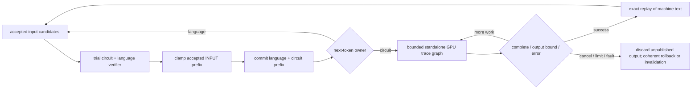

> **Current priority (R10, 2026-10-29):** IGC is primary; compiled Qwenputer is secondary. Continue the [IGC primary plan](../../plans/2026-10-29-igc-experimental-adaptation.md), beginning with real-Gyro adapter training/forward/gradient feasibility. Preserve local checkpoints; do not advance major compiled-only P5-P8 ahead of the new path. Shared input binding/state/measurement components remain reusable. The user explicitly authorized the R10 architecture body update; use the normal issue tool and honor any mandatory form. Phase reports remain comments, with their earlier approval blocker tracked separately.

> Current execution authority: user authorized P1-P8 end-to-end under /t4-afk and the pinned compiler/calc firmware digest for local export/oracles/bounded Native tests. Earlier P0-only stops below are historical. PRD R9 adds the capability/residency roadmap and latest G9 conditional hub-default policy; do not restart completed planning or change baseline.

> R6 evidence update: startup/inference component smoke succeeds on unchanged main with the explicitly authorized diagnostic removal of the task's private-commit cap. Job readback confirms no process/job memory cap; system safety, timeout and process-tree cleanup remain. This is not a change to the repository's 42 GB budget policy. Actual private commit exceeds that budget. No served/model/cache settings were changed, and P1+ remains outside this debugging scope. Local public-safe R6 is prepared; GitHub still holds R4 and the earlier R5 Submit form is pending. Do not bypass or duplicate that write.

> P0 diagnosis update: keep the unchanged main baseline e5737a27. A bounded startup reproduction hit the test-owned 42 GB process guard (matching Windows limit event and near-limit job peak); this does not rule out Gyro inference on main. The source-base switch remains unapproved and is not a remedy established by this failure. Memory fit, actual inference, parity and performance gates remain open. Original GlobalMemoryStatusEx-derived system_commit samples are historical/non-authoritative; corrected GetPerformanceInfo telemetry and job-event evidence are retained separately. No guard, served setting or production behavior was changed.

# Native Qwenputer Implementation Plan

> Local R3 amendment, 2026-10-28: use Gyro-M for model-dependent validation. The actual GGUF exists (91,965,774,272 bytes), metadata qwen4exp / 48 layers / hidden 2560 / 512 experts, routed TQ2_T tensors. The user selected strata-gyro-m-d2x.json:262K context,5 workers. The512K YaRN profile is not this test baseline. Do not restore Swift for this baseline. Preserve current served configuration; pin chosen inputs before model tests. The user subsequently authorized public-safe PRD synchronization; R4 was synchronized to issue #276; later revisions remain local while the Submit form is pending. Detailed local evidence remains private; no library upload or repository push is authorized. All Native, numerical, state and offload contracts below remain in force.

> **For agentic workers:** REQUIRED SUB-SKILL: Use superpowers:executing-plans to implement this plan task-by-task. Steps use checkbox (`- [ ]`) syntax for tracking. The parent reviews each evidence checkpoint before work proceeds. P0 diagnostics are authorized; do not advance to P1 or production integration without the next review gate.

**Goal:** เพิ่มวงจร FFN/GDN จริงภายใน decoder ของ Qwen3.8 Flash-Next ให้ GPU หลักควบคุม bounded trace และคืนผลให้โมเดลใช้ต่อ พร้อมหลักฐาน correctness, memory และ latency บนเครื่องจริง

**Architecture:** ใช้ C++/CUDA sparse executor บน primary GPU และเก็บ circuit weights เป็น artifact แยก ใช้ standalone top-level conditional WHILE graph พร้อม state แยกต่อ session ผูก ownership กับ consumed/accepted input prefix ของ verifier โดย trace ไม่เปลี่ยน language state และไม่มี host calculator/emulator ตอบคำขอจริง

**Tech Stack:** C++ เดิมของ Strata, CUDA 13.3/MSVC 14.44 ที่ตรวจพบ, Python 3.11/NumPy สำหรับ offline compiler adapter กับ test-only oracles, Python serving และ TypeScript UI tests

**Spec:** [Native Qwenputer PRD](../../plans/2026-10-28-native-qwenputer-prd.md)

**Status:** P0, P1 offline export/oracles, P2 CPU-loader and P3 NVIDIA CUDA-step gates passed. P4 bounded free-running execution is underway: development79 and frozen held-out64 pass. WHILE instrumentation has an isolated toolchain limitation; final limit/resource checks are running. Model integration and performance gates remain open.
**Revision:** R2 หลัง parent review: ขัดเกลาภาษา, ยืนยัน D2x compatibility, เพิ่ม policy references, dual-architecture build และ numerical/measurement gates
**Baseline:** `e5737a27f485773a7ce22784fef6af7b480dcc9a`
**Upstream pin:** `ca13310e2f9f788d1dd3feeea8213c1b0c23913c`
**Tracking:** PRD R2 เผยแพร่และตรวจกลับที่ #276 แล้ว ฉบับ public-safe R6 เตรียมในเครื่องแล้ว แต่ issue ยังเป็น R4 และรอ Submit ของ R5 ห้ามอ้างว่า sync ฉบับใหม่แล้ว รายงานและ inventory ในเครื่องยังเป็นข้อมูลส่วนตัว

## Global Constraints

- ทำ Native สำหรับ existing Qwen3.8 Flash-Next D2x ก่อน ส่วน Universal อยู่ระยะถัดไป
- ผลคำนวณจริงต้องมาจาก compiled sparse FFN/GDN เท่านั้น ส่วน compiler/IR/RISC-V emulator/Python arithmetic ใช้ offline หรือใน tests
- ใช้ primary RTX 5060 Ti และคง GPU/RAM/NVMe offload mechanism เดิม
- display RTX 4070 SUPER ต้องคง headroom รวม 2.5 GB ตาม [AGENTS.md:323-324](../../../AGENTS.md#L323) ซึ่งรวมการใช้ของ desktop อยู่แล้ว ค่านี้เป็นข้อกำหนดเดิมของ repo ไม่ใช่ตัวเลขใหม่ที่แผนเสนอ
- Full D2x unchanged baseline และ candidate ต้อง build ด้วย `-DCMAKE_CUDA_ARCHITECTURES="89;120"` หรือ target-specific equivalent ที่ตรวจว่ามี code ครบทั้งสอง GPU แล้ว มีเพียง isolated primary-only probe/executor ที่ใช้ 120-only ได้ ก่อน ABBA ต้องตรวจ binary coverage และ smoke secondary expert tier จริง
- งบ private commit 42 GB มาจาก [AGENTS.md:295-299](../../../AGENTS.md#L295) ต้องรายงานทั้ง baseline, delta และ peak หาก baseline เกินอยู่แล้วต้องระบุชัด ห้ามลด context หรือเปลี่ยน profile แทนผู้ใช้
- Feature เป็น opt-in เมื่อปิดต้องไม่โหลด artifact, reserve circuit VRAM, เพิ่ม graph nodes, แก้ prompt หรือเปลี่ยน default protocol/snapshot bytes
- Conditional trace graph เป็น top-level และ single-device ต้อง initialize condition ทุก launch ภายใน body ไม่มี host callbacks, allocation/free, CDP หรือ device-graph launch ห้าม clone graph นี้หรือใช้เป็น child ของ verifier graph
- แต่ละ chunk มี finite step/output bound การ cancel/fault/limit ต้องไม่เผยแพร่ partial arithmetic ว่าเป็น success และห้ามเปลี่ยน TDR/security settings
- v1 รองรับ D2x แบบ single decoder พร้อม secondary expert tier, MTP และ suffix drafting ข้อห้าม layer-split หมายถึงการแบ่ง decoder layers ไม่ใช่ secondary expert offload หรือ `STRATA_PREFILL_EXPERT_SPLIT`
- Current D2x config ใช้ `--secondary-expert-mib 4100`, `--spec 4`, `STRATA_PREFILL_EXPERT_SPLIT=1` และ `STRATA_PREFILL_WAVE=1` โดยไม่มี `--layer-split`, `--batch`, `--slots` หรือ `--pipeline-windows` จึงอยู่ในเส้นทางที่ v1 ต้องรองรับ
- Feature-on ที่ใช้ decoder layer-split, `--batch`/`--slots` หรือ `--pipeline-windows > 0` ต้องถูกปฏิเสธก่อน allocation; feature-off ยังคงรองรับ modes เดิม
- Trace IDs เป็น internal tagged kind ส่วน client IDs ยังคงอยู่ใน vocabulary เดิม ห้าม request ฉีด trace/control IDs
- ใช้ deterministic reductions ห้ามเปิด global fast-math/TF32 หรือ quantize circuit โดยไม่มี exactness gate
- Engine flag, GEN key, snapshot format, protocol หรือ diagnostic ใหม่ต้องอัปเดต docs/BLUEPRINT.md ใน commit เดียวกัน และวางใน “Not yet in the baseline” ตามกฎ repo
- [AGENTS.md:44](../../../AGENTS.md#L44) กำหนดให้ build ทุก backend ที่ไฟล์แตะก่อนขอ code review แผนนี้มี CUDA เป็น execution target แรก; HIP/SYCL checks ที่ทำไม่ได้ต้องบันทึกเป็น validation debt และจัดทางตรวจตามกฎก่อนอ้างว่า implementation พร้อม review การยังไม่รัน checks เหล่านั้นไม่ขัดขวางการ review แผน และไม่ถือว่าผ่านแล้ว
- ทุก A/B/ABBA ใช้ `--pool-priority 2` และ `--process-priority 2`, ปิด profiler และเก็บ same-session counters กับ exe hashes ต้องรอ DONE ก่อนเริ่ม heavy job ถัดไป
- เกณฑ์ noise 13.6% มาจาก [AGENTS.md:320-321](../../../AGENTS.md#L320) นี่เป็น repo heuristic ไม่ใช่เกณฑ์ statistical significance ผลต่ำกว่าเกณฑ์ยังไม่พิสูจน์ เว้นแต่ paired ABBA ซ้ำอย่างสม่ำเสมอ
- ทุก subprocess/background child ใช้ CREATE_NO_WINDOW ห้ามแตะ served profile, launcher, routing trace เดิม หรือบริการอื่น
- ต้องมี approval เฉพาะก่อนรัน third-party source/ELF, ติดตั้ง dependencies หรือดาวน์โหลดโมเดล รอบ planning ยังไม่รันสิ่งเหล่านี้
- ผู้ใช้ต้อง review แผนและจุดเชื่อมต่อก่อน implementation ส่วน tracker publication, push/PR และ deployment ไม่รวมใน phase นี้
- ใช้ Fast สำหรับ non-Astra เมื่อ controls รองรับ ยังตรวจ active tier ไม่ได้ จึงห้ามอ้างว่าเปิดแล้ว

## Review Focus

1. ENTER ที่ input row สุดท้ายหรือ rejected draft: ต้องไม่สับสน consumed input กับ emitted next-token ทดสอบใน P5
2. Native call/result ที่ไม่ปรากฏใน visible API history: next turn ต้อง reuse canonical prefix ที่ยืนยันได้ หรือ cold-read อย่างถูกต้อง ทดสอบใน P6/P7
3. NUL, UTF-8, long BPE token และ capture overflow ที่ upstream อาจตัดเงียบ: ต้อง explicit refusal ไม่มีคำตอบผิด ทดสอบใน P1/P4/P7
4. Restore artifact อื่นหรือ device copy ล้มเหลวครึ่งทาง: ต้อง refuse ก่อน mutation หรือ invalidate ทั้ง context ทดสอบใน P6
5. Relaunch conditional graph และ Windows cancel: condition, pending queue และ epoch ต้องไม่ค้างจากรอบก่อน ทดสอบใน P0/P4

## แผนโดยย่อและจุดหยุด

| Phase | ผลงานที่ตรวจแยกได้ | ต้องผ่านก่อน |
|---|---|---|
| P0 | Source/build/model inventory, real conditional probe และ unchanged baseline | Review แผน |
| P1 | Compiler/tokenizer adapter พร้อม canonical artifact/oracle bundle | P0 และ third-party execution approval |
| P2 | Bounded artifact loader กับ exact feature decoding | P1 |
| P3 | Native deterministic CUDA step | P2 |
| P4 | Bounded device-driven trace runner | P0 capability และ P3 |
| P5 | Verifier/commit/MTP/suffix integration | P4 |
| P6 | Canonical history กับ snapshot identity/restore | P5 |
| P7 | API/internal ownership, live UI และ reconnect | P5/P6 |
| P8 | Full parity/backend gates พร้อม D2x ABBA/report | P0-P7 และ model inputs ที่พร้อม |

หาก conditional probe ใน P0 ไม่ผ่าน ให้หยุดและส่งทางเลือก fixed-count graph chunks ให้ผู้ใช้เลือก ห้ามเปลี่ยน runtime เงียบ ๆ สำหรับ model-dependent runs ให้ใช้ Gyro-M profile 262K/5 workers ที่ผู้ใช้เลือก ไม่กู้ Swift เพื่อ baseline นี้ และไม่ข้าม gate ไป P1

## จุดเชื่อมต่อและ interfaces ที่เสนอ

ชื่อและ signatures ต่อไปนี้เป็นการออกแบบใหม่ ไม่ใช่อ้างว่ามีแล้ว ใช้ namespace `strata::qwenputer` ให้ตรงกันทุก phase

- `bool load_artifact(const std::filesystem::path&, const Binding&, const LoadLimits&, Artifact&, MemoryPlan&, std::string& error)` ทำ CPU validation เท่านั้น ไม่เรียก CUDA และไม่ execute artifact
- `struct Token { TokenKind kind; uint32_t id; };` โดย `TokenKind = Text | Trace` ห้ามใช้ id offset ของ Qwen3.5 แทน kind
- `bool Executor::init(const Artifact&, const RuntimeLimits&, cudaStream_t, std::string& error)`
- `bool Executor::enqueue_step(Token, cudaStream_t, std::string& error)` เป็น diagnostic one-step path สำหรับพิสูจน์ math; production trace ใช้ graph loop
- `bool Runtime::prepare_window(const int32_t* device_text_ids, int count, int64_t pos0, TextMode, cudaStream_t, std::string& error)` เปลี่ยน trial shadow เท่านั้น โดย `TextMode = History | LiveAssistant`
- `WindowDecision Runtime::decision(int normal_keep)` คืน consumed-input keep count กับ takeover-after-row ให้อ่านผลหลัง completion เดียวกับ verifier เมื่อทำได้
- `bool Runtime::commit_window(int consumed_inputs, cudaStream_t, std::string& error)` replay accepted prefix จาก committed base โดย rejected shadow ไม่เข้า state จริง
- `bool Runtime::enqueue_chunk(cudaStream_t, std::string& error)` กับ `ChunkResult Runtime::collect_chunk()` คืน phase, trace steps, pending text และ terminal reason โดยไม่อ่าน host ต่อ instruction
- `bool Runtime::save_quiescent(NativeImage&, std::string& error)` กับ `RestoreResult Runtime::restore(const NativeImage&, std::string& error)`
- `NativeTranscript` ใน server มี `record_fragment(...)`, `expand_verified_history(...)`, `export_metadata(...)` และ `restore_metadata(...)` โดยไม่คำนวณ arithmetic

`RuntimeLimits` มี `max_trace_steps`, `chunk_steps`, `max_output_text_tokens`, `max_metadata_bytes` และ time/cancel policy ที่ตรวจได้ ค่าทดลองต้องระบุใน artifact/command และ log อย่างชัดเจน ห้ามมี implicit unbounded value และยังไม่ตั้ง serving defaults จากตัวเลข upstream ให้ทดสอบ boundary ด้วย limits เล็กที่ระบุแน่นอน แล้วเลือกค่าทดลองจริงจาก P4/P8 พร้อมรายงาน

`MemoryPlan` แยก weights, committed/shadow/init states, history, scratch, FIFO, metadata, graph resources และ transient upload/restore peak โดยใช้ checked uint64 arithmetic



## P0 — Feasibility, provenance และ baseline

**Files:** สร้าง `tests/qwenputer/conditional_probe.cu` และ `tools/qwenputer/preflight.py`; แก้ `CMakeLists.txt` กับ `docs/BLUEPRINT.md`; เขียน report ที่ `docs/reports/2026-10-28-qwenputer-feasibility.md`

**Interfaces:** standalone `qwenputer_conditional_probe --device <uuid-or-resolved-primary> --json <path>`; preflight คืน model-input existence/size/hash manifest โดยไม่เปิด server

- [x] อ่าน PRD กับแผนนี้ และยืนยันขอบเขต/primary seam จาก review เมื่อเริ่ม execution ให้สร้าง isolated worktree ผ่าน using-git-worktrees โดยเก็บ main และ untracked work เดิมไว้ ใช้ build directory ใหม่ ห้าม rebuild baseline directory เดิม
- [x] สร้าง compiling probe fixture พร้อม semantic assertions: while limit 0 ให้ steps=0, limit 1 ให้ steps=1 และ limit 5 ให้ steps=5 การ launch ซ้ำต้อง reset condition เพิ่ม intentional wrong-limit negative control เพื่อให้ test fail จาก observed step count ไม่ใช่ missing binary
- [x] บันทึก CUDA runtime/driver/device UUID, WDDM mode, toolkit และ host compiler จากนั้นทดสอบ create/instantiate/launch/relaunch จริงบน primary ตรวจ cancel/full-output bounds และยืนยันว่า context switch/rebuilt graph ไม่มี stale state
- [x] สร้าง unchanged baseline จาก e5737a27 และ candidate ใน directories ใหม่ด้วย `-DCMAKE_CUDA_ARCHITECTURES="89;120"` พร้อม source/config/toolchain hashes ตรวจ cubin/PTX architecture coverage ตาม target ที่ต้องรันบนแต่ละ GPU และ smoke secondary expert tier จริงก่อน ABBA หาก model inputs ยังไม่พร้อมให้ระบุ smoke ว่า blocked ไม่ใช้ primary-only probe อ้างแทน ตรวจ exe ก่อนและหลังทุก run และเก็บ executable ไว้ immutable ระหว่าง ABBA
- [x] Preflight ตรวจ `--pack`, `--native`, `--ple-gguf`, `--mtp` และ tokenizer ทุก role ของ Gyro-M ที่ผู้ใช้เลือก ตรึง config/model hashes และใช้ profile 262K/5 workers ที่ผู้ใช้เลือกสำหรับ model-dependent runs ไม่ต้อง restore Swift และห้ามแก้ served profile หรือดาวน์โหลดแทนโดยไม่ได้รับอนุญาต
- [x] รัน smoke ผ่าน detached/no-window helper ที่ใส่ CUDA bin และ bin/x64 ใน PATH คืนผล probe และ feasibility report ก่อน P1/P4 หาก unsupported ให้ส่ง native regular-graph chunk fallback ให้ผู้ใช้พิจารณา
- [x] Build ด้วย `cmake --build build-qwenputer --target qwenputer_conditional_probe` ผลตรวจต้องเป็น probe JSON ที่ระบุทุก case พร้อม counts และ exit 0 ห้ามอนุมานว่าผ่านจาก header/version
- [x] สรุป probe/preflight/blueprint ใน commit แยกจาก production feature โดยจัดทำ evidence ก่อน commit และไม่ push

**ผลปิด P0:** ดู [รายการตรวจและหลักฐาน](../../reports/2026-10-28-qwenputer-p0-closeout.md) การ build, probe และ smoke ผ่านแล้ว แต่ยังไม่ได้ทำ ABBA, candidate raw-token parity หรือพิสูจน์ว่า Native circuit จะใช้ทรัพยากรพอ ข้อความเรื่อง immutable executable เป็นข้อกำหนดสำหรับ ABBA ใน P8 ไม่ใช่คำกล่าวว่าได้รัน ABBA แล้ว

**Baseline ตามการใช้งานจริง:** ให้ตรึง hub launcher → server → profile → executable และ dependencies ที่ใช้อยู่จริง พร้อม model, context, workers, cache/offload และ process settings เดิม ห้ามเพิ่ม private-commit cap แล้วเรียกผลนั้นว่า production baseline ผล run03/04 เป็น capped diagnostics ส่วน run05 เป็น component control ของ unchanged main และ run07 ใช้ server/executable ของ hub จริงบน loopback port แยก พร้อม task-only no-window shim หลัง review พบ missing child flag ใน run06 ขอบเขตและความต่างของ wrapper ต้องอยู่ในรายงาน Main ยังเป็น source base ของ Native worktree; ยังไม่ได้ย้าย base หรือแก้ served setup

## P1 — Pinned compiler, tokenizer adapter และ artifact/oracles

**Files:** สร้าง `tools/qwenputer/export.py`, `tools/qwenputer/tokenizer.py`, `tools/qwenputer/oracle.py` และ `tools/test_qwenputer_export.py`; เพิ่ม reviewed subset/pin/notices/patches ใน `third_party/qwenputer/`; เพิ่ม `docs/QWENPUTER_FORMAT.md` และอัปเดต blueprint

**Consumes:** P0 tool/model/tokenizer manifest, approved source pin และ approval เฉพาะสำหรับ compiler/firmware execution
**Produces:** `export_artifact(source_dir, tokenizer_dir, firmware_path, limits, output_dir) -> ExportManifest` พร้อม `manifest.json`, `native.qput`, `oracle.jsonl` และ license/provenance bundle

- [x] ก่อน source execution ขอ approval โดยระบุ exact commit, file/import list, command, expected output directories และ memory/disk estimate ห้ามรัน uv sync/pip/HF download แบบเหมารวม ให้ audit offline dependency closure ก่อนตัดสินใจ install
- [x] เขียน tokenizer tests จาก Strata descriptor/vocab/merges/types จริง ครอบคลุม 248,320 IDs, six observed special IDs จาก metadata, byte tokens ทั้ง 256 ตัว, invalid IDs, long raw bytes, Thai/UTF-8 และ added-token bytes ตรวจ hash ครบไฟล์ที่กำหนด semantics ไม่ hash descriptor อย่างเดียว
- [x] สร้าง compiler-compatible Text adapter ที่ใช้ Strata bytes/encoding จริง ใช้ tokenizers หรือ strata_tokenizer เดิมเฉพาะเมื่อยืนยัน dependency/import ที่จำเป็นแล้ว ห้ามส่ง descriptor 554 bytes เข้า HF Tokenizer.from_file
- [x] ทดสอบ native-call eligibility: live enrolled calc เท่านั้นที่รันได้ ส่วน Bash/tool อื่น, history, quoted/code-fenced examples และ malformed/nested tags ต้องไม่เริ่ม burst การเปลี่ยน compiler gates ต้องมี patch digest กับ oracle ใหม่ และไม่อ้าง parity กับ source ที่ไม่ได้ patch
- [x] ระบุ arithmetic grammar/limits จาก source และ firmware ที่ใช้จริง ได้แก่ MAXD=62, 80 capture tokens, 16-byte rows และ payload 255 bytes เพิ่ม no-silent-truncation guards สำหรับ bytes/token/total capture/NUL กับ unsupported syntax โดยคืน explicit native error
- [x] Export schema 1.0 little-endian STQPUT01 พร้อม bounded section table, exact FP32 coefficient bits, int32 indices, operation/reduction order, head/lag dimensions, state init, byte lengths/maps, feature slots, model/tokenizer/firmware/ABI identity, declared caps, hashes และ provenance ห้ามมี pickle หรือ arbitrary callbacks
- [x] Lower known token features เป็น native descriptors แล้ว enumerate supported trace-token domain กับ text IDs ทุกตัว เทียบกับ `c.feature_value` หากพบ unknown feature function ต้อง fail export ห้าม fallback ไป Python ที่ runtime
- [x] ตรวจ ELF header/segments/entry/memsz/filesz อย่างเข้มงวดก่อน snapshot ใช้ offline boot/park oracle เท่านั้นและไม่ export โมเดล Qwen3.5 ทั้งชุด ตรวจ provenance/notice ของ firmware/libc/libgcc แยก
- [x] Freeze compiler/patch digests, development corpus และ seeds ก่อนปรับ implementation แล้วสร้าง held-out acceptance corpus/seeds แยก ห้ามใช้ held-out cases ปรับหรือตั้งค่าจนกว่าจะรับงาน ให้ mathematical oracle ใช้ Python integers/Fraction กับ expression AST ที่สร้างแยกจาก firmware/IR ไม่ยืม parser/compiler logic เดียวกัน เพื่อจับ common-mode bugs ส่วน IR oracle ใช้ตรวจ circuit semantics และไม่ใช่หลักฐาน mathematical correctness เพียงตัวเดียว
- [x] สร้าง corpus ครบ instruction families/faults, deterministic seeded arithmetic, negative floor/modulo, exact rationals, decimals ที่รองรับ, pow/precedence/gcd, zero/division errors และ 62-digit/product/complexity boundaries บันทึก expected text กับ per-step state/retained dimensions ที่ตรวจได้ และแยก emulator oracle ชัดเจน
- [x] รัน `python -B -m pytest -q -p no:cacheprovider tools/test_qwenputer_export.py` ผลต้องยืนยัน reproducible artifact digests, exhaustive feature-map equality และ named invalid-input errors การ export ซ้ำต้อง byte-identical เมื่อ inputs/compiler/limits เหมือนกัน
- [x] รวม ABI spec, notices, source pin/patch และ blueprint ใน commit เดียวกับ exporter ห้ามเผยแพร่ generated binaries จน license/provenance review ผ่าน

## P2 — Safe loader และ token-feature decoding

**Files:** สร้าง `include/strata/core/qwenputer_artifact.hpp`, `src/core/qwenputer_artifact.cpp`, `tests/qwenputer/artifact_test.cpp` และ `tests/qwenputer/feature_test.cpp`; อัปเดต CMake/format/blueprint

**Consumes:** P1 schema/oracle bundle
**Produces:** `Artifact`, `Binding`, `LoadLimits`, `MemoryPlan`, `load_artifact(...)` และ CPU token-feature expansion สำหรับ tests เท่านั้น

- [x] สร้าง linked test harness และ minimal unsupported boundary ก่อน red โดย malformed fixture ต้อง fail ด้วยชื่อ field/violation ที่ implementation รายงาน ไม่ใช่ compiler/link/import error
- [x] เพิ่ม valid roundtrip และ cases ของ corrupt magic/version/endian/digest, overlapping/out-of-file sections, integer overflow, nonmonotone CSR, invalid columns/heads/output slots, NaN/Inf, excessive shapes/counts และ wrong tokenizer/firmware/ABI bindings
- [x] ทำ streaming/bounded CPU validation ก่อน CUDA allocation/upload โดย failure ไม่แก้ Artifact output หรือ active state ทดสอบ allocation spy/byte budget และ malformed fields แบบ mutation/fuzz ที่มี seed
- [x] Implement checked memory estimate ให้ครอบคลุม shadow/init/history/FIFO กับ restore transient โดย loader ต้อง recompute resource costs ไม่เชื่อ claims ของ artifact
- [x] CPU feature tests ต้องตรงกับ P1 exhaustive vectors สำหรับ tagged Text/Trace, ONE/code/tau/mu, family/payload/byte flags, special/printable mappings และ invalid IDs โดยไม่ยอมรับ source callbacks
- [x] Build/run `qwenputer_artifact_test` และ `qwenputer_feature_test` ทุก fixture ต้องผ่านหรือ refuse ตามเหตุผล และ invalid packs ต้องมี allocation spy=0 เพิ่ม negative control ที่ยอมรับ bad index เพื่อพิสูจน์ว่า test จับได้ แล้วคืน implementation
- [x] Commit loader/format/blueprint โดยยังไม่แตะ decoder path

## P3 — Deterministic native CUDA circuit step

**Files:** สร้าง `include/strata/kernels/qwenputer.hpp`, `src/kernels/qwenputer.cu` และ `tests/qwenputer/step_test.cu`; เพิ่ม executor storage ใน `include/strata/core/qwenputer.hpp` กับ `src/core/qwenputer.cpp`; อัปเดต CMake/blueprint

**Consumes:** validated Artifact/MemoryPlan กับ oracle vectors
**Produces:** `Executor::init(...)`, `Executor::enqueue_step(...)`, device weights, mutable state และ retained-code output

- [x] เขียน FFN/head/lag/state tests จาก exported real reachable traces และ synthetic cases ที่พิสูจน์ reduction collisions, ties, decay 1/0.5/0, beta=0/1, no-key/no-query และ normalized zero state
- [x] Implement sparse dot/relu/product/scatter ด้วย canonical deterministic reductions โดยกำหนด output-grouped segment order ใน exporter/ABI แทนการเชื่อว่า atomic_add deterministic เอง ใช้ rounded operations ตาม reference และรักษา coefficient bits
- [x] Implement head write/read, QHOT selection, decay rows, gate, rounded sqrt/div และ history shift ตามลำดับเดิม ห้าม reuse LM fused GDN kernels จนกว่าสมการ/rounding จะพิสูจน์เท่ากัน
- [x] กำหนด kernel flags เฉพาะไฟล์ใหม่ ห้ามเปลี่ยน global compiler math flags หรือ Q2 kernels ตรวจ FTZ/FMA/fast-math behavior ตาม numeric ABI หาก chosen reduction ไม่ตรง oracle ต้องแก้ก่อน fuse
- [x] Upload/init ครั้งเดียว โดย diagnostic one-step launches ไม่ใช่ production trace path ระหว่าง capture warmup ต้อง save/restore ทั้ง S และ history เพื่อไม่ให้ boot state ขยับ
- [x] รัน `python -B -m tools.qwenputer.step_validation --binary <build>/qwenputer_step_test.exe --bundle <approved-bundle> --binding <binding.bin> --output <new-output>` ต้องมี retained-dimension/state/trace mismatches เป็นศูนย์ ทำ repeated collision/replay ข้าม fresh sessions และ relaunches และตรวจ negative control ที่เปลี่ยน coefficient ว่าถูกจับได้
- [x] รัน Compute Sanitizer memcheck, initcheck และ synccheck กับ isolated single-step tests และ racecheck ใน paths ที่รองรับ บันทึก tool/runtime support กับ unsupported cases ชัดเจน racecheck ไม่ได้พิสูจน์ว่าไม่มี global-atomic nondeterminism จึงยังต้องใช้ deterministic reduction และ semantic repeated-run gate ห้ามนำ sanitizer runs ไปใช้เป็น speed measurement
- [x] รายงาน arithmetic kernel/resource evidence โดยยังไม่อ้าง end-to-end speed แล้ว commit kernels/storage/blueprint

## P4 — Bounded device-driven trace runner

**Files:** เพิ่มใน `src/core/qwenputer.cpp` กับ `src/kernels/qwenputer.cu`; สร้าง `tests/qwenputer/runner_test.cu`; อัปเดต CMake/native guide/blueprint

**Consumes:** P0 runtime pass และ P3 exact step
**Produces:** `Runtime::enqueue_chunk(...)`, `collect_chunk()`, `ChunkResult` และ `RuntimeLimits`

- [x] เขียน state-machine tests สำหรับ text-to-GO, trace family/payload decoding, BYTE/echo, HALT/newline ownership, fault, zero-work chunk, FIFO-full pause, global step cap, cancel และ repeated launches ที่ใช้ buffer เดิม
- [x] สร้าง standalone top-level WHILE graph ที่ผูก device token selection/embedding กับ circuit step ให้ GPU feed token ต่อเอง และ initialize condition/counters ทุก launch ตาม ABI ห้าม host อ่านผลเพื่อเลือก token ต่อ instruction
- [x] ให้ loop หยุดตาม min(chunk budget, remaining global steps, output capacity) หรือเมื่อ termination/fault/cancel โดย bounded chunk เป็นหน่วยที่ host กำกับ ไม่ใช่รอโปรแกรมที่อาจไม่สิ้นสุด ต้องแยก terminal reason เป็น success/cancel/limit/fault/gpu_error
- [x] Stage machine text จน response สำเร็จครบก่อนเผยแพร่ หาก FIFO เต็มให้หยุด chunk แล้วเก็บข้อความใน bounded staging โดยไม่ตัดผล หากถึง max-output ก่อนสำเร็จต้อง error ไม่ใช่ partial success
- [x] ทดสอบ graph lifetime serialization, state address เปลี่ยนแล้ว rebuild, ไม่มี stale condition/epoch, context ownership และไม่มี allocation/callback ใน body หาก P0 runtime ไม่รองรับต้องกลับไปให้ผู้ใช้ตัดสินใจทางสำรองที่บันทึกไว้
- [x] รัน `qwenputer_runner_test --artifact ... --oracle ...` ต้องได้ trace/output/final state เหมือน one-step P3/reference รวม chunk sizes 1/2/5 และการแบ่ง chunks หลายแบบ เมื่อ poison old outputs ต้องไม่มีข้อมูลรั่วเข้ารอบใหม่
- [ ] รัน free-running held-out traces โดย executor เลือก token ถัดไปเอง ห้าม teacher-force oracle tokens เพื่อผ่าน acceptance ทดสอบ conditional runner ด้วย memcheck/initcheck/synccheck และ applicable racecheck หากเครื่องมือไม่รองรับ conditional graph path ให้บันทึกข้อจำกัดและตรวจ single-step path ที่รองรับ แต่อย่าอ้างว่า runner path ผ่าน sanitizer แล้ว
- [x] วัด chunk duration/cancel completion บน driver จริงและรายงาน WDDM behavior โดยไม่แก้ TDR ระบุค่าจำกัดทดลองจริงใน log แต่ยังไม่สรุป default ก่อน P8
- [ ] Commit runner/limits/diagnostics/blueprint พร้อมหลักฐานว่า math อยู่ใน native GPU path


**P4 validation debt:** final held-out64 and repeat pass; actual WHILE initcheck passes. Memcheck/synccheck/racecheck remain blocked by the standalone unconditional-barrier reproducer. These checks are not passed, and P4 is not fully closed. See the P4 report.

## P5 — Verifier, commit, MTP/suffix และ prompt history

**Files:** แก้ `include/strata/core/verify.hpp`, `src/core/verify.cpp` และ `src/program/generate.cpp`; เพิ่ม Runtime; สร้าง `tests/qwenputer/ownership_test.cpp` กับ `tests/qwenputer/decode_test.cu`; อัปเดต blueprint

**Consumes:** P4 runner, P3 step และ Verifier::run/commit/wait_commit semantics เดิม
**Produces:** `prepare_window(...)`, `decision(normal_keep)`, `commit_window(consumed_inputs,...)` และ optional verifier hook ที่ default เป็น null

- [ ] เขียน ownership arithmetic tests ก่อน: no takeover ให้ normal_keep; takeover_after=0 ให้ consumed input ได้ไม่เกิน 1; takeover_after=T-1 ให้ได้ไม่เกิน T; takeover บน rejected draft ต้องไม่เริ่ม burst ทดสอบ ENTER ทุก r ใน T และ normal_keep ทุกค่า
- [ ] เตรียม trial state จาก committed base แล้วรัน candidate text rows โดยยังไม่เริ่ม machine burst เก็บ first takeover ใน results ที่อ่านพร้อม verifier completion เมื่อทำได้ จากนั้น clamp กับ normal acceptance, replay accepted prefix เข้า committed circuit state และทิ้ง shadow suffix
- [ ] ENTER หมายถึงวงจรเลือก token ถัดไปหลัง input row r ห้าม commit LM pick ที่ row r แทน GO/echo หรือใช้ emitted-token count เป็น n_keep ให้ยึด verify.hpp STATE และ coupled_draft counter contract
- [ ] รอ/fence outstanding commit ก่อน cross-stream handoff, snapshot หรือ host state access โดยไม่เพิ่ม sync ต่อ instruction หยุดและทิ้ง MTP/suffix/prefetched suffix ที่เกิน accepted boundary แล้ว reset/catchup จาก coherent language position หลัง replay owned text
- [ ] History prefill ป้อน bridge ใน History mode โดยไม่ execute old calls ส่วน prompt last token ไม่กลายเป็น live-generated native call โดยอัตโนมัติ ทดสอบ cached-prefix replay และ chunked prefill เทียบ token-by-token
- [ ] Machine-only steps ไม่เพิ่ม KV/GDN/PLE/RNG/penalty positions ส่วน machine text ต้องถูก consume ครั้งเดียวผ่าน exact verifier known-input windows ใช้ head sampling off ตาม existing prompt-window pattern ได้เมื่อพิสูจน์ถูกต้องแล้ว ก่อน resume MTP
- [ ] เพิ่ม opt-in engine flag `--qwenputer-pack PATH` กับ explicit experimental limits ตรวจ flags/unsupported combinations ก่อน reserve/cache fill ส่วน feature-off ต้องไม่มี artifact load/allocation/graph nodes และใช้ old loops ทั้ง serve/generate
- [ ] ปฏิเสธ feature-on decoder layer-split, --batch/--slots และ --pipeline-windows>0 อย่างชัดเจน แต่ต้องรองรับ D2x secondary experts/MTP/suffix จริง ห้ามปิด MTP ตลอด feature เพื่อเลี่ยง correctness tests ทดสอบ refusals กับ baseline feature-off behavior แยกกัน
- [ ] รัน ownership/decode tests กับ same-session real-model transition tests เมื่อ model inputs พร้อม โดย circuit/language fingerprints ต้องตรง serial reference หลัง resume และ seeded next-text sample/penalties ต้องตรง counter contract
- [ ] Commit integration/flags/blueprint และแสดงต้นทุน trial copy/replay จริงใน timeline ก่อนพิจารณา journal optimization

## P6 — Canonical history และ snapshots

**Files:** แก้ conversation_cache/file/snapshot headers/sources; สร้าง `serve/native_transcript.py`, `tests/qwenputer/session_test.cpp` และ `serve/test_native_transcript.py`; เพิ่ม server cold SAVE/RESTORE metadata handling; อัปเดต blueprint

**Consumes:** P5 coherent Native state กับ internal-span events
**Produces:** `NativeImage`, save_quiescent/restore, `NativeTranscript` และ versioned metadata ใน atomic snapshot publication เดียวกัน

- [ ] เพิ่ม tests สลับสองบทสนทนา, matching visible prefix, altered/stale/untrusted prefix, history ที่ไม่ส่ง hidden native fragments กลับมา, slot eviction และ cold restart ต้อง reuse canonical prefix เมื่อพิสูจน์ match หรือ cold-read โดยไม่ splice จากการเดา
- [ ] เก็บ visible-prefix hash, artifact/session identity และ canonical fragment spans/output IDs โดยไม่ rerun old calculations เพื่อเติม history ให้ prune mapping ตาม retained context/checkpoints และนับ bytes ใน MemoryPlan
- [ ] ส่ง bounded native metadata เข้า engine เฉพาะ cold-save boundary โดยตรวจ frame/version/length กับ canonical-token hash ให้ engine เก็บ metadata ใน native snapshot extension ของไฟล์เดียว ห้ามใช้ sidecar สองไฟล์ที่ publish สำเร็จแยกกัน ส่วน default feature-off SAVE bytes/protocol ต้องไม่เปลี่ยน
- [ ] ตรวจ extended identity ได้แก่ artifact SHA256, compiler/local patch/numeric ABI, tokenizer/firmware, state geometry และ limits ที่มีผลต่อ semantics ก่อนเขียน GPU เก็บ committed S/history, RAM/PC/register/counters, bridge phase/position และ canonical metadata แต่ไม่ serialize graph handles
- [ ] V1 save ได้เฉพาะ quiescent boundary ส่วน active save ต้องตอบ busy/refused หรือรอผ่าน existing bounded queue ไม่ snapshot ครึ่ง burst ก่อน restore ต้องตรวจทุก section/size และหาก transfer ล้มเหลวต้อง invalidate ทั้ง context โดยห้าม resume
- [ ] ทดสอบ wrong artifact/tokenizer/firmware/ABI, old native-less snapshot เมื่อเปิด feature, corrupted metadata, graph address rebuild และ injected partial GPU transfer failure ส่วน existing non-native files ต้อง restore ได้ตามเดิมเมื่อปิด feature
- [ ] รัน `qwenputer_session_test` และ `python -B -m pytest -q -p no:cacheprovider serve/test_native_transcript.py serve/test_slots.py serve/test_session_save_retry.py` ต้องไม่มี stale RAM/prefix, roundtrip ที่ quiescent boundary ต้อง exact และมี named busy/invalid/transfer refusals
- [ ] Commit cold protocol/snapshot/canonical map/blueprint พร้อม version/compatibility table

## P7 — Serving protocol, internal tools, status และ reconnect

**Files:** แก้ `serve/server.py`, `serve/frontend.py`, `serve/runs.py` และ engine event sites; แก้ UI status/i18n/event consumers/tests; สร้าง `serve/test_native_qwenputer.py`; อัปเดต blueprint

**Consumes:** P5 ownership และ P6 canonical map/snapshots
**Produces:** versioned native capability/events, internal calc declaration/filter และ user status ที่ต่อเนื่อง

- [ ] กำหนด native protocol capability ที่ engine/server ต้องตกลงก่อน serve-native รวม GEN key/handshake ที่จำเป็น หาก mismatch ต้อง refuse ก่อน claim native เพื่อไม่ให้ old server dispatch calc ภายนอกโดยไม่ตั้งใจ ส่วน feature-off ยังคง protocol เดิม
- [ ] เพิ่ม framing tests สำหรับ NC status/internal span/terminal reason/metadata โดย split ทุก token/tag boundary ทดสอบ malformed/oversize line, EOF/engine failure และ reordered/duplicate events ที่ต้องไม่เปลี่ยน partial number เป็น success
- [ ] Inject internal calc capability เฉพาะ feature-on โดย buffer/suppression ต้องแยก native call ก่อน OutputParser publish external tool start ส่วน Bash/tools อื่น รวมชื่อชนกัน ต้องคง behavior ตาม eligibility contract
- [ ] เชื่อม visible-message/canonical-token map จาก P6 ก่อน prepare/prefix reuse และหลัง completed response โดย cold history ไม่ execute old tool text และ client raw trace/control tokens ต้องถูกปฏิเสธก่อน device input
- [ ] ส่ง computing ตั้งแต่ก่อน enqueue burst, returning ตั้งแต่เริ่ม replay และ terminal error ทันที ให้ agentStatus มีคำอังกฤษ/ไทย ไม่โกง token progress ด้วยการนับ internal trace เป็น LLM tokens และให้ RunStore แสดง state เดียวกันหลัง refresh/reconnect
- [ ] Native error/cancel/limit ต้องไม่ทำให้โมเดลเดาตัวเลขแทนแบบเงียบ ๆ ให้ discard unpublished number และแสดง terminal reason ชัดเจน หาก GPU context เสียให้ใช้ existing end-engine path โดยไม่ reuse partial state
- [ ] รัน native HTTP/SSE tests กับ mock ก่อน แล้วทดสอบ real D2x request/refresh เมื่อ inputs พร้อม ใช้ frontend test commands ที่อ่านจาก serve/ui/package.json และตรวจ rendered UI จริงผ่าน supported browser ห้ามข้าม policy denial หากถูกปฏิเสธให้บันทึก UI verification debt และขอช่องทางตรวจที่อนุญาตก่อนอ้างว่าผ่าน
- [ ] Commit API/UI events/status/blueprint โดยไม่เปลี่ยน installer/profile defaults

## P8 — Final correctness, resources, latency และ rollout review

**Files:** สร้าง `tests/xeno/perf/qwenputer.py`, `tests/qwenputer/corpus.jsonl` และ tests; เพิ่ม timeline analyzer/tests กับ latency breakdown เฉพาะ new counters; อัปเดต native guide/report/blueprint

**Consumes:** P0-P7, approved model inputs ที่พร้อม, unchanged baseline/candidate builds และ experimental config copies
**Produces:** raw logs, source/exe hashes, corpus results, paired stage/memory tables, unsupported list และข้อมูลให้ผู้ใช้ตัดสินใจ rollout

- [ ] เพิ่ม analyzer tests ก่อน spans ใหม่ โดยชื่อ span เป็น string literals และตัวเลขใช้ integer arguments ตาม timeline API เก็บ bridge/trial/commit/entry/trace/result replay/host wait กับ terminal reasons ใน timeline เดียว
- [ ] ตรวจ full D2x baseline/candidate ว่ามี architecture coverage ทั้ง sm_89 และ sm_120 ตาม CMakeLists.txt:9,156-159 และผ่าน actual secondary-tier smoke ที่ใช้ 4070 จริงแล้วก่อน ABBA การวาง circuit บน 5060 ไม่ทำให้ข้อกำหนดของ engine ส่วนอื่นหายไป
- [ ] Build ทุก target และ backend ที่ไฟล์แตะตาม AGENTS.md:44 แล้วรัน Q2 CPU/GPU parity gate เดิมด้วย same-session valid Q2 fixture ห้ามใช้ token IDs เก่าเป็น gate หาก model/backend toolchain/browser verification ยังไม่พร้อม ให้รายงาน not run พร้อม validation debt แทนการอ้างว่า implementation ผ่านครบ
- [ ] Freeze hashes ของ unchanged baseline A และ candidate B แล้วรัน A-B-B-A feature-off greedy parity บน code/Thai/ordinary/long cached prefix กับ short parts ให้ prompts, args, caches และ priorities เหมือนกัน ห้ามมี artifact reserve หรือ prompt injection ตอน off
- [ ] วัด ordinary enabled bridge overhead ด้วย identical rendered prompt bytes ทั้งสอง arms เพื่อไม่ปนผล internal tool declaration/prefix length แล้วแยก real-user prompt cases ที่ native capability ทำให้ prompt เปลี่ยน
- [ ] วัด native arithmetic quality ด้วย forced native calls เทียบ independent exact arithmetic oracle และ compiled trace corpus ใช้ held-out free-running acceptance cases/seeds ที่ freeze แยกจาก development fixtures แล้วแยก mixed-conversation evaluation ที่ดูว่าโมเดลเลือก native call เองได้หรือไม่ การไม่เรียกวงจรไม่ใช่หลักฐานว่าคณิตศาสตร์ของวงจรถูกหรือผิด
- [ ] กำหนด timed intervals ให้ครอบคลุม production work จริง รวม transfer/stream ที่ต้องใช้เพื่อส่งคำตอบ แต่ไม่รวม oracle/reference calls, diagnostic state readback, checksum comparison หรือ correctness verification ตรวจผลกับ oracle แบบ offline หลังหยุดเวลาแล้ว ใช้ test hook/module-call assertion ยืนยันว่า production benchmark path ไม่เรียก host arithmetic/reference Mandatory artifact integrity ที่ production ต้องทำตอน startup ให้รายงานเป็น startup cost แยก ไม่แอบลบจากตัวเลขนั้น
- [ ] ทำ mechanism ABBA ระหว่าง diagnostic GPU circuit ที่ host ควบคุมแต่ละ step กับ device-driven trace โดย math/trace/output เหมือนกัน ทั้งสองห้ามใช้ host arithmetic เป็นคำตอบ ใช้ timeline วัด host-wait/launch ceiling ก่อน optimize
- [ ] Real D2x ABBA turns ต้องวัด total HTTP-to-final, TTFT, prompt read, ordinary decode, calc bridge/entry/trace/return/replay และ tool roundtrip ที่ยังมี พร้อม same-run stage counters กับ expert/draft split ห้ามนำ upstream L4 tok/s มาอ้างเป็นผลเครื่องนี้
- [ ] เก็บ used RAM/private commit/VRAM peaks, boot/warm/restore transients, pagefile/disk, actual expert-slot loss และ display others+free headroom หากเกิน budget เดิม 42 GB หรือ language decode ช้าลง ต้องเสนอ tradeoffs จากผลวัด โดยไม่ลด context/profile เอง
- [ ] ทุก measurement ใช้ detached CREATE_NO_WINDOW, CUDA bin+bin/x64, --pool-priority 2 และ --process-priority 2 ต้องรอ DONE ก่อน heavy job ถัดไป ทำ one heavy job at a time และบันทึก disturbed runs ห้าม run build ขณะวัด
- [ ] เก็บ raw stdout/stderr และ parse ด้วย latency_breakdown.py กับ native extension แยก profiler-off numbers จาก timeline overhead ใช้ noise heuristic เดิมตาม AGENTS.md:320-321 ซึ่งไม่ใช่ statistical-significance test โดยผลต่ำกว่า 13.6% ยังไม่พิสูจน์เว้น paired repetition สม่ำเสมอ และไม่มี automatic default change
- [ ] ส่ง final report ที่แยก passed/failed/not run พร้อม arithmetic/call-use/latency/memory/results และ limitations ให้ผู้ใช้พิจารณา opt-in rollout เท่านั้น ห้าม push/PR/deploy จากแผนนี้เอง

## คำสั่งตรวจที่ต้องเตรียมใน execution workspace

คำสั่งต่อไปนี้เป็น planned targets ไม่ได้รันแล้ว ต้องอยู่ใน isolated worktree และใช้ headless launcher ที่จัด MSVC/CUDA environment พร้อม รันแต่ละคำสั่งเป็นขั้นและอ่าน exit/output ก่อนขั้นถัดไป

```text
cmake -S . -B build-qwenputer -G Ninja -DSTRATA_ENABLE_CUDA=ON -DCMAKE_CUDA_ARCHITECTURES="89;120" -DSTRATA_BUILD_TESTS=ON -DSTRATA_BUILD_CONVERSATION_TESTS=ON
cmake --build build-qwenputer --target qwenputer_conditional_probe qwenputer_artifact_test qwenputer_feature_test qwenputer_step_test qwenputer_runner_test qwenputer_ownership_test qwenputer_decode_test qwenputer_session_test strata
ctest --test-dir build-qwenputer --output-on-failure -R qwenputer_
python -B -m pytest -q -p no:cacheprovider tools/test_qwenputer_export.py serve/test_native_transcript.py serve/test_native_qwenputer.py tests/xeno/test_serve_protocol.py serve/test_slots.py serve/test_session_save_retry.py serve/test_timeline.py tests/xeno/test_timeline.py
```

HIP/SYCL ต้องใช้ backend-specific configure/build จาก docs ของ repo กับ toolchain ที่มีจริง ห้ามใช้ CUDA configure command ด้านบนอ้างว่าผ่าน backends อื่น ส่วน UI ต้องอ่าน package.json ก่อนเลือกคำสั่งจริงและตรวจ end-to-end ไม่สมมติชื่อ script

Compute Sanitizer ต้องตรวจ executable/version และความรองรับบน runtime จริงก่อนใช้ คำสั่งต่อไปนี้เป็น planned checks ของ component binaries ไม่ใช่ผลที่รันแล้ว หาก path ใดไม่รองรับต้องระบุ validation debt ของ path นั้น โดยไม่ใช้ผลจาก path อื่นอ้างแทน และไม่นำ sanitizer timing ไปเป็น benchmark

```text
compute-sanitizer --tool memcheck build-qwenputer/qwenputer_step_test.exe --artifact <approved-export>/native.qput --oracle <approved-export>/oracle.jsonl
compute-sanitizer --tool initcheck build-qwenputer/qwenputer_step_test.exe --artifact <approved-export>/native.qput --oracle <approved-export>/oracle.jsonl
compute-sanitizer --tool synccheck build-qwenputer/qwenputer_runner_test.exe --artifact <approved-export>/native.qput --oracle <approved-export>/oracle.jsonl
compute-sanitizer --tool racecheck build-qwenputer/qwenputer_step_test.exe --artifact <approved-export>/native.qput --oracle <approved-export>/oracle.jsonl
```

racecheck ตรวจ hazards เฉพาะที่เครื่องมือรองรับ ไม่ได้พิสูจน์ determinism ของ global atomic reductions หลักฐานใน P3/P4 จึงยังต้องมี deterministic reduction contract, repeated semantic tests และ independent oracle

## Self-review และ approval ledger

- [ ] Parent ตรวจทุก PRD story/contract กับ P0-P8 และ G0-G9 โดยผังและ types ต้องตรงกับแต่ละ task
- [ ] ตรวจ no-silent-truncation, deterministic math, CUDA real-runtime probe, input/emitted boundary, hidden-prefix persistence, disabled bytes และ budget pressure ให้ครบห้ากลุ่ม Review Focus
- [ ] User ตรวจ primary behavioral seam และแผนนี้ก่อน implementation โดยไม่ต้องเลือก architecture ที่อนุมัติแล้วซ้ำ
- [ ] Third-party execution/firmware/license inputs ยังต้องมี action-time approval เฉพาะ ส่วน model-path restoration/download หรือ dependency install ต้องขอแยก
- [ ] Tracker publishing กับ ready-for-agent labels ทำหลัง review/authorization เท่านั้น ยังไม่ได้รัน /to-issues แทนผู้ใช้
- [ ] ระหว่าง execution แต่ละ task ทำ red-green และอ่าน semantic failure จริง แล้วทำ simplify/verify กับ reviews ตาม skills ห้ามใช้ missing binary/import เป็นหลักฐาน red
- [ ] ทุก phase commit มี blueprint กับ evidence หากยังไม่ publish ให้ handoff ด้วย local commit/log path ไม่อ้าง issue ที่ไม่มี

**Current evidence:** มีเพียง baseline protocol/session/timeline ที่รันแล้วได้ 65 passed, 1 skipped และ 19 subtests passed รวม source/header/config inspection ยังไม่ได้รัน conditional probe, compiler, native kernels, model parity หรือ ABBA ตามแผนนี้

**Current P0 gates:** พบไฟล์ Gyro-M และตรวจ full hashes แล้ว conditional probe กับ final suite มีหลักฐานผ่าน ส่วน model smoke, parity, ABBA และ model memory peaks ยังไม่รัน โดยให้ใช้ Gyro-M 262K/5 workers ที่ผู้ใช้เลือกแล้ว การอนุมัติ third-party compiler/reference/firmware ยังต้องพิจารณาเมื่อจะรันจริง HIP/SYCL toolchains ยังไม่มี จึงคงเป็น validation debt ไม่ใช่ check ที่ผ่าน

## Historical R2 planning findings — superseded test baseline

ข้อความต่อไปนี้เก็บผลสำรวจ ณ ตอนวางแผน R2 ไว้เป็นประวัติ ไม่ใช่คำสั่งทดสอบหรือสถานะปัจจุบัน ผู้ใช้เปลี่ยน baseline เป็น Gyro-M แล้ว และ P0 ได้พิสูจน์ conditional graph ภายหลัง:

> **Execution blockers/debt:** ยังไม่พบ configured Swift GGUF shards, conditional runtime capability ยังไม่พิสูจน์ และยังไม่มี third-party execution approval ส่วน HIP/SYCL toolchains ไม่พบใน PATH และ browser policy เดิมอาจบล็อก UI verification ทั้งสองเป็น validation debt ที่ต้องมีทางตรวจตาม policy ก่อนอ้างว่าผ่านครบ ไม่ใช่หลักฐานว่า plan review ทำต่อไม่ได้ ไม่มี process ค้างจาก planning

เดิม R2 ให้หา configured Swift GGUF ก่อน real-model gates ข้อจำกัดนั้นถูกแทนด้วย Gyro-M ที่ผู้ใช้เลือก ไม่ต้อง restore Swift และไม่ได้ลบผลสำรวจเก่าออกจาก frozen R2 reference หรือรายงานประวัติ

## P0 checkpoint after selected-model smoke

Gyro-M262K/5workers ถูกเลือกแล้ว การลอง baseline จากe573/stockvendor หยุดก่อนสร้างtoken ด้วยVirtualAlloc MEM_COMMIT error1455 ภายใต้ task-owned job cap42,000,000,000bytes ค่า sampled PrivateUsage ไม่ใช่หลักฐานว่า job cap และ private-commit budget หมายถึงตัวเดียวกัน ขณะนี้ยังไม่ผ่าน inference/parity/resource gates

profile ที่เลือกบันทึกdailyexeจากxeno/defer-m145@9c3f16f8 พร้อมtrellisoverlay ส่วนbaselineของแผนคือe573 และbuildที่ลองไม่มีMMQexpert split ของGyro ต้องให้ผู้ใช้เลือกฐานโค้ดก่อนเปลี่ยนcheckoutหรือbuildstrategy ไม่ใช้ผลนี้แทนความพร้อมของdaily-use ทั้งหมด และไม่เพิ่มbudgetหรือลดprofileเอง
